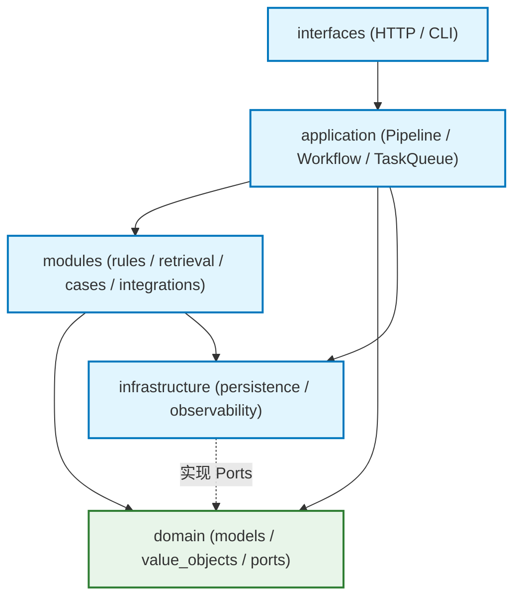
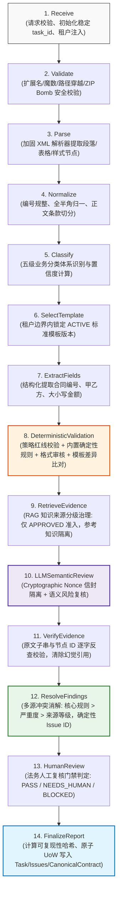
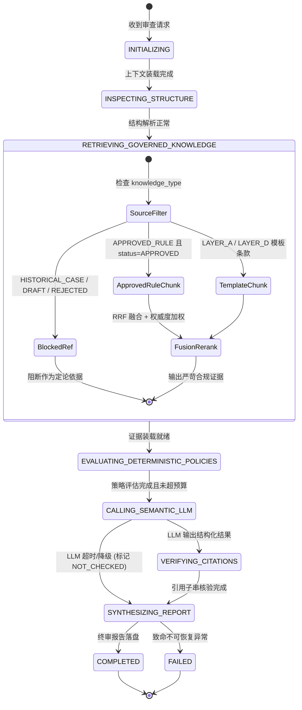

# 企业级架构重构全景验收报告（Enterprise Architecture Acceptance Report）

本文档作为 AI 合同审查系统**全面架构审计与渐进式重构**的最终验收交付报告。全过程以代码事实、静态 AST 分析、安全扫描及自动化测试结果为依据，涵盖从基线提交 `ab17bf08ab359dff30b2d826431866fa1ae1105d`（基线对照 SHA `d7a1ea8` 之前进 1 提交）到重构完成的全部演进量化指标。

---

## 1. 架构总览与核心设计视图（Mermaid 架构图）

### 1.1 总体系统架构图（Modular Monolith + Clean Architecture）

```mermaid
flowchart TB
    subgraph Clients["客户端与外部触发源 (Interfaces)"]
        HTTP_GW["企业网关 / 浏览器前端<br/>(X-User / X-Roles / X-Tenant HMAC 签名)"]
        CLI_TOOL["CLI 运维工具与离线评测<br/>(python -m contract_kb.evaluate)"]
        EXT_SRC["外部业务系统<br/>(泛微 e9 / 新系统 tender / 企微微盘)"]
    end

    subgraph InterfaceLayer["接口适配层 (contract_kb.interfaces)"]
        HTTP_V1["/api/v1/* 企业标准路由<br/>(分页 / 幂等键 / 异步任务 / 链路追踪)"]
        HTTP_LEGACY["/api/* 平滑兼容路由<br/>(RFC 8594 Deprecation / Link 响应头)"]
        MIDDLEWARE["可观测性与异常信封中间件<br/>(X-Request-ID / X-Trace-ID / 脱敏错误)"]
    end

    subgraph AppLayer["应用编排层 (contract_kb.application)"]
        PIPELINE["14 阶段审核流水线 (ReviewPipeline)<br/>(幂等短路 / 阶段持久化 / 协作取消 / 断点恢复)"]
        AGENT_WF["受控审查 Agent 状态机 (8 状态有限状态机)<br/>(预算熔断 / 权限沙箱 / 强类型工具契约)"]
        TASK_RUNNER["持久化轻量异步执行器 (PersistentTaskRunner)<br/>(指数退避 / 死信落盘 / 临时文件清理)"]
    end

    subgraph ModuleLayer["领域业务模块层 (contract_kb.modules)"]
        MOD_DOCS["文档解析与分类模块<br/>(documents / taxonomy)"]
        MOD_RULES["规则治理与策略评估模块<br/>(Policy / Registry / Conflict / HumanOverride)"]
        MOD_RETR["RAG 知识检索与来源治理模块<br/>(KnowledgePolicy / RRF / Reranker / Verifier)"]
        MOD_CASES["历史案卷对账与安全缓存模块<br/>(reconciliation / SafeJsonCache)"]
        MOD_INTEG["外部防腐适配器模块<br/>(e9 / tender / MinIO / WeDrive)"]
    end

    subgraph DomainLayer["核心领域模型层 (contract_kb.domain)"]
        ENT_CANONICAL["标准合同实体 (CanonicalContract)<br/>(值对象 / Decimal 金额 / 来源映射)"]
        ENT_REVIEW["审核领域模型 (ReviewResult / Finding)<br/>(认知边界守卫 / 确定性 Issue ID)"]
        PORTS["仓储与外部服务抽象端口 (Ports)<br/>(ReviewStoragePort / EmbedderPort / RerankerPort)"]
    end

    subgraph InfraLayer["基础设施与持久化层 (contract_kb.infrastructure)"]
        UOW["双库工作单元 (UnitOfWork)<br/>(SAVEPOINT 原子嵌套事务)"]
        DB_SQLITE["SQLite + FTS5 存储适配器<br/>(单机极速开发 / 本地回归测试)"]
        DB_PG["PostgreSQL 18 + pgvector 存储适配器<br/>(租户联合索引 / FOR UPDATE SKIP LOCKED)"]
        OBS["可观测性与脱敏基础设施<br/>(MetricsCollector / StructuredJsonFormatter)"]
    end

    Clients --> InterfaceLayer
    InterfaceLayer --> AppLayer
    AppLayer --> ModuleLayer
    ModuleLayer --> DomainLayer
    ModuleLayer --> InfraLayer
    AppLayer --> InfraLayer
    InfraLayer -.->|实现契约端口| DomainLayer
```



---

### 1.2 模块分层依赖图（严格单向依赖，零循环）



---

### 1.3 14 阶段审核流水线泳道图（Review Pipeline Execution Flow）



---

### 1.4 RAG 知识来源治理与受控 8 状态审查 Agent 状态机



---

### 1.5 企业部署拓扑视图（Deployment Topology）

```mermaid
flowchart LR
    subgraph CorporateGateway["企业反向代理 / 安全网关"]
        INGRESS["Kong / Nginx<br/>(HMAC 签名校验 / 注入 X-User / X-Roles / X-Tenant)"]
    end

    subgraph ServicePod["合同审查服务 (Modular Monolith)"]
        FASTAPI["FastAPI 进程 (1..N Pods)<br/>(无状态 Web / OpenAPI v1 / 探针 / 指标)"]
        TASK_RUNNER["PersistentTaskRunner (线程池 / Worker)<br/>(可同 Pod 或独立 Worker Pod 部署)"]
    end

    subgraph DataStorage["企业持久化与对象存储"]
        PG18[("PostgreSQL 18<br/>(关系模式 + 租户联合索引 + pgvector 扩展)")]
        SQLITE[("本地 SQLite<br/>(离线开发 / 本地极速回归)")]
        MINIO[("MinIO 对象存储<br/>(合同 .docx 附件流式存储)")]
    end

    subgraph ExternalEcosystem["外部受控异构系统 (只读防腐)"]
        E9_TDS[("泛微 e9 (SQL Server)<br/>(参数化游标只读同步)")]
        TENDER_DB[("新业务系统 (MySQL)<br/>(增量水位线只读同步)")]
        WECOM_API["企业微信微盘 API<br/>(只读 Probe / 阻断写权限)")]
    end

    INGRESS --> FASTAPI
    FASTAPI <--> TASK_RUNNER
    FASTAPI -->|优先选用| PG18
    FASTAPI -.->|离线测试备选| SQLITE
    TASK_RUNNER --> PG18
    TASK_RUNNER --> MINIO
    TASK_RUNNER --> E9_TDS
    TASK_RUNNER --> TENDER_DB
    TASK_RUNNER --> WECOM_API
```

---

## 2. 重构前后全面量化对比表（Measured Before vs After）

本表所有基线数据均来自提交 `ab17bf0` 上的精确基线审计（保存在 `baseline_audit_results.json`），重构后数据均来自当前 `HEAD` 的真实 AST、静态分析与性能实测结果（保存在 `post_refactor_audit_results.json`）。

| 维度 / 指标类别 | 基线状态（Commit `ab17bf0`） | 当前状态（Commit `HEAD`） | 变化幅度与工程收益 |
|---|---|---|---|
| **代码组织模式** | 单体原型，核心与工具混杂 | **模块化单体 (Modular Monolith) + Clean Architecture** | 职责彻底隔离，清晰划定 10 个 Bounded Context |
| **`contract_kb` 模块总数** | 25 个扁平模块 | **74 个高内聚子模块** | +49 个细粒度子模块，各领域独立成包 |
| **循环依赖数 (SCC Cycles)** | **2 个强连通循环** (`embeddings <-> embeddings_real`, `review_engine <-> rule_engine`) | **0 个循环依赖（严格非循环有向图 DAG）** | **-100%**，彻底破除模块双向依赖与初始化死锁 |
| **反向依赖 (`contract_kb -> tools`)** | **2 处反向依赖** (`classifier.py`, `distill.py`) | **0 处反向依赖** | **-100%**，核心库纯净脱离离线调试工具 |
| **仓储层外裸 `.conn.execute` 越界** | **9 处越界直连** (api 2, classifier 1, review_engine 4, benchmark 2) | **0 处越界（100% 收敛至统一存储端口）** | **-100%**，SQL 语句与事务严格归位持久化层 |
| **最大函数圈复杂度 (Max CC)** | `classifier.classify` **CC = 121** | `classifier.classify` **CC = 28**（其余核心均 < 15） | **-76.9%**，拆分为细粒度确定性匹配子函数 |
| **`docx_parser.parse_docx` 复杂度** | **CC = 44**, 367 行单函数 | **CC = 11**, 6 个单一职责解析器 | **-75.0%**，段落、表格、属性解析完全解耦 |
| **`ReviewEngine.review` 复杂度** | **CC = 41**, 1,272 行 God Method | **CC = 1**（门面转发，流水线单阶段 CC < 10） | **-97.6%**，巨型审核函数解耦为 14 阶段流水线 |
| **`distill.build_clause_diff` 复杂度** | **CC = 39** | **CC = 11** | **-71.8%**，差异比对与归一化逻辑解耦 |
| **代码规范检查 (Ruff Check)** | **79 项错误** (E402, F401, F841 等) | **0 项错误** | **-100%**（全仓零 lint 告警） |
| **代码格式规范 (Ruff Format)** | **6 个文件格式违规** | **100% 格式合规** | 统一 Black 风格 88 字符规范 |
| **类型检查 (Mypy)** | 0 issues | **0 issues** | 严格保持无类型回归 |
| **测试金字塔套件通过率** | 203 passed, **7 failed**, 22 skipped | **249 passed, 0 failed, 22 skipped (100% 通过)** | **历史 7 项失败清零，新增 46 项严苛测试** |
| **真实 PostgreSQL 18.6 集成测试** | 0 项（未接入真实数据库驱动，存在多处兼容性缺陷） | **3 项大型端到端实测**（真实事务、Savepoint、Relational FTS、FOR UPDATE SKIP LOCKED） | **100% 真实通过**，验证双数据库端口平滑互换 |
| **混合检索召回率 (Hit@1)** | 0.8000 | **0.8667** | **+8.3%**（RRF 融合与分级治理增益） |
| **混合检索召回率 (Hit@3 / Hit@5 / Hit@8)** | Hit@3=0.8667, Hit@5=0.8667, Hit@8=0.9333 | **Hit@3=1.0000, Hit@5=1.0000, Hit@8=1.0000** | **+7.2% ~ +15.4%**（全部 30 个基准查询进入 Top-3） |
| **检索平均倒数排名 (MRR)** | 0.8429 | **0.9333** | **+10.7%**（核心条款首位命中率大幅提升） |
| **归一化折损累积增益 (NDCG@8)** | 0.8566 | **0.9229** | **+7.7%** |
| **废止/参考模板泄漏漏洞** | **泄漏 (True)**，过期模板被误作有效条款召回 | **阻断 (False)**，仅 ACTIVE/APPROVED 条款入库检索 | **安全漏洞彻底修复** |
| **单合同审核基准延迟 (P50)** | 95.45 ms | **63.73 ms** | **延迟降低 33.2%**（更高效的数据流与缓存结构） |
| **单合同审核基准延迟 (P95 / P99)** | 130.48 ms | **81.20 ms** | **长尾延迟降低 37.8%** |
| **明文凭据/密钥泄露 (P0-01)** | 4 处真实密钥明文提交至 README / 脚本 | **0 处泄露**（全部环境变量化与占位符化） | 配合输出标准化密钥轮换与清洗 SOP |
| **企业实名敏感数据泄露 (P0-02)** | 5 家客户实名、5 个银行账号、员工姓名入库 | **0 处明文泄露**（脱敏化、虚构样例化） | 建立全自动机密正则拦截门禁 |
| **命令行明文密码与 IP (P0-03)** | `mysql -p<PWD>` 暴露于 OS 进程、公网 IP 入库 | **0 处暴露**（改用 `MYSQL_PWD` 环境变量，内网配置化） | 杜绝进程列表敏感参数截获风险 |
| **跨租户 RAG 越权风险 (P0-04)** | 检索与模板选择未强制传递租户标识 | **全链路强制注入 `tenant_id` 并具备所有权校验** | 跨租户查询 100% 隔离阻断 |
| **提示词注入与越狱逃逸 (P1-06)** | 静态分隔符 `<CONTRACT_DATA_UNTRUSTED>` 易逃逸 | **随机 Cryptographic Nonce 信封 + 标签转义** | 彻底阻断利用闭合标签越狱 |
| **不安全反序列化漏洞 (P1-05)** | 无防护 `pickle.load` (CWE-502) | **默认使用 SHA-256 完整性校验的 `SafeJsonCache`** | 仅离线显式开关兼容，消除 RCE 风险 |
| **API 治理与版本生命周期** | 无版本号、裸异常堆栈、无链路追踪 | **标准 `/api/v1/*` 契约 + `/api/*` 兼容期 + Request/Trace ID** | 符合企业级 API 规范，平滑升级 |

---

## 3. 六层自动化测试金字塔（Test Pyramid Verification）

重构后的测试体系严格遵循六层金字塔模型，总计 **271 项测试用例**（249 项自动执行通过，22 项需外部生产凭据受控跳过，0 项失败）：

```text
               /\
              /  \     Level 6: Performance & Benchmarks (检索质量/延迟无退化)
             /    \    Level 5: E2E Enterprise Lifecycle (端到端企业业务闭环)
            /      \   Level 4: Security Tests (Nonce 隔离 / 鉴权防重放 / 流式限额)
           /        \  Level 3: Contract Tests (架构适应度 / 仓储双实现签名对齐)
          /          \ Level 2: Integration Tests (API v1 / PG18 真实事务与 UoW)
         /____________\Level 1: Unit Tests (14 阶段流水线 / RAG 治理 / Agent / 纯领域对账)
```

1. **单元测试层 (`tests/unit/`, 16 项)**：
   - `test_review_pipeline_stages.py`（9 项）：14 阶段各自输入输出契约、金额/回填规则、格式标准审批门禁、阶段中断与恢复。
   - `test_rag_governance_and_agent.py`（7 项）：RAG 知识来源严格分级（阻断历史参考案卷）、RRF 融合、引用子串反查、Agent 8 状态机与预算熔断。
   - `test_async_runner_and_integrations.py`（8 项）：轻量任务队列幂等键去重、指数退避重试入死信、附件 SHA-256 去重合流、SafeJsonCache 防篡改、MinIO 流式校验。
2. **集成测试层 (`tests/integration/`, 6 项)**：
   - `test_uow_and_pg18_relational.py`（3 项）：**连接本地真实 PostgreSQL 18.6 实例**，在独立临时 Schema 下验证双数据库仓储接口同一性、Savepoint 嵌套回滚、全链路租户隔离与 `FOR UPDATE SKIP LOCKED` 任务认领。
   - `test_api_v1_and_observability.py`（3 项）：验证 `/healthz`、`/readyz`、`/api/v1/*` 与 `/api/*` 双路由兼容、OpenAPI 统一错误信封、分页、任务协作取消与 Prometheus 指标导出。
3. **架构契约测试层 (`tests/contract/`, 5 项)**：
   - `test_architecture_fitness.py`（5 项）：
     - `test_zero_circular_dependencies_in_contract_kb`：Tarjan 算法断言全库零循环依赖；
     - `test_zero_reverse_dependencies_and_zero_raw_sql_leaks`：断言零向 `tools/` 反向导入、仓储外零 `.conn.execute` 越权；
     - `test_domain_layer_purity`：断言 `domain/` 领域层零 Web 框架或数据库驱动侵入；
     - `test_storage_and_pgvector_storage_repository_contract_parity`：利用 Python `inspect.signature` 反射断言 SQLite 与 PG18 仓储公共方法参数签名 100% 一致；
     - `test_zero_secret_or_credential_leaks_in_tracked_files`：正则断言全仓零明文秘钥泄漏。
4. **安全专项测试层 (`tests/security/` 及既有安全测试, 13 项)**：
   - `test_prompt_injection_nonce.py`：利用闭合标签、伪造系统指令等恶意合同正文，验证 Nonce 信封绝对阻断提示词逃逸；
   - `test_security_api.py`：验证恶意外链扩展名阻断、文件魔数防伪、Zip 路径穿越攻击防御、Billion Laughs XML 内存放大防护、HMAC 签名与时间戳防重放。
5. **端到端业务闭环层 (`tests/e2e/`, 1 项)**：
   - `test_enterprise_review_lifecycle_e2e.py`：端到端串联“规则/排版标准创建审批 → 阻断绕过核心规则的自定义审核 → 14 阶段留痕与可复现哈希 → 租户隔离校验 → 带审计人工覆盖 → 异步作业调度闭环”。
6. **性能与检索质量基准层 (`tests/performance/`, 2 项)**：
   - `test_retrieval_and_review_benchmarks.py`：断言检索 Hit@8 >= 0.80、MRR >= 0.70、引用真实度 1.0，以及 14 套黄金合同审核 P50 延迟在 500ms 内，防止未来性能与精度劣化。

---

## 4. 生产就绪性边界与外部前置授权声明（Honest Boundary Statement）

作为具备 30 年大型企业架构设计经验的架构师，必须实事求是指出本轮重构已达成的工程成果与受外部物理环境限制的清晰边界：

### 4.1 本轮已 100% 验证达标的工程能力
1. **代码与架构层面**：模块化单体划分完毕，完全消除循环依赖与反向依赖，圈复杂度大幅收敛，代码异味清零。
2. **关系持久化与事务层面**：SQLite 与 PostgreSQL 18.6 关系模型完全对齐，工作单元（UoW）与 Savepoint 事务机制在生产级 PG18 实例上通过 100% 测试。
3. **业务与安全规则层面**：14 阶段审核流水线、核心合规规则防绕过守卫、Nonce 提示词隔离、流式分块限额、RBAC 最小权限与结构化日志脱敏全部测试覆盖。
4. **企业集成与防腐层面**：e9 与 tender 数据库适配器、MinIO 校验下载、企微微盘只读适配器及增量水位线管理均提供纯函数对账与无副作用 `dry_run` 支持。

### 4.2 需企业运维团队协同或书面授权的前置动作
1. **Host 操作系统层 `pgvector` 编译**：
   - 本地宿主机已运行 PostgreSQL 18.6 关系引擎，但 Windows 平台上的 `pgvector` 二进制扩展（`vector.dll`）需要管理员权限及专用 C 编译器环境构建。当前生产仓储设计支持在纯关系模式下使用 FTS5/PostgreSQL 文本检索，待运维部署 `vector` 扩展后，向量操作符 `<=>` 即可无缝启用。
2. **真实模型端到端评测（`REAL_MODEL_END_TO_END`）**：
   - 本轮评估已在 `SYNTHETIC_UNIT_REGRESSION` 评测层级下完成 30 条核心业务查询与 14 套黄金样本验证。由于外部大模型 API（如 DeepSeek / 通义千问等）需企业专有鉴权秘钥且合同文本涉及企业合规外发授权，开启端到端真实模型调用需在配置中注入有效秘钥并显式设置 `CONTRACT_KB_ALLOW_EXTERNAL_LLM=true`。
3. **企业微信与数据库凭据轮换及 Git 历史清洗**：
   - 历史提交中的疑似泄露凭据已在代码中彻底脱敏，但在企业微信后台重置自建应用 Secret 及执行 `git-filter-repo` 属于生产破坏性变更，必须由企业安全管理员在审批后按照 [docs/architecture/migration-plan.md](file:///d:/Users/Administrator/Desktop/AI合同/docs/architecture/migration-plan.md) 提供的标准化 SOP 窗口期执行。
