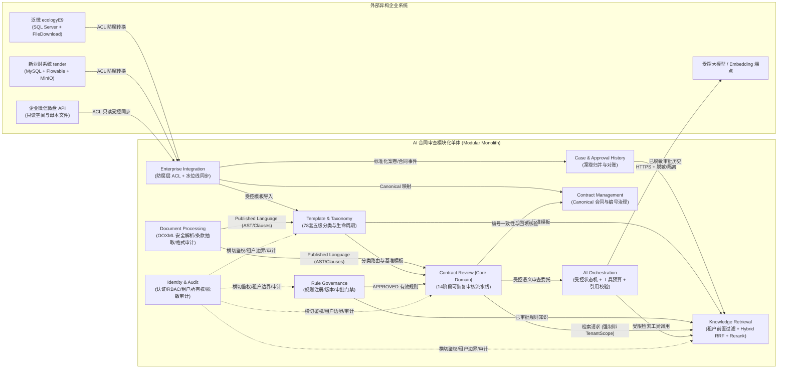

# 业务架构与限界上下文设计（Bounded Contexts）

本文档基于全仓代码审计与企业知识产权合同业务全貌，识别系统的 **10 个核心业务领域（Bounded Contexts）**，明确每个上下文的职责边界、核心聚合、泛在语言（Ubiquitous Language）、上下文映射关系（Context Map），并给出**模块化单体（Modular Monolith）内的模块拆分决策**——拒绝脱离团队与负载规模的“一领域一微服务”教条。

---

## 1. 十大限界上下文识别与模块归属决策

| 序号 | 限界上下文 | 核心业务职责 | 核心实体 / 值对象 | 架构形态决策 | 理由与边界 |
|---:|---|---|---|---|---|
| 1 | **Contract Management** 合同主数据与编号治理 | 统一管理标准合同实体（Canonical Contract）、合同编号分配与正文回填校验、多源合同记录去重与版本演化 | `CanonicalContract`, `ContractNumber`, `ContractParty`, `SourceRecordRef`, `BackfillCheckResult` | **独立业务模块** (`modules/contracts` / `domain/contracts`) | 承接泛微 e9、新系统 `tender` 与在线审核的统一合同主模型，必须将“业务实体 ID”与“合同编号”解耦 |
| 2 | **Template & Taxonomy** 模板库与五级分类体系 | 管理 8 大业务板块、26 二级分类、78 套标准模板五级路由、12 组排他决策树、产品编码绑定及模板生命周期（`DRAFT`/`ACTIVE`/`SUPERSEDED`） | `ContractTemplate`, `TaxonomyRoute`, `TemplateVersion`, `DisambiguationRule` | **独立业务模块** (`modules/templates`) | 模板生命周期与分类标准变化频率高，且被入库、检索、审核共同依赖，需独立治理，严禁反向依赖 `tools/` |
| 3 | **Document Processing** 文档安全解析与抽取 | ZIP/OOXML 安全门禁（防穿越/防压缩炸弹/安全 XML）、段落/表格/修订批注 AST 解析、16 类条款切分、金额/费率/期限结构化抽取、版式规范度量 | `ParsedDocument`, `DocNode`, `ExtractedClause`, `FieldValue`, `FormatAuditReport` | **独立基础支撑模块** (`modules/documents`) | 纯确定性、CPU 密集、无数据库状态的计算逻辑，作为无副作用纯函数组件供模板导入和待审合同解析复用 |
| 4 | **Rule Governance** 企业审核规则治理 | 规则候选蒸馏、规则规格定义（10 类规则类型）、规则注册表、版本管理、法务人工审批门禁（`DRAFT` → `APPROVED` → `SUPERSEDED`）、生效期与例外策略 | `RuleSpec`, `RuleVersion`, `RulePolicy`, `RuleApprovalRecord` | **独立业务模块** (`modules/rules`) | 规则具备严格法律合规生命周期（未审批规则严禁强制执行，核心规则严禁被自定义要求覆盖），需独立策略与审计边界 |
| 5 | **Contract Review** 合同智能审核流水线 | 编排 14 阶段可组合审核流水线、确定性校验、模板条款差异比对、规则/语义/人工结论冲突消解、稳定任务状态机与人工复核反馈闭环 | `ReviewTask`, `ReviewContext`, `ReviewStageState`, `Finding`, `EvidenceReference`, `HumanOverride` | **核心领域模块（Core Domain）** (`modules/review`) | 产品最核心价值主线，协调模板、文档、规则、检索与 AI 编排输出可追溯、可复现的审核报告 |
| 6 | **Knowledge Retrieval (RAG)** 多源企业知识检索 | 区分模板、已审批规则、历史合同、法律参考四类知识源的可信度与生命周期，执行租户/状态前置过滤、FTS + Vector 双路召回、RRF 融合、可插拔 Rerank 与证据核验 | `KnowledgeChunk`, `RetrievalQuery`, `RetrievalHit`, `IndexVersionMeta`, `SourceTrustPolicy` | **独立应用模块** (`modules/retrieval`) | 读写负载特征独特，涉及索引版本一致性门禁与多租户前置过滤，必须与底层 SQLite/pgvector 存储细节解耦 |
| 7 | **AI Orchestration** 受控审核状态机与模型网关 | 基于确定性状态机编排工具调用、不可信文档隔离（防 Prompt Injection）、模型 Provider 故障转移、Token/调用次数预算控制、原文逐字引用校验与 `NOT_CHECKED` 诚实降级 | `AgentWorkflowState`, `ToolSpec`, `ToolAuditRecord`, `ExecutionBudget`, `SemanticReviewOutcome` | **独立子模块（受 Review 驱动）** (`modules/agents`) | 封装外部不确定性 LLM 调用，严格受控于确定性状态机，禁止自治多 Agent 自由对话或越权修改规则 |
| 8 | **Case & Approval History** 历史案卷与审批流治理 | 治理泛微 e9 流程审批意见、Flowable 历史审批记录、合同附件与图片完整性核验、两库交叉对账与缺口登记 | `ApprovalCase`, `ApprovalOpinion`, `AttachmentAsset`, `ReconciliationGap` | **内部业务子组件（归入 `cases`）** (`modules/cases`) | 作为历史数据资产治理与 RAG 案例来源，采用纯函数归并 + 资产校验组件即可，无需独立部署进程 |
| 9 | **Enterprise Integration** 外部企业系统防腐层 | 对接泛微 e9（SQL Server + OA 文件接口）、新业务系统 `tender`（MySQL + MinIO）、企业微信微盘只读探测与增量同步、未来电子签预留端口 | `SyncWatermark`, `SyncCheckpoint`, `ExternalSourceAdapter`, `WeDriveSyncState` | **独立防腐层模块（ACL）** (`modules/integrations`) | 外部异构系统字段命名混乱、网络不可靠，必须通过 Anti-Corruption Layer 转换为内部 Canonical 模型，严禁污染核心域 |
| 10 | **Identity, Security & Audit** 身份认证、租户隔离与审计 | 网关签名认证（防重放 HMAC / Bearer 扩展）、段安全 RBAC、租户与资源所有权强校验、全链路敏感信息脱敏审计日志 | `Principal`, `TenantScope`, `PermissionPolicy`, `AuditEvent` | **横切基础子组件** (`infrastructure/security` + `domain/audit`) | 贯穿 HTTP 入口、应用用例与仓储查询的横切安全防线，在单体内部以中间件 + 显式 `Principal/TenantId` 值对象传递实现 |

---

## 2. 上下文映射图（DDD Context Map）

---

## 3. 为什么选择模块化单体而非微服务（架构权衡结论）

1. **真实数据规模**：当前标准模板库共 `78` 套 `.docx`（条款级 Chunk 约 $10^3 \sim 10^4$ 量级），历史合同与审批案卷约数万单（单库 PostgreSQL + `pgvector` HNSW + 分区索引在百毫秒内即可完成过滤与混合检索）。
2. **事务一致性需求**：模板导入（文档元数据 + 条款 + 向量索引版本）与审核任务落盘（任务状态 + 阶段快照 + 风险项 + 规则执行轨迹 + 审计日志）强依赖本地 ACID 事务（Unit of Work）；拆分为微服务反而引入分布式事务与最终一致性复杂度。
3. **演进预留**：通过严格的 Application Port（`DocumentRepository`、`RuleRepository`、`ReviewTaskRepository`、`KnowledgeRetriever`、`TaskQueuePort`、`LLMProviderPort`）隔离模块边界，未来若文档解析或语义评测出现独立弹性伸缩瓶颈，仅需将 `workers/` 独立进程化而无需重写任何领域逻辑。
