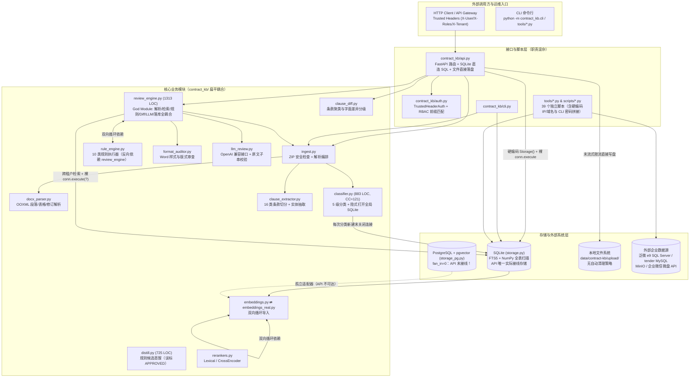
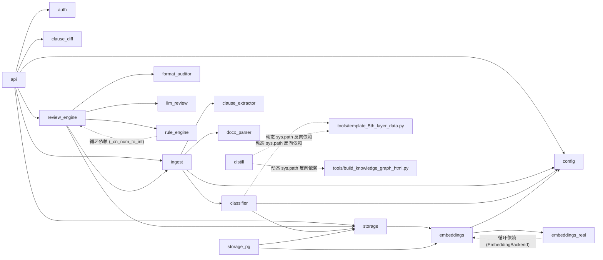
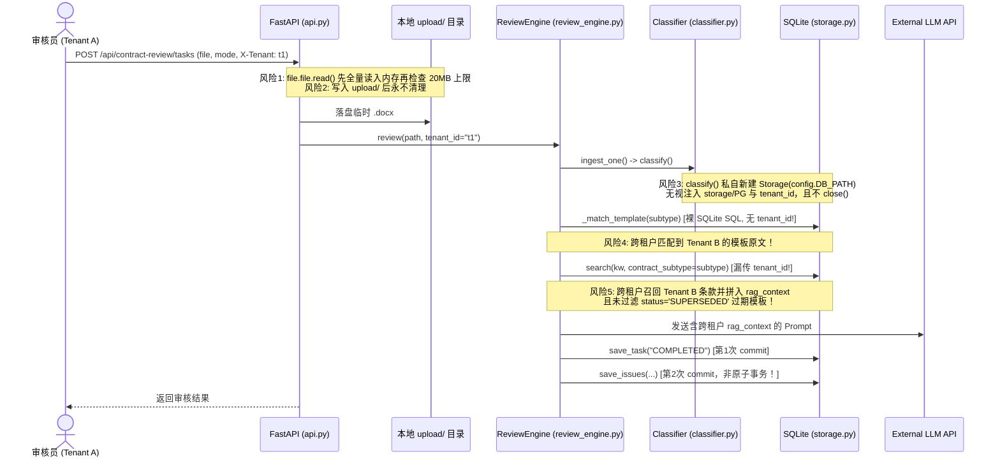

# 当前系统架构审计报告（Phase A Baseline Audit）

- **审计基准分支与提交**：远端 `origin/main` 最新 `HEAD = ab17bf08ab359dff30b2d826431866fa1ae1105d`（较任务参照基线 `d7a1ea80cc3e01134a53ccddb948fd2ecc1e28a4` 前进 1 个提交：`ab17bf0 fix(wedrive-probe): 完善640008微盘空间权限错误诊断与动态报告生成`）。
- **审计执行环境**：Windows x64, Python `3.13.17`（隔离虚拟环境 `.venv`）, 本地 `PostgreSQL 18.6`（`127.0.0.1:5432`）。
- **产品边界声明**：系统核心主线为企业知识产权合同信息核验、格式审核、条款风险审核、规则治理、混合 RAG 与历史案卷数据集成；电子签章/电子签约资料仅作为未来扩展接口参考保留，本轮不实现任何未授权签章或合同发起操作。

---

## 1. 当前系统拓扑与架构现状图

当前仓库由 4 个松散目录组成：`contract_kb/`（25 个 Python 模块，核心知识库与审核原型）、`tools/`（37 个数据同步/探针/合并脚本）、`scripts/`（2 个泛微 e9 导出脚本）、`migrations/`（2 个 PostgreSQL DDL 脚本）。

---

## 2. 模块依赖图与耦合度实测分析

基于 AST 静态分析全仓 `71` 个 Python 文件（其中 `contract_kb/` 共 `25` 个模块、内部依赖边 `57` 条），实测模块耦合指标如下（不稳定性 $I = \frac{C_e}{C_a + C_e}$）：

### 2.1 `contract_kb` 模块依赖图

### 2.2 核心模块规模、耦合度与圈复杂度实测表

| 模块 | LOC | 有效代码行 | 函数数 | 最大圈复杂度 (Max CC) | 扇入 ($C_a$) | 扇出 ($C_e$) | 不稳定性 ($I$) | 关键架构风险 |
|---|---:|---:|---:|---:|---:|---:|---:|---|
| `contract_kb/review_engine.py` | 1313 | 1221 | 28 | 41 | 3 | 6 | 0.667 | **God Module**：集解析、分类、模板匹配、金额/主体/期限规则、RAG、LLM、落库于一体；4 处裸 `storage.conn.execute` |
| `contract_kb/classifier.py` | 883 | 824 | 3 | **121** | 1 | 3 | 0.750 | 超高复杂度单函数 `classify`（CC=121）；内部偷开全局 `Storage(config.DB_PATH)` 且不关闭；反向 import `tools/` |
| `contract_kb/storage.py` | 877 | 815 | 37 | 10 | 10 | 2 | 0.167 | 承担 6 类聚合根全部 SQL；多线程共享单连接无锁；文档落库与向量索引非原子 |
| `contract_kb/storage_pg.py` | 787 | 730 | 36 | 11 | **0** | 3 | 1.000 | **业务代码零扇入（`fan_in=0`）**：`api.py` 从未接线；异常后缺失 `conn.rollback()`；忽略 `knowledge_type` 过滤 |
| `contract_kb/distill.py` | 725 | 631 | 9 | 39 | 0 | 3 | 1.000 | 反向 import `tools/`；提交 `b8dc7d5` 将未审批候选规则硬编码为 `APPROVED` |
| `contract_kb/rule_engine.py` | 474 | 425 | 16 | 14 | 1 | 2 | 0.667 | 函数内反向 `from .review_engine import _cn_num_to_int` 构成循环依赖 |
| `contract_kb/format_auditor.py` | 438 | 392 | 14 | 11 | 1 | 0 | 0.000 | 纯函数设计较好，可保留为文档版式审查子组件 |
| `contract_kb/api.py` | 425 | 348 | 20 | 9 | 0 | 7 | 1.000 | 硬编码 SQLite；2 处直接执行 SQLite `?` 占位符 SQL；上传全量读入内存后再做体积校验 |
| `contract_kb/docx_parser.py` | 367 | 326 | 8 | 44 | 1 | 0 | 0.000 | `etree.fromstring` 使用默认 `XMLParser`，未显式加固实体解析参数 |
| `contract_kb/embeddings.py` | 91 | 67 | 7 | 5 | 4 | 3 | 0.429 | 与 `embeddings_real.py` 存在双向循环导入 |
| `tools/tender_case_export.py` | 1691 | 1530 | 61 | 85 | 0 | 0 | 0.000 | 超大脚本，混杂 SQL Server/MySQL/HTTP 下载/Markdown 渲染与 `pickle.load`，硬编码企业域名 |
| `tools/export_contract_mappings_excel.py` | 1163 | 1042 | 5 | **141** | 0 | 0 | 0.000 | 全仓最高圈复杂度函数 `main`（926 LOC, CC=141） |
| `tools/cross_verify_and_merge.py` | 1117 | 912 | 13 | 110 | 0 | 0 | 0.000 | 命令行 `-p<MYSQL_PWD>` 暴露数据库密码；8 处静默 `except: pass/continue` |
| `tools/live_db_merge.py` | 939 | 765 | 13 | 91 | 0 | 0 | 0.000 | 硬编码企业内外网数据库 IP 与端口（`183.x.x.x`, `192.168.x.x`） |
| `scripts/e9_form_attach_export.py` | 922 | 810 | 38 | 69 | 0 | 0 | 0.000 | 硬编码 OA 内网域名默认值 `http://<OA_INTERNAL_HOST>:8088` |

### 2.3 高复杂度函数 Top 15 清单（全仓共 73 个函数 CC >= 15，其中 `contract_kb/` 占 16 个）

| 排名 | 文件路径与行号 | 函数名 | LOC | 圈复杂度 (CC) |
|---:|---|---|---:|---:|
| 1 | `tools/export_contract_mappings_excel.py:234-1159` | `main` | 926 | 141 |
| 2 | `contract_kb/classifier.py:640-883` | `classify` | 244 | 121 |
| 3 | `tools/cross_verify_and_merge.py:473-845` | `execute_cross_verification_and_merge` | 373 | 110 |
| 4 | `tools/build_template_5th_layer_rules.py:96-493` | `main` | 398 | 91 |
| 5 | `tools/live_db_merge.py:436-753` | `execute_union_merge` | 318 | 91 |
| 6 | `tools/tender_case_export.py:1465-1687` | `main` | 223 | 85 |
| 7 | `scripts/e9_form_attach_export.py:458-611` | `render_case` | 154 | 69 |
| 8 | `tools/tender_case_export.py:528-669` | `load_oa` | 142 | 63 |
| 9 | `tools/contract_merge_repair.py:217-352` | `build` | 136 | 63 |
| 10 | `tools/tender_case_export.py:358-493` | `load_mysql` | 136 | 56 |
| 11 | `tools/tender_unify_merge.py:206-343` | `main` | 138 | 55 |
| 12 | `tools/wecom_wedrive_probe/probe.py:179-647` | `run_stage_b_api_tests` | 469 | 50 |
| 13 | `scripts/e9_form_attach_export.py:753-918` | `main` | 166 | 50 |
| 14 | `contract_kb/docx_parser.py:167-367` | `parse_docx` | 201 | 44 |
| 15 | `contract_kb/review_engine.py:251-585` | `ReviewEngine.review` | 335 | 41 |

---

## 3. 当前核心数据流图与断裂点

---

## 4. 全量问题清单与优先级矩阵（证据化定级）

### 4.1 P0 级缺陷（阻断部署、安全暴露、跨租户泄露、数据库假接线、CI 失败）

| 编号 | 类别 | 代码位置与函数 | 实证问题描述 | 影响范围 |
|---|---|---|---|---|
| **P0-01** | 凭据暴露 | `tools/wecom_wedrive_probe/README.md:61-63,96,114` | 提交 `d7a1ea8` 在文档示例中写入疑似真实企业微信 `WECOM_CORP_ID`、43 位明文 `WECOM_APP_SECRET`、`WECOM_SPACE_ID` 及真实出口 IP | 外部攻击者获取仓库访问权即可换取企业微信 `access_token` |
| **P0-02** | 企业敏感信息入库 | `知识库_合同模板.md:25-37`、`知识库_合同模板_简版.md`、`tools/wecom_wedrive_probe/probe.py:723-724`、`validators.py:149-151`、`需求对接.md:7,34` | 提交 `b8dc7d5` / `ab17bf0` 将 5 家关联主体全称、法人姓名、5 个银行账号、内部邮箱电话、员工实名、AgentId 写入跟踪文件 | 违反脱敏红线，阻塞公开/半公开协作与合规审计 |
| **P0-03** | 内网拓扑与命令行密码暴露 | `tools/live_db_merge.py:7-8,820-821`、`tools/tender_case_export.py:74`、`scripts/e9_*.py`、`tools/cross_verify_and_merge.py:98`、`tools/tender_fullsync.py:71,282`、`tools/tender_attach_export.py:40`、`tools/tender_unify_merge.py:52` | 多处硬编码企业公网映射与内网数据库 IP/端口及 OA 域名；`subprocess.run(["mysql", ..., "-p" + env["MYSQL_PWD"]])` 在操作系统进程表暴露密码 | 内网拓扑泄露、同机任意用户可通过进程列表窃取数据库口令 |
| **P0-04** | 跨租户数据泄露 | `contract_kb/review_engine.py:441-443` (`review`)、`588-595` (`_match_template`)、`1250-1279` (`_diff_vs_template`) | 审核期间 RAG 检索未传 `tenant_id`，模板匹配与模板差异比对执行无 `tenant_id` 的裸 SQL，甚至将其他租户模板原文拼入外部 LLM Prompt | 多租户隔离失效，严重数据串租泄露 |
| **P0-05** | 隐式全局连接与测试污染 | `contract_kb/classifier.py:835-849` (`classify`) | 每次启发式分类私自实例化 `Storage(config.DB_PATH)`，忽略上层传入的测试库/PostgreSQL 与 `tenant_id`，连接永不关闭，异常被 `except Exception: pass` 吞掉 | 连接句柄泄漏、跨租户规则污染、PostgreSQL 模式下依然强读本地 SQLite |
| **P0-06** | PostgreSQL 假接线与方言崩溃 | `contract_kb/api.py:38-45,165-179`、`contract_kb/review_engine.py:589,1181,1244,1250`、`tools/sync_wecom_wedrive.py:50` | `api.get_storage()` 硬编码返回 SQLite `Storage`；API 与 `ReviewEngine` 多处直接调用 `storage.conn.execute("... WHERE x=?", ...)` 及 `INSERT OR REPLACE`，切换到 `PgVectorStorage` 即刻崩溃 | PostgreSQL 生产存储完全无法在 API 与审核链路工作 |
| **P0-07** | 基线单测回归与规则治理破环 | `contract_kb/distill.py:533,557,575`、`contract_kb/classifier.py:640-883` | 提交 `b8dc7d5` 将未审批蒸馏候选规则直接置为 `status="APPROVED"`，删除 `AGENCY_FEE_FLOOR` 人工底价门禁与 `contract_total` 字段抽取，重命名分类编码未做兼容，导致当前 `HEAD` **7 个核心测试失败** | 破坏“未审批规则不得自动生效”核心安全不变量，阻塞 CI |
| **P0-08** | CI 静态检查与打包缺失 | `pyproject.toml`、`.github/workflows/ci.yml` | Ruff 存在 **79 个 lint 错误 + 6 个文件格式不合规**；`pyproject.toml` 与 `ci.yml` 缺失 `pillow`、`python-tds` 等测试依赖；JUnit Artifact 未配置短期 `retention-days` | GitHub Actions `lint` 与 `test-synthetic` 必然失败 |

### 4.2 P1 级缺陷（数据一致性、RAG 准确性、鉴权加固、架构耦合）

| 编号 | 类别 | 代码位置与函数 | 实证问题描述 |
|---|---|---|---|
| **P1-01** | 非原子事务与脏索引状态 | `storage.py:229-231`、`storage_pg.py:223-225`、`review_engine.py:575-585` | `upsert_document` 先提交 `status='ACTIVE'` 再构建向量索引，若 Embedding 异常则文档永久处于无向量 `ACTIVE` 状态且后续幂等跳过；`PgVectorStorage` 异常不执行 `rollback()` |
| **P1-02** | 过期模板被静默召回 | `storage.py:334,489,530`、`storage_pg.py:269,396,440` | `SUPERSEDED` 状态历史模板仍保留向量与 FTS 记录，且 `search()` 未过滤 `d.status = 'ACTIVE'` |
| **P1-03** | SQLite vs PG 行为分叉 | `storage.py:176,604` vs `storage_pg.py:324,487` | `source_hash UNIQUE` 全局唯一导致不同租户无法导入同模板；`PgVectorStorage.search` 忽略 `knowledge_type`；PG `_rerank` 缺少 `0.15` 数值匹配加分 |
| **P1-04** | 鉴权防重放与路由边界 | `auth.py:26-42,85-90,107`、`api.py:35` | `TrustedHeaderAuth` 在模块导入时固化密钥，HMAC 无时间戳防重放窗口；RBAC `startswith` 未校验路径段边界 `/` |
| **P1-05** | 文件上传 OOM 与 XML 加固 | `api.py:374-380`、`ingest.py:55`、`docx_parser.py:184,328,335` | 上传先 `file.file.read()` 全量入内存再判断 `MAX_DOCX_BYTES`；上传临时文件无清理机制；`lxml` 解析未显式配置 `XMLParser(resolve_entities=False, no_network=True, huge_tree=False)` |
| **P1-06** | 循环依赖与反向依赖 | `review_engine.py` ⇄ `rule_engine.py`、`embeddings.py` ⇄ `embeddings_real.py`、`classifier.py`/`distill.py` → `tools/` | 2 组双向循环导入；核心包通过篡改 `sys.path` 反向导入打包排除目录 `tools/` |
| **P1-07** | 规则与版式表缺少租户隔离 | `storage.py:49-54,91-95`、`migrations/001,002` | `rules` 与 `format_standards` 缺少 `tenant_id` 列，多租户共用全局规则命名空间 |
| **P1-08** | 反序列化风险 | `tools/tender_case_export.py:536`、`tools/contract_merge_repair.py:156,160` | 使用 `pickle.load` 加载本地缓存文件，若缓存目录被污染可触发任意代码执行 |

### 4.3 P2 级缺陷（可演进性、异步可靠性、可观测性、评测深度）

| 编号 | 类别 | 代码位置 | 实证问题描述 |
|---|---|---|---|
| **P2-01** | 审核流水线不可恢复 | `review_engine.py:251-585` | 缺少独立 `ReviewStage` 契约、阶段持久化、幂等键、超时取消与断点重试 |
| **P2-02** | 同步阻塞长任务 | `api.py:364-409` | 合同审核、模板导入在 HTTP 请求线程内同步串行执行，缺少持久化后台任务执行器与进度查询 |
| **P2-03** | 历史合同缺少统一主模型 | `migrations/` & `tools/` | 泛微 e9 与 `tender` 合同合并结果仅落地 CSV/Markdown，数据库层缺少 Canonical Contract Model、来源映射表与同步水位线 |
| **P2-04** | 可观测性与 API 规范不足 | `api.py` | 缺少 `/api/v1` 版本路由、统一错误响应模型、`X-Request-ID`、`/healthz` & `/readyz`、脱敏结构化日志与 P50/P95/P99 运行指标 |
| **P2-05** | 测试副作用污染工作区 | `tests/test_llm_e2e.py:31-66` | 每次运行 `pytest` 直接改写 Git 跟踪文件 `reports/contract-kb/llm-e2e-evidence.json` |

---

## 5. 可复现测试与性能基线（重构前实测证据）

所有命令均在 `HEAD = ab17bf0` 干净工作区实测：

| 检查项 | 执行命令 | 退出码 | 实测结果 | 备注 / 阻塞说明 |
|---|---|---:|---|---|
| Ruff 静态检查 | `.\.venv\Scripts\ruff.exe check contract_kb tests --select=E,F,W --ignore=E501` | `1` | **79 errors**（72 `E701`, 4 `E702`, 1 `W292`, 1 `E401`, 1 `F401`） | 由 `b8dc7d5` 引入单行多语句导致 |
| Ruff 格式检查 | `.\.venv\Scripts\ruff.exe format --check contract_kb tests` | `1` | **6 files would be reformatted**, 38 already formatted | 格式未门禁 |
| Mypy 类型检查 | `.\.venv\Scripts\mypy.exe contract_kb --ignore-missing-imports` | `0` | **Success: no issues found in 25 source files** | 通过（但 `tools/` 未纳入检查） |
| Pytest 全量套件 | `.\.venv\Scripts\python.exe -m pytest tests tools/wecom_wedrive_probe/tests -v` | `1` | **7 failed, 203 passed, 22 skipped**（补齐缺失依赖 `pytds` 前为 **8 failed**） | 7 个核心断言因 `classifier.py` 与 `distill.py` 回归失败 |
| PostgreSQL 静态迁移解析 | `.\.venv\Scripts\python.exe -m pytest tests/test_pg_migration.py tests/test_pg_storage.py` | `0` | **10 passed, 15 skipped** | `pglast` 真实解析 SQL 通过 |
| 本地 PostgreSQL 18.6 连通性 | `psql -h 127.0.0.1 -p 5432 -U postgres -d postgres -c "SELECT version();"` | `0` | `PostgreSQL 18.6 on x86_64-windows` 在线可用 | 本地 Windows PG18 未安装 `pgvector` C 扩展 DLL（`pg_available_extensions` 0 行），`vector` 类型需在 CI `pgvector/pgvector:pg16` 容器或安装扩展后运行；关系型事务可在本地 PG18 真实实测 |
| 检索评测基线（`local_hash_256`） | `build_bench_storage` + `run_benchmark`（15 条黄金查询 + 困难负样本） | `0` | `Hit@1=0.8000`, `Hit@3=0.8667`, `Hit@5=0.8667`, `Hit@8=0.9333`, `MRR=0.8429`, `NDCG@8=0.8566`, `HardNegAvoidance@8=0.8000` | 仅代表合成语料 + 词面哈希基线，**不代表真实语义模型效果** |
| 单合同审核延迟基线（14 个黄金样本） | `ReviewEngine.review(..., mode="COMBINED")` SQLite 本地实测 | `0` | `Mean=103.25 ms`, `P50=95.45 ms`, `P95=130.48 ms`, `P99=130.48 ms`, `Max=156.70 ms` | 无外部 LLM 网络调用条件下测得 |

---

## 6. 渐进式重构风险识别与防控策略

1. **公共导入路径与 CLI/API 兼容性风险**：现有 19 个测试文件与外部脚本直接导入 `contract_kb.storage.Storage`、`contract_kb.review_engine.ReviewEngine`、`contract_kb.api.app` 及 `/api/contract-kb/*`、`/api/contract-review/*`。
   - **防控策略**：采用**包内分层演进 + 外观兼容层（Facade）**，在 `contract_kb/` 内部建立 `domain/`、`application/`、`infrastructure/`、`interfaces/` 四层结构，保留原顶层模块与原 HTTP 路由作为稳定兼容契约，同时提供 `/api/v1/*` 标准版本化接口，确保零破坏迁移。
2. **Git 历史重写与线上凭据轮换风险**：`d7a1ea8` 与 `b8dc7d5` 已推送至远端 `origin/main`。
   - **防控策略**：本分支立即清除工作区与跟踪文件中的全部明文 Secret、企业实名、银行账号与内网地址，并增加自动化安全扫描测试阻断复发；对于远端 `main` 历史重写（`git filter-repo`）与企业微信后台 Secret 轮换，严格输出管理员执行手册等待授权，绝不擅自强推改写远端历史。
3. **数据库迁移风险**：现有 SQLite 测试库与 PostgreSQL 001/002 迁移已存在表结构。
   - **防控策略**：新增 `migrations/003_enterprise_canonical_and_pipeline.sql` 采用纯增量、幂等 DDL（`CREATE TABLE IF NOT EXISTS` / `ALTER TABLE ... ADD COLUMN IF NOT EXISTS`），SQLite 侧通过列存在性探测平滑演进，不做任何删表或破坏性迁移。
