# 企业数据架构与统一持久化治理（Data Architecture）

## 1. 核心数据治理目标

针对审计发现的“双存储实现分裂（`PgVectorStorage` 生产零接入）、多表写入缺乏原子事务边界、异构源系统表结构侵入核心层、多租户唯一键冲突”四项核心缺陷，本阶段建立了统一的领域持久化契约与关系模型体系：

1. **统一存储端口（[`KnowledgeStoragePort`](file:///d:/Users/Administrator/Desktop/AI合同/contract_kb/application/ports/persistence.py)）**：`Storage`（SQLite FTS5 + NumPy）与 `PgVectorStorage`（PostgreSQL + `pgvector`）实现 100% 仓储方法签名对齐，由 [`create_storage()`](file:///d:/Users/Administrator/Desktop/AI合同/contract_kb/storage.py) 按 `CONTRACT_KB_STORAGE_BACKEND` / `CONTRACT_KB_PG_DSN` 统一注入，显式配置异常时遵循 **Fail-Closed** 原则拒绝静默降级。
2. **原子工作单元（[`UnitOfWorkPort`](file:///d:/Users/Administrator/Desktop/AI合同/contract_kb/application/ports/persistence.py)）**：[`SqliteUnitOfWork`](file:///d:/Users/Administrator/Desktop/AI合同/contract_kb/infrastructure/persistence/uow.py) 与 [`PostgresUnitOfWork`](file:///d:/Users/Administrator/Desktop/AI合同/contract_kb/infrastructure/persistence/uow.py) 基于连接级重入锁（`RLock`）、嵌套深度计数器（`_tx_depth`）与 SQL `SAVEPOINT` 实现跨仓储多表原子提交与异常整体回滚。
3. **企业标准合同模型（[`CanonicalContract`](file:///d:/Users/Administrator/Desktop/AI合同/contract_kb/domain/models/canonical_contract.py)）**：将泛微 e9（`formtable_main_*`）、新业务系统 `tender`（`crm_contract`）、企微微盘（`fileid`）及 API 上传文档统一映射至标准领域实体，外部系统主键封装在 [`SourceRecordMapping`](file:///d:/Users/Administrator/Desktop/AI合同/contract_kb/domain/models/canonical_contract.py) 防腐值对象中。
4. **全表租户与生命周期边界**：`documents` 唯一约束由全局 `source_hash` 升级为 `(tenant_id, source_hash)`；`documents`、`clauses`、`embeddings`、`rules`、`format_standards`、`review_tasks`、`human_overrides`、`canonical_contracts`、`async_jobs` 全面支持 `tenant_id` 强隔离。

---

## 2. 核心实体关系图（ERD）

```mermaid
erDiagram
    DOCUMENTS ||--o{ CLAUSES : "1:N 拆解结构化条款"
    DOCUMENTS ||--o{ EMBEDDINGS : "1:N 版本化向量分块"
    DOCUMENTS ||--o{ CANONICAL_CONTRACTS : "来源文档关联"
    REVIEW_TASKS ||--o{ REVIEW_STAGE_STATES : "1:14 阶段持久化"
    REVIEW_TASKS ||--o{ REVIEW_ISSUES : "1:N 风险发现"
    REVIEW_TASKS ||--o{ HUMAN_OVERRIDES : "1:N 人工覆写留痕"
    RULES ||--o{ RULE_EXECUTIONS : "1:N 规则执行留痕"

    DOCUMENTS {
        text document_id PK
        text tenant_id "租户隔离键"
        text source_hash "租户内唯一 (tenant_id, source_hash)"
        text business_category
        text contract_subtype
        int version "模板版本链"
        text status "ACTIVE / SUPERSEDED / DELETED"
    }

    CANONICAL_CONTRACTS {
        text contract_id PK
        text tenant_id
        text contract_number "标准编号值对象"
        text entity_prefix "签约主体编码前缀"
        text lifecycle_status "DRAFT..ARCHIVED"
        text source_system "UPLOAD / WEAVER_E9 / TENDER_NEW / WECOM_WEDRIVE"
        numeric total_amount "NUMERIC(18,2) 严禁 float"
        jsonb parties_json
        jsonb amounts_json
        jsonb source_mappings_json
    }

    REVIEW_TASKS {
        text task_id PK
        text tenant_id
        text idempotency_key "幂等防重键"
        text document_id
        text mode "STANDARD / COMBINED / CUSTOM"
        text status "PENDING / RUNNING / COMPLETED / FAILED / TIMED_OUT / CANCELLED"
        boolean cancel_requested
        text rule_set_version "规则集指纹"
        text model_version "模型版本标识"
        text reproducibility_hash "可复现哈希"
    }

    REVIEW_STAGE_STATES {
        text task_id PK,FK
        text stage_name PK
        int stage_order "1..14"
        text status "RUNNING / COMPLETED / FAILED / TIMED_OUT"
        int attempt "断点重试计数"
        float duration_ms
    }

    REVIEW_ISSUES {
        text issue_id PK
        text task_id FK
        text rule_id
        text severity "HIGH / MEDIUM / LOW / INFO"
        text finding_source "DETERMINISTIC / LLM_SEMANTIC / HUMAN"
        text check_status "CHECKED / INSUFFICIENT_EVIDENCE / NEEDS_MANUAL_REVIEW / NOT_CHECKED"
        text human_state "PENDING / ACCEPT / IGNORE / FALSE_POSITIVE ..."
    }

    HUMAN_OVERRIDES {
        text override_id PK
        text task_id FK
        text issue_id
        text tenant_id
        text actor
        text action
        text previous_state
        text new_state
        timestamptz created_at
    }

    ASYNC_JOBS {
        text job_id PK
        text tenant_id
        text idempotency_key
        text job_type
        text status "PENDING / RUNNING / SUCCEEDED / FAILED / DEAD_LETTER / CANCELLED"
        int attempts
        int max_attempts
        timestamptz next_run_at
    }
```

---

## 3. SQLite 与 PostgreSQL 行为差异治理矩阵

| 维度 | SQLite (`Storage`) | PostgreSQL (`PgVectorStorage`) | 统一治理策略 |
| :--- | :--- | :--- | :--- |
| **全文检索** | FTS5 虚拟表（`clauses_fts`）字符二元切分 | `to_tsvector('simple', ...)` + GIN 索引 | 统一封装在 `search()` 内部，对外返回一致的 `channel="fts"` 结构与 RRF 融合分数 |
| **向量检索** | NumPy 内存矩阵余弦计算（仅开发/单测小规模） | `pgvector` SQL 下推 `vec <=> %s::vector ORDER BY ... LIMIT` | 统一校验 `embedding_index_meta`（`provider`/`model`/`dim`），模型或维度不匹配立即抛出 `EmbeddingConfigMismatch` |
| **时间戳列** | `REAL`（Unix Epoch 秒） | `TIMESTAMPTZ`（UTC 时区感知时间） | `PgVectorStorage` 在读写边界统一将 `datetime` 与 `float` 双向归一化，消除跨库比较 `TypeError` |
| **事务隔离与错误状态** | 异常后可执行后续语句 | 连接 `autocommit=False`，单条 SQL 报错即进入 `InFailedSqlTransaction` | 所有读写方法统一经过 `_commit()` / `_rollback()` 守卫；外层处于 `UnitOfWork`（`_tx_depth > 0`）时交由 `ROLLBACK TO SAVEPOINT` 控制 |
| **并发任务抢占** | `RLock` + 单事务原子条件更新 `WHERE status='PENDING'` | `SELECT ... FOR UPDATE SKIP LOCKED` | 两端统一暴露 `claim_next_async_job()` 原子认领接口，杜绝重复消费 |

---

## 4. 数据库迁移演进（幂等脚本）

| 迁移文件 | 职责范围 | 幂等与回滚安全特性 |
| :--- | :--- | :--- |
| [`migrations/001_init_pgvector.sql`](file:///d:/Users/Administrator/Desktop/AI合同/migrations/001_init_pgvector.sql) | 初始化核心知识库表、`pgvector` 扩展、规则表、审核任务与审计日志表 | 全部采用 `CREATE TABLE/INDEX IF NOT EXISTS` |
| [`migrations/002_format_and_tenant.sql`](file:///d:/Users/Administrator/Desktop/AI合同/migrations/002_format_and_tenant.sql) | 格式标准审批表（`format_standards`）与基础租户字段扩展 | `ADD COLUMN IF NOT EXISTS` 无损扩展 |
| [`migrations/003_enterprise_canonical_and_pipeline.sql`](file:///d:/Users/Administrator/Desktop/AI合同/migrations/003_enterprise_canonical_and_pipeline.sql) | 升级租户哈希唯一索引；新增 `review_stage_states`、`human_overrides`、`canonical_contracts`、`async_jobs` 及复现性/幂等治理字段 | 零破坏性删表或删列，旧版本客户端读写完全兼容 |
