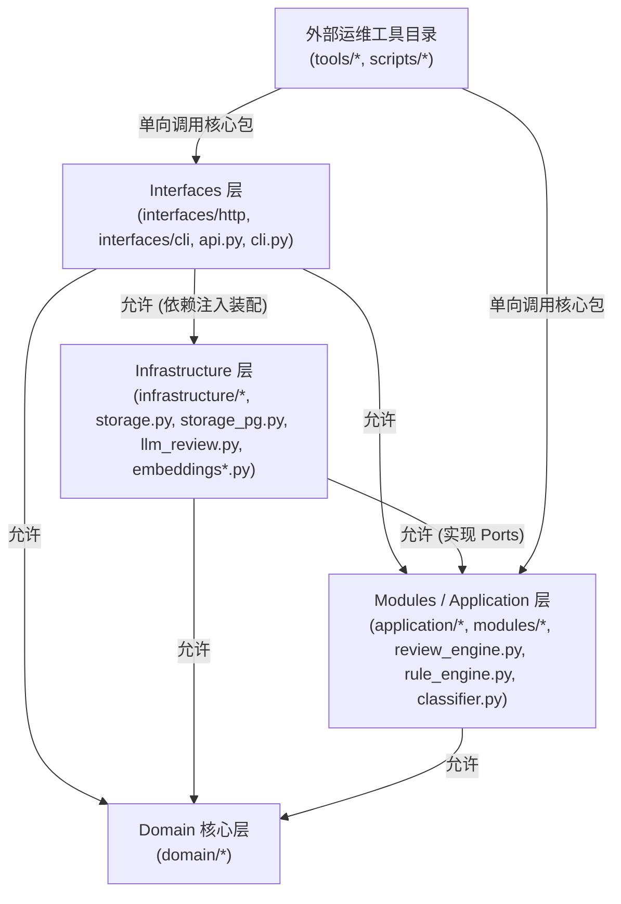

# 模块依赖规则与架构边界门禁（Dependency Rules）

本文档定义模块化单体内部严格的**单向依赖法则（The Dependency Rule）**，并通过自动化架构契约测试（`tests/contract/test_architecture_dependencies.py`）在每次测试与 CI 中强制执行，杜绝架构腐化。

---

## 1. 分层单向依赖矩阵

依赖箭头只能从外层指向内层：`Interfaces -> Application -> Domain <- Infrastructure`。

### 严格允许与禁止矩阵

| 源层 / 模块 | 允许依赖（Allowed） | 严禁依赖（Forbidden — CI 阻断） |
|---|---|---|
| **`contract_kb.domain.*`** | Python 标准库（`dataclasses`, `decimal`, `enum`, `typing`, `re`, `hashlib` 等）、同层 `domain.*` | `fastapi`, `starlette`, `sqlite3`, `psycopg2`, `pytds`, `httpx`, `requests`, `contract_kb.infrastructure.*`, `contract_kb.interfaces.*`, `contract_kb.api`, `tools.*`, `scripts.*` |
| **`contract_kb.application.*`** | `contract_kb.domain.*`, `contract_kb.modules.*`（纯计算/策略接口）, `pydantic` / 标准库 | `fastapi`, `sqlite3`, `psycopg2`, `pytds`, 具体数据库驱动连接 `.conn`, `tools.*`, `scripts.*` |
| **`contract_kb.modules.documents`** | `lxml`（仅限安全 `SAFE_XML_PARSER`）, `docx`, `contract_kb.domain.*` | 数据库仓储 (`storage*`), Web 框架 (`fastapi`), 外部 LLM, `tools.*` |
| **`contract_kb.modules.templates`** | 标准库, `contract_kb.domain.*` | 任何数据库实例 (`Storage`), `tools.*`, 网络 IO |
| **`contract_kb.modules.rules`** | `contract_kb.domain.*` | `review_engine`（消除原反向导入 `_cn_num_to_int` 循环依赖）, `fastapi`, 裸 SQL |
| **`contract_kb.modules.retrieval`** | `contract_kb.domain.*`, `contract_kb.application.ports`, `numpy` | `fastapi`, 跨模块裸 `conn.execute`, `tools.*` |
| **`contract_kb.infrastructure.*`** | `contract_kb.domain.*`, `contract_kb.application.ports`, 数据库驱动 (`sqlite3`, `psycopg2`), `httpx`, `numpy` | `fastapi` HTTP 路由层, `tools.*`, `scripts.*` |
| **`contract_kb.*`（全包任意模块）** | 包内合法下层模块 | **严禁通过 `import` 或 `sys.path` 反向依赖 `tools.*` 或 `scripts.*`；严禁出现任何模块级循环导入（Cycle = 0）** |
| **`tools/*` & `scripts/*`** | `contract_kb.*` 稳定公开契约与 `modules.integrations` / `modules.cases` | 严禁硬编码企业内网 IP/域名、严禁命令行 `-p<password>` 传递口令 |

---

## 2. 稳定公共契约清单（Stable Public Contracts）

以下接口属于跨模块或对外稳定契约，变更必须保持向后兼容或提供双版本过渡期：

1. **领域与流水线核心契约（`contract_kb.domain` & `contract_kb.application.pipeline`）**
   - `ReviewContext` / `ReviewStage` / `ReviewResult` / `Finding` / `EvidenceReference`
   - `RuleSpec` / `RuleEvalResult` / `RuleRegistry`
   - `CanonicalContract` / `ContractSourceMapping`
2. **统一持久化端口（`contract_kb.application.ports`）**
   - `KnowledgeStoragePort`（统一抽象 `Storage` 与 `PgVectorStorage` 的全部读写方法，彻底消灭上层 `storage.conn.execute` 裸 SQL 调用）
   - `UnitOfWork`（提供 `commit()` / `rollback()` 原子事务上下文管理）
3. **HTTP API 契约**
   - 标准版本化接口：`/api/v1/contract-kb/*`、`/api/v1/contract-review/*`、`/healthz`、`/readyz`
   - 兼容期保留接口：`/api/contract-kb/*`、`/api/contract-review/*`
4. **CLI 契约**
   - `python -m contract_kb.cli [ingest|distill|review|eval|all]`
   - `tools/*.py` 原有命令行参数兼容（新增 `--dry-run` 安全预演开关）

---

## 3. 自动化守护机制（Fitness Functions）

在测试套件中内置架构适应度函数（Architectural Fitness Functions）：
1. **零循环依赖检测**：AST 扫描 `contract_kb/` 全包模块导入有向图，强断言 `cycles == []`。
2. **零反向依赖检测**：强断言 `contract_kb/` 任何文件不包含对 `tools` 或 `scripts` 的静态或动态导入。
3. **领域层纯净度检测**：强断言 `contract_kb/domain/` 不导入任何 Web 框架、ORM/数据库驱动或网络客户端。
4. **持久化封装检测**：强断言除仓储适配器（`storage.py`, `storage_pg.py`, `infrastructure/persistence/*`）外，任何业务模块与 API 路由不得直接访问 `.conn.execute`。
