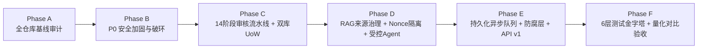

# 渐进式迁移、兼容期治理与高危操作授权方案（Migration & Rollout Plan）

## 1. 迁移总原则

本次企业级重构严格遵循**模块化单体渐进式演进（Strangler Fig within Modular Monolith）**原则：

1. **零推倒重写**：保留 `contract_kb` 顶层包名、CLI 子命令（`python -m contract_kb ...`）与全部历史业务规则语义。
2. **每阶段独立可回滚**：按 `Phase A -> Phase B -> Phase C -> Phase D -> Phase E -> Phase F` 分阶段提交独立 Git Commit，任意阶段均可通过 `git revert` 安全回退。
3. **高危操作强制人工审批门禁**：Git 远端历史重写、生产凭据轮换、生产库破坏性 DDL 均仅输出标准化 SOP，未经人工书面授权严禁自动执行。

---

## 2. HTTP API 版本演进与兼容期策略（`/api/*` → `/api/v1/*`）

| 维度 | 旧版兼容路由（`/api/*`） | 企业标准路由（`/api/v1/*`） |
|---|---|---|
| 可用状态 | 保留运行（注入 RFC 8594 `Deprecation: true` 与 `Link: </api/v1/...>; rel="successor-version"`） | 主推生产契约 |
| 文档列表 `GET .../contract-kb/documents` | 返回裸数组 `list[dict]`（100% 兼容存量调用方） | 返回标准分页包裹器 `{"items": [...], "total": N, "limit": L, "offset": O}` |
| 请求追踪与错误信封 | 统一注入 `X-Request-ID` / `X-Trace-ID`；保留顶层 `error` + `request_id` 并扩展 `code` / `status_code` / `trace_id` | 同左（OpenAPI 显式 `ErrorEnvelope` Schema） |
| 幂等与生命周期治理 | 同步挂载 | 原生支持 `X-Idempotency-Key`、`/stages`、`/overrides`、`/cancel` 及 `/api/v1/jobs/*` |

**兼容期下线窗口建议**：
- **T + 0 ~ T + 90 天**：双路由并行运行；通过 `/api/v1/metrics` 中 `http_requests` 监控 `/api/*` 旧前缀流量占比。
- **T + 90 天后**：当旧前缀连续 14 天请求量为 0 时，经变更评审后移除 `app.include_router(shared_router, prefix="/api")`。

---

## 3. SQLite → PostgreSQL 18 + pgvector 平滑切换与回滚方案

### 3.1 Schema 演进顺序
1. `migrations/001_pgvector_schema.sql`：核心文档、条款、向量表、规则、审核任务与审计日志。
2. `migrations/002_tenant_and_format_standards.sql`：全表 `tenant_id` 租户隔离索引与版本化 `format_standards`。
3. `migrations/003_review_pipeline_and_canonical_contract.sql`：`review_stage_states`、`human_overrides`、`canonical_contracts`、`async_jobs` 及 `review_tasks` 可复现性与幂等列扩展。

### 3.2 切换步骤（Blue/Green 配置切换）
1. 在目标 PostgreSQL 18 实例安装 `pgvector` 扩展并按顺序执行 `001` → `002` → `003` 迁移脚本（纯关系功能可先通过 `PgVectorStorage.migrate_relational()` 验证）。
2. 设置环境变量：
   - `CONTRACT_KB_STORAGE_BACKEND=postgres`
   - `CONTRACT_KB_PG_DSN=postgresql://<user>:<pwd>@<host>:5432/<db>`
3. 调用 `GET /api/v1/readyz` 验证 `db_ready=true` 及延迟指标；执行模板幂等导入 `POST /api/v1/contract-kb/import`。
4. **一键回滚**：若生产数据库维护或网络异常，`create_storage()` 默认 **Fail-Closed**（绝不静默降级至本地空 SQLite 造成数据幻觉）；如需应急切回本地单机只读实例，显式修改配置 `CONTRACT_KB_STORAGE_BACKEND=sqlite` 并重启服务即可在秒级恢复。

---

## 4. 外部异构系统同步与缓存安全迁移

1. **淘汰不安全 `pickle` 缓存（CWE-502）**：
   - 新增 `SafeJsonCache`（带 SHA-256 完整性校验头）及 `tender_case_export.py` 的 `oa.json` 安全缓存；
   - 历史遗留 `.pkl` 缓存默认拒绝反序列化，仅在离线一次性迁移且显式配置 `ALLOW_UNSAFE_PICKLE_CACHE=1` 时只读兼容。
2. **防腐层渐进替代直连脚本**：
   - 新增量同步统一走 `ContractIntegrationOrchestrator`（参数化只读 SQL + `SyncWatermarkStore` + `dry_run=True` 预演核对差异报告后再执行 `dry_run=False` 正式入库）。

---

## 5. 需人工书面授权的高危治理操作清单（严禁自动执行）

> [!CAUTION]
> 以下三项操作涉及外部生产系统凭据、Git 远端协作历史或生产存储，本轮重构**已完成代码侧脱敏与配置化改造，但严格遵守安全边界未自动执行外部破坏性动作**，请安全管理员审批后按步骤执行：

### 5.1 疑似暴露凭据轮换清单（Credential Rotation SOP）
1. **企业微信应用 Secret 与微盘凭证**：登录企业微信管理后台重置历史曾在脚本/报告中出现的应用 `Secret`，更新至运维密钥管理中心并注入 `.env`（`WECOM_CORP_ID`、`WECOM_WEDRIVE_SECRET`）。
2. **泛微 e9 SQL Server 与新系统 MySQL 只读账号**：轮换历史脚本涉及的数据库只读口令，收敛网络 ACL 仅允许合同审查服务出口 IP 访问，并注入环境变量。
3. **API 网关共享密钥**：生成不少于 32 字节高熵随机密钥配置于 `CONTRACT_KB_AUTH_SHARED_KEY`，并开启 `CONTRACT_KB_REQUIRE_AUTH_TIMESTAMP=1`。

### 5.2 Git 历史敏感信息清洗方案（`git filter-repo` SOP）
1. 通知全体协作者冻结分支推送并备份裸仓库镜像：`git clone --mirror <repo_url> repo-backup.git`。
2. 基于本地私有脱敏词表（切勿将词表提交入库）执行 `git filter-repo --replace-text replacements.txt`。
3. 验证全历史 `git log -S` 零敏感命中后，由仓库管理员在维护窗口执行受控强推并通知协作者重新克隆。
