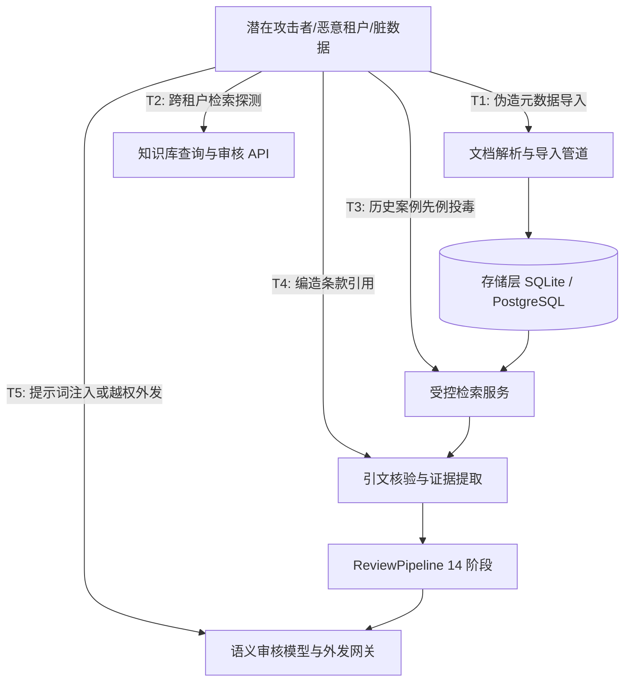

# 02 - Threat Model: Governed RAG & Evidence Integrity

## 1. 威胁源与攻击面定义

---

## 2. 威胁场景分析 (STRIDE)

| 威胁类型 | 威胁场景 | 攻击路径与潜在后果 | 防御与整改措施 |
|---|---|---|---|
| **Spoofing (伪造身份)** | 伪造审批人身份创建获批模板 | 客户端向导入/审批接口传入 `approved_status="APPROVED"` 或通过免审参数提权。 | 只有认证层传递并经授权的 `approver` 才能调用统一审批写命令；`upsert_document` 剥离自动提权。 |
| **Tampering (篡改数据)** | 知识降级检索篡改元数据 | PG 向量不可用时，FTS 回退通过 SQL 硬编码将所有条款篡改为 `APPROVED TEMPLATE`。 | 彻底删除 SQL 中的字面量伪造；直接查询真实 `clauses` 审批与类型字段。 |
| **Information Disclosure (信息泄露)** | 跨租户知识借由 RAG 召回泄露 | 检索接口不传 `tenant_id` 或只在 Python 层浅过滤，数据库召回并缓存/日志泄露其他租户条款。 | 数据库层强制 SQL `tenant_id` 过滤（Fail-Closed）；CitationVerifier 回查必须验证租户归属。 |
| **Elevation of Privilege (特权提升)** | 历史合同参考晋升为企业强制规则 | 检索历史案例时未剥离 `can_drive_mandatory_finding`，LLM 将个案妥协视作企业制度发起阻断违规。 | 严格知识矩阵准入：历史案例永久标记 `can_drive_mandatory_finding=False`，流水线冲突消解层禁止其作为 Mandatory Violation 依据。 |
| **Denial of Service / Integrity Failure** | 虚假引用导致审计链崩塌 | 审核生成虚假的 `clause_id` 或引述，CitationVerifier 因空集合返回 1.0 导致失真通过。 | 强类型 `EvidenceReference` 强校验；空证据集合显式返回 `0.0` / `NO_EVIDENCE`；核验失败候选立即剥离。 |

---

## 3. 安全防线架构原则 (Defense-in-Depth)

1. **第一道防线：写入门禁（Write Gate）**
   - 导入只导入事实原文，默认状态一律为 `PENDING_REVIEW`。
   - 任何审批提升必须走带审计日志、乐观锁的独立事务性审批命令。
2. **第二道防线：数据库预过滤（Database Pre-filter）**
   - SQL 查询前置施加 `tenant_id`、`doc_status='ACTIVE'`、`approved_status='APPROVED'`，避免未授权数据溢出到应用内存。
3. **第三道防线：治理策略复核（Governance Policy Assertion）**
   - Python 应用层执行严格 Fail-Closed 二次校验，缺失元数据直接阻断。
4. **第四道防线：证据链哈希与时态锁定（Citation & Evidence Verification）**
   - 对进入 Prompt 的条款进行逐项存在性、租户一致性、原文哈希比对与版本时效校验。
5. **第五道防线：结论权限隔离（Decision Authority Boundary）**
   - 规则消解阶段核对证据能力，非权威证据驱动的判定降级为提示或人工复核。
