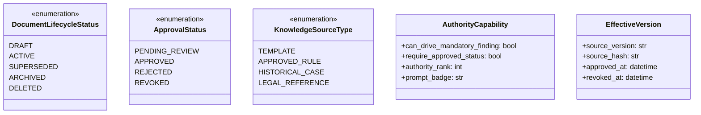
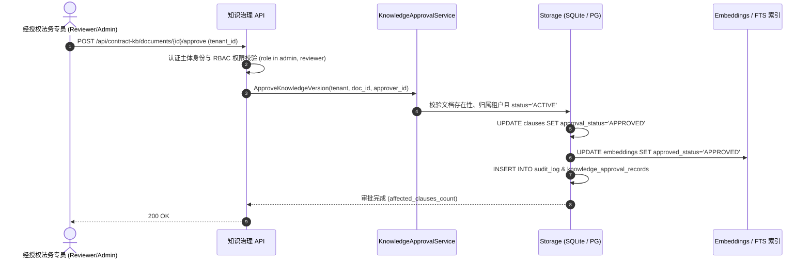

# 03 - Knowledge Approval Model & State Machine Design

## 1. 五维知识治理模型

Phase 11 重构了企业知识治理的数据与状态模型，彻底杜绝概念混淆：

---

## 2. 知识准入与权威能力判定矩阵

| 知识源类别 (`knowledge_type`) | 文档状态 (`doc_status`) | 审批状态 (`approval_status`) | 权威等级 (`authority_rank`) | 强制违规依据 (`can_drive_mandatory_finding`) | 提示词徽标 (`prompt_badge`) |
|---|---|---|:---:|:---:|---|
| `TEMPLATE` | `ACTIVE` | `APPROVED` | 2 | **TRUE** | `[企业现行标准模板条款-权威基准]` |
| `TEMPLATE` | `ACTIVE` | `PENDING_REVIEW` | - | **FALSE (阻断准入)** | - |
| `TEMPLATE` | `SUPERSEDED` | `APPROVED` | - | **FALSE (阻断准入)** | - |
| `TEMPLATE` | `DRAFT` | `APPROVED` | - | **FALSE (阻断准入)** | - |
| `APPROVED_RULE` | `ACTIVE` | `APPROVED` | 1 | **TRUE** | `[企业已审批强制规则-权威依据]` |
| `APPROVED_RULE` | `ACTIVE` | `REVOKED` | - | **FALSE (阻断准入)** | - |
| `LEGAL_REFERENCE` | `ACTIVE` | `APPROVED` | 3 | **FALSE** | `[外部法规参考-辅助说明]` |
| `HISTORICAL_CASE` | `ACTIVE` | 任意 (不作要求) | 4 | **FALSE (严禁强制依据)** | `[历史合同先例-仅供参考，严禁作为强制违规标准]` |
| 缺失元数据 / UNKNOWN | 任意 | 任意 | - | **FALSE (阻断准入)** | - |

---

## 3. 统一审批写命令 (Approval Command Architecture)

为杜绝普通导入 (`upsert_document`) 或客户端请求自动提权，审批流程成为提升条款权威的唯一合法入口：

### 关键约束：
1. **身份不可伪造**：`approver_id` 强制取自服务端认证主体，不接受 Body 伪造。
2. **生命周期前置约束**：非 `ACTIVE` 状态文档禁止审批通过。
3. **撤销即时生效**：调用 `revoke_knowledge_version` 后，条款与向量分块状态同步置为 `REVOKED`，数据库与 RAG 检索在下一毫秒即被完全阻断。
