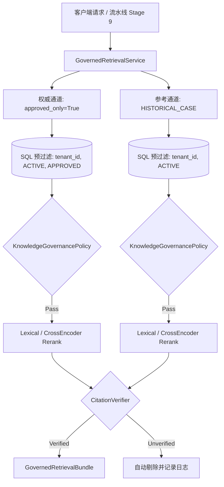

# 04 - Governed Retrieval Application Service Contract

## 1. 核心契约职责

`GovernedRetrievalService` 是企业级受控知识检索的核心门面与防线，负责：
1. **多路召回 (Hybrid Retrieval)**：组合 FTS (BM25 / tsquery) 与向量嵌入 (pgvector / Cosine)；
2. **数据库预过滤 (Database Pre-filtering)**：强制在 SQL 层注入 `approved_only=True`、`tenant_id`、`status='ACTIVE'`；
3. **权威与参考物理隔离 (Authority Partitioning)**：
   - 权威通道（`retrieve_authoritative`）：仅检索获法务审批的 `TEMPLATE` 与 `APPROVED_RULE`；
   - 参考通道（`retrieve_historical_reference`）：仅检索 `HISTORICAL_CASE`，且永久标记 `can_drive_mandatory_finding=False`；
4. **两阶段无损降级 (Secure Fallback Ordering)**：
   - 精确 subtype 无结果 -> 同 business category 现行标准 -> 全局通用现行标准；
   - **安全原则**：仅可放宽业务相关性，绝对禁止放宽租户边界、审批状态或生命周期有效性！
5. **重排序与引文剔除 (Rerank & Invalidation Pruning)**：
   - 结合覆盖率与 RRF 分值重排；
   - 经 `CitationVerifier` 核验失败的分块自动从最终提示词上下文中剔除。

---

## 2. 接口契约规范



### 接口定义：

```python
class GovernedRetrievalService:
    def retrieve_authoritative(
        self,
        query: str,
        *,
        top_k: int = 6,
        business_category: str | None = None,
        contract_subtype: str | None = None,
        clause_number: str | None = None,
        tenant_id: str | None = None,
    ) -> list[dict[str, Any]]: ...

    def retrieve_historical_reference(
        self,
        query: str,
        *,
        top_k: int = 2,
        business_category: str | None = None,
        tenant_id: str | None = None,
    ) -> list[dict[str, Any]]: ...

    def retrieve_for_review(
        self,
        query: str,
        *,
        top_k: int = 6,
        business_category: str | None = None,
        contract_subtype: str | None = None,
        clause_number: str | None = None,
        tenant_id: str | None = None,
        include_historical_cases: bool = False,
        historical_top_k: int = 2,
    ) -> GovernedRetrievalBundle: ...

    def search_user_visible_knowledge(
        self,
        query: str,
        *,
        top_k: int = 8,
        business_category: str | None = None,
        contract_subtype: str | None = None,
        clause_number: str | None = None,
        keyword: str | None = None,
        rerank: bool = True,
        tenant_id: str | None = None,
        include_unapproved: bool = False,
    ) -> list[dict[str, Any]]: ...
```
