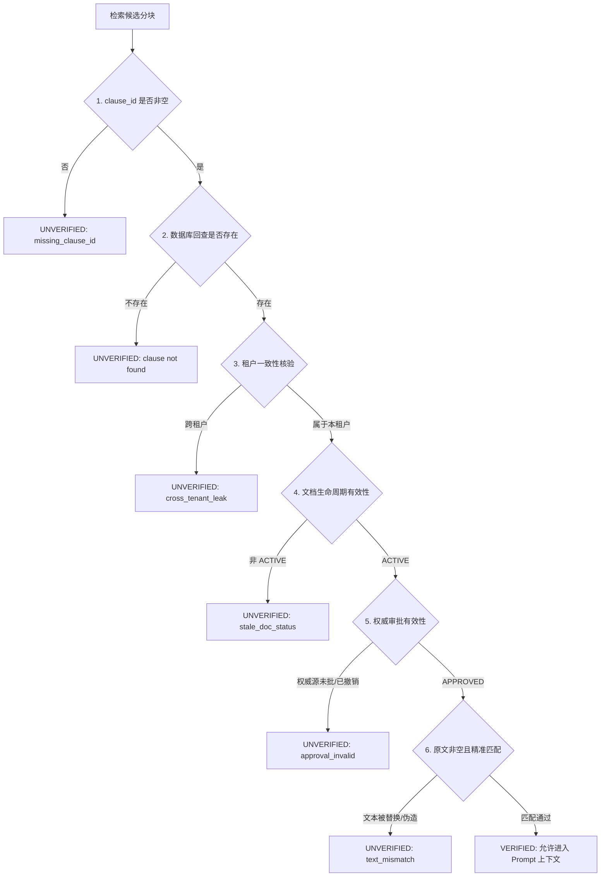

# 05 - Citation Integrity & Evidence Verification Design

## 1. 强类型证据对象 (`EvidenceReference`)

在 `contract_kb/domain/models/review.py` 中定义并增强了强类型证据对象：

```python
@dataclass
class EvidenceReference:
    """原文证据与知识来源引用强类型定位对象。"""

    document_id: str
    node_ids: list[str] = field(default_factory=list)
    clause_number: str | None = None
    original_text: str = ""
    section: str = ""
    clause_id: str = ""
    exact_quote: str = ""
    char_offset_or_locator: str | None = None

    # 证据链与治理扩展字段
    tenant_id: str = ""
    knowledge_source_type: str = "TEMPLATE"
    document_version: str = "v1"
    clause_version: str = "v1"
    source_hash: str = ""
    text_hash: str = ""
    source_locator: dict[str, Any] = field(default_factory=dict)
    approval_reference: str = ""
    evidence_status: str = "VERIFIED"  # VERIFIED | UNVERIFIED | STALE_VERSION | REVOKED_SOURCE | CROSS_TENANT | MISSING_SOURCE | CONTENT_MISMATCH
    verified_at: float | None = None
```

---

## 2. 证据核验流水线 (Verification Pipeline)

`CitationVerifier.verify_retrieval_hits` 对进入提示词的每条证据实施六维校验：



---

## 3. 指标口径真实性与防 TOCTOU

### 指标口径重构：
- 当检索结果集为空 (`len(hits) == 0`) 时：
  - `total_checked = 0`
  - `citation_correctness = 0.0`（严禁无条件填报 1.0）
  - `answer_groundedness = 0.0`
- 严禁将“没有发现任何引用错误”等同于“没有检索到任何引用”。

### 防 TOCTOU（Time-of-Check to Time-of-Use）：
1. **启动时版本快照**：流水线在 Stage 9 检索时记录候选的 `source_hash` 与 `document_id`。
2. **终结时状态复核**：Stage 11 与 Stage 12 在形成最终 `Finding` 时，核验证据的 `can_drive_mandatory_finding`，若对应知识已被撤销 (`REVOKED`)，自动将问题降级为 `LOW` / 人工复核，并在审计报告中明确留痕。
