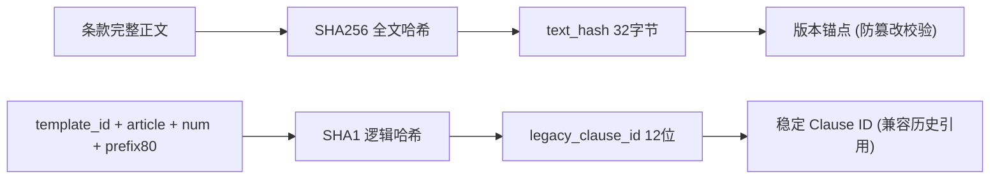

# 06 - Chunk Versioning & Content Fidelity Design

## 1. 原文保真与段落边界修复

在 `contract_kb/clause_extractor.py` 中：
- 修复了前序版本的 `"".join(buffer).strip()`，彻底消除了跨段落文本硬拼接造成的段落换行信息丢失问题；
- 采用显式段落分隔符 `"\n".join(b for b in buffer if b).strip()`，保证原始文档排版与语义段落完全可还原；
- 严格遵循原则：**原始文档内容不可变，规范化检索文本可派生**。

### 四层文本分离体系：
1. `raw_text`：DOCX / PDF 解析得到的未加工原文（保留段落边界与原始标点）；
2. `display_text`：用于前端高亮展示与法务人工对照的文本；
3. `retrieval_text`：结合文章标题与条款正文派生的分词与向量嵌入输入；
4. `normalized_summary`：由确定性规则派生的摘要与关键实体槽位（标注 `deterministic_rule_v1`）。

---

## 2. 稳定身份标识 (Stable Chunk Identity) 与向后兼容

针对前 80 字符哈希易导致同前缀条款碰撞的问题，Phase 11 建立了多层次身份机制：

### 向后兼容方案：
- 保留原有 12 位十六进制 `legacy_clause_id` 作为默认 `clause_id`，防止破坏历史审核引用与已落库的 `canonical_contracts`；
- 增加 `text_hash`（正文全量 SHA256）与 `legacy_clause_id` 显式字段；
- 查询接口支持通过 `clause_id` 与 `legacy_clause_id` 双向定位。
