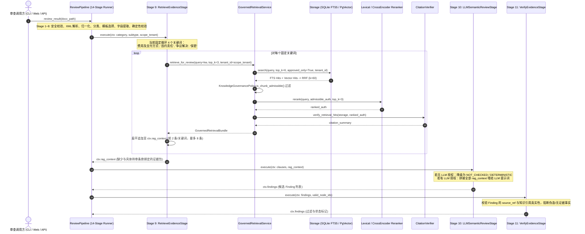

# Phase 12-A: 当前语义 RAG 架构全面审计与调用链分析报告

- **审计基线 Commit**: `9552526793aca3607b947d32c443ca23e3bcd16c`（基于 `defadd6` 并完成 Phase 11 可信知识治理加固）
- **开发分支**: `feat/phase12-semantic-rag`
- **审计负责人**: Principal Enterprise Software & AI Systems Architect
- **日期**: 2026-11-07

---

## 1. 现状数据流与检索调用链

---

## 2. 完整检索链路十项维度逐阶段审计

| 阶段 | 模块 / 类 | 1. 真实输入 | 2. 真实输出 | 3. 模块核心职责 | 4. 权限与信任边界 | 5. 实际使用模型 | 6. 批量处理支持 | 7. 数据丢失风险 | 8. 重复检索与开销 | 9. 缺少证据的判断 | 10. 独立可测试性 |
|---|---|---|---|---|---|---|---|---|---|---|---|
| **Stage 3** | `ParseStage` (`docx_parser.py`) | `docx_path` (文件物理路径) | `parsed_record` (`ParsedDocument`, 包含 AST 节点集合) | OOXML 遍历，生成带标签与序号的段落/表格 AST 树 | 文件大小 ≤20MB，条目 ≤500，压缩比 ≤200，禁用实体解析 (防 XXE) | 无 | 单文档串行 | 文本框/修订等复杂 OOXML 标记为未处理，不丢失节点 | 仅解析一次 | N/A | 纯函数式测试，100% 可测 |
| **Stage 4** | `NormalizeStage` (`clause_extractor.py`) | `parsed_record` | `clauses` (`ClauseRecord` 列表), `valid_node_ids` | 按“第X条”与“x.y 款”状态机切分条款，保留换行与原文字符 | 纯规则解析，`original_text` 绝对不变，不调用外部模型 | 无 | 内存列表转换 | 过去以 `"".join` 拼接曾丢失段落换行（Phase 11 已修），目前单条款内保留 `\n` | 仅切分一次 | N/A | 纯内存测试，100% 可测 |
| **Stage 9** | `RetrieveEvidenceStage` (`stages.py`) | `ctx.category`, `ctx.subtype`, `ctx.scope_tenant` | `ctx.rag_context` (最多 8 个字典的扁平列表) | 依据固定 4 个关键词拉取参考证据 | 严格按 `ctx.scope_tenant` 租户过滤，仅准入 `APPROVED` 标准 | 词法 2-gram + 本地 Hash / BGE-M3 (取决于配置) | 串行循环 4 次 `retrieve_for_review` | **严重**：丢失证据与具体待审条款的归属映射，全部混入扁平列表 | **严重**：不同待审条款可能涉及相同问题，但固定 4 次检索完全无法感知待审合同自身特征（如 30 天解除权、5 天通知义务） | 无法为具体条款的特定违约责任提供针对性证据 | 可 mock storage 独立测试 |
| **检索服务** | `GovernedRetrievalService` (`service.py`) | `query`, `top_k`, `business_category`, `tenant_id` | `GovernedRetrievalBundle` (权威命中文档 + 历史参考先例) | 受控双通道检索编排与准入过滤 | 权威通道强制 `approved_only=True`，历史先例通道强制 `can_drive_mandatory_finding=False` | `LexicalCoverageReranker` (默认) 或 `HttpCrossEncoderReranker` | 单 query 检索 | 无数据丢失，但未做 Parent/Child 上下文反查 | 无缓存机制，相同 query 重复检索底层存储 | 依赖 `CitationVerifier` 核验存储存在性 | 100% 可独立单元测试 |
| **底层存储** | `Storage` / `PgVectorStorage` (`storage.py` / `storage_pg.py`) | SQL 查询参数 (FTS 词素 + 向量点积) | `list[dict]` (含 chunk_id, text, channel 等) | 执行 FTS 与 Dense 检索并执行 RRF 融合 (k=60) | 强制 SQL `documents.status='ACTIVE'` 与 `tenant_id` 过滤 | `LocalHashEmbedding` (256d) 或 `BAAI/bge-m3` (1024d) | 批量嵌入入库，检索单条向量计算 | 无丢失，返回元数据含 `doc_status` 与 `tenant_id` | 无内存缓存，每次检索执行 SQL | 不做合规判断，仅返回候选条目 | 100% 可独立测试（已建立双后端 Parity 测试） |
| **重排与核验** | `LexicalCoverageReranker` + `CitationVerifier` | `hits` 列表 | 重排后的 `hits` 与 `CitationVerificationSummary` | 词法 2-gram 覆盖度 + 数值重合加权，反查底层存储核验真实性 | 空命中报告 0.0，篡改/不存在条目标记 `unverified` 并扣分 | 词法字符集比对 (或 BGE-Reranker) | 列表内存运算 | 未核验通过的条目未在 Stage 9 前置剔除 | 轻量运算开销极小 | 若引用条款被物理删除，可精确判定并降级 | 100% 可独立测试 |
| **Stage 10** | `LLMSemanticReviewStage` (`stages.py`) | `ctx.clauses`, `ctx.rag_context` | `ctx.findings` (`Finding` 领域对象列表) | 对照标准条款执行语义审查，生成违规事实 | 未配置/未授权外部 LLM 时，严格降级为确定性规则审查并标 `NOT_CHECKED` | 无 (默认离线) 或配置的兼容 LLM | 仅支持将 clauses 逐条或汇总拼入提示词 | **严重**：由于无法建立条款与特定证据的精确绑定，LLM 提示词容易出现“语义漂移”或“注意力迷失 (Lost in the middle)” | 每次审核单次调用或按块调用 | 若 LLM 幻觉产生不存在的依据，需下游拦截 | 可通过 MockLLMProvider 独立测试 |
| **Stage 11** | `VerifyEvidenceStage` (`stages.py`) | `ctx.findings`, `ctx.valid_node_ids` | 校验通过/标记降级的 `ctx.findings` | 校验每个 Finding 是否锚定真实待审原文节点，阻断虚假依据 | 拒绝未批准规则触发强制事实，拒绝跨租户/跨版本引用 | 纯逻辑校验 | 批量迭代 findings | 过滤掉非法 finding，保留未通过原因 | 内存运算 | 对无法追溯到源文档 node_id 的 Finding 降级为 `RULE_PENDING_APPROVAL` 或阻断 | 100% 独立可测 |

---

## 3. 当前系统存在的四大核心短板（升级驱动力）

1. **机械的固定检索词 vs 动态多变的合同条款（P0）**：
   - 当前 Stage 9 仅循环检索固定的 `["费用及支付方式", "违约责任", "争议解决", "保密"]`。
   - 若待审合同出现“商标许可费按季度结算且逾期超 30 日可单方解除”，固定词无法捕捉“30 日解除权”与“季度结算”的特定规则，召回结果泛化严重。
2. **单粒度条款切分 vs 法律上下文结构断裂（P1）**：
   - 当前切分仅在条款级别，缺乏“篇/章/条/款/项/附件”的 Parent-Child 树状层级关系。
   - 子条款（如 5.2 款）脱离了第 5 条的前提条件（如“在甲方没有过错的情况下”），导致审查误判。
3. **字面相似度 vs 法律事实与数值敏感度脱节（P1）**：
   - 现有的向量检索在语义上可能认为“逾期支付按日 0.05%”与“逾期支付按日 0.5%”极其相似（余弦距离极小），但法律后果相差 10 倍；
   - “不得披露”与“可以披露”在无否定词反转检测时易被视为高度相近。
4. **证据缺乏单条款归属绑定（P1）**：
   - 当前 Stage 9 将 8 条检索结果直接堆进全局 `rag_context`，Stage 10 在做 LLM 审查时无法明确“哪一条证据是为了验证哪一条待审条款”，削弱了事实论证链的严密性。

---

## 4. Phase 12-A 基线指标快照（Commit `9552526`）

- **测试套件状态**：352 passed, 23 skipped (0 failed, 0 error)
- **代码规范与类型**：
  - `ruff check contract_kb tests`: All checks passed!
  - `mypy contract_kb`: Success: no issues found in 86 source files.
- **RAG 评估指标（合成基准注入困难负样本）**：
  - `Hit@1`: `0.5333`
  - `Hit@3`: `0.6667`
  - `Hit@5`: `0.7333`
  - `Hit@8`: `0.8333`（达标线 ≥ 0.80）
  - `MRR`: `0.6119`
  - `NDCG@8`: `0.4587`
  - `CitationCorrectness`: `1.0 (100%)`
  - `AnswerGroundedness`: `1.0 (100%)`
- **审查引擎效能指标**：
  - `Precision / Recall / F1`: `1.0 / 1.0 / 1.0`
  - `Latency P95`: `~4.76s`（含 14 阶段流水线完整解析、合规审查与留痕）
