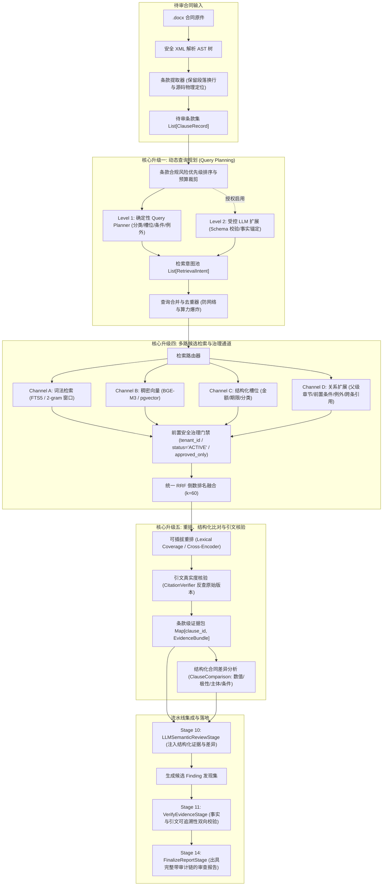

# Phase 12-A: 目标语义 RAG 架构设计与架构决策记录 (ADR)

- **状态**: APPROVED (架构设计基线)
- **版本**: v2.0-Semantic-RAG
- **所属系统**: `contract-kb` (企业知识产权合同模板知识库与智能审核引擎)

---

## 一、架构决策记录 (ADR: Architectural Decision Record)

### 1. 背景与上下文
当前系统在 Phase 11 完成了严格的可信知识治理门禁（生命周期状态、审批状态与租户边界隔离），但检索逻辑依然停留在“待审合同全局执行固定 4 个关键词检索”的原始形态。对于复杂的企业知识产权合同（如专利许可、软著转让、商标维权、保密协议），审查重点高度依赖合同内部的具体条款约定（如单方解除条件、违约金比例、交付工作日、送达认定、在先近似风险披露等）。

### 2. 核心架构决策
1. **决策 1 (动态 Query Planning)**：
   引入独立的 `ContractAwareQueryPlanner`，将固定关键词检索替换为“基于待审条款结构与法律关系的意图驱动规划”。
   分为两级：Level 1（确定性规则抽取，零外部依赖必选）+ Level 2（可选 Pydantic 受控 LLM 意图扩展）。
2. **决策 2 (防爆炸检索预算与批处理)**：
   严禁每个条款无节制膨胀检索。设立 `QueryPlanningBudget`，提供条款风险优先级排序、查询去重合并、单合同最大检索次数上限与超时取消机制。
3. **决策 3 (多粒度条款索引与 Parent-Child 上下文关联)**：
   保留原有 AST 解析与段落完整性，扩充知识单元的层级关系：`Document -> Article -> Subclause -> SemanticUnit -> Table`。检索子条款命中后，通过 `parent_id` 自动关联父级章条与前置生效条件，形成无断章取义的完整证据链。
4. **决策 4 (轻量法律关系建模，非重型图数据库)**：
   提取并结构化建模 9 类轻量法律关系（`OBLIGATION`, `RIGHT`, `PROHIBITION`, `CONDITION`, `EXCEPTION`, `DEADLINE`, `LIABILITY`, `TERMINATION`, `CROSS_REFERENCE`），支持跨条款引用跳转（如“第八条依照第十二条执行”），严设遍历深度防死循环。
5. **决策 5 (多路候选召回与证据包绑定)**：
   构建 Channel A（Lexical）、Channel B（Dense）、Channel C（Structured）、Channel D（Relationship），由 RRF (k=60) 融合并前置执行安全过滤。检索产物由扁平的 `rag_context` 升级为强类型的 `EvidenceBundle`，严格按待审条款进行一一映射归属（`clause_id -> EvidenceBundle`）。
6. **决策 6 (数值与语义结构化对比，杜绝 Cross-Encoder 替代法律判断)**：
   Cross-Encoder 仅用于语义相关性打分，法律等价性交由 `ClauseComparison` 结构化引擎校验（Decimal 级数值、工作日/自然日单位、义务主体方向、否定词极性、生效前提与免责例外）。

---

## 二、目标系统整体架构视图



---

## 三、关键数据契约定义 (Data Contracts)

### 1. 检索意图模型 (`RetrievalIntent`)
```python
class RetrievalIntent(BaseModel):
    intent_id: str                      # 确定性 SHA-1 ID
    source_clause_id: str               # 关联的待审条款 ID
    source_node_ids: list[str]          # 物理 AST 节点 ID
    intent_type: str                    # 如 TERMINATION_CHECK, PAYMENT_DEADLINE_CHECK
    contract_category: str | None
    contract_subtype: str | None
    legal_subject: str | None           # 义务/权利主体（甲方/乙方）
    action: str | None                  # 法律行为（如：单方解除、支付款项）
    conditions: list[str]               # 触发前提（如：逾期超过30日）
    exceptions: list[str]               # 免责或例外（如：不可抗力除外）
    numeric_constraints: list[dict]     # 数值限制（如：{"type": "DAYS", "value": 30, "unit": "DAY"}）
    referenced_clauses: list[str]       # 跨条款引用编号（如：["第十二条"]）
    lexical_queries: list[str]          # 供 FTS 使用的精确关键词
    semantic_queries: list[str]         # 供 Dense 向量使用的语义语句
    target_knowledge_types: list[str]   # 目标知识层级 (默认 ['TEMPLATE', 'APPROVED_RULE'])
    priority: int = 100                 # 检索优先级 (数值越小越优先)
```

### 2. 条款级证据包模型 (`EvidenceBundle`)
```python
class EvidenceBundle(BaseModel):
    target_clause_id: str
    intents: list[RetrievalIntent]
    authoritative_clauses: list[dict[str, Any]]     # 经审批的标准模板条款
    parent_clause: dict[str, Any] | None            # 父级章节或大条款上下文
    related_conditions: list[str]                   # 补充的前置条件或生效要求
    related_exceptions: list[str]                   # 补充的免责例外
    cross_referenced_clauses: list[dict[str, Any]]  # 跨条款引用的目标条款实体
    historical_cases: list[dict[str, Any]]          # 历史案卷先例 (仅供参考，不可违规裁决)
    citation_summary: Any                           # 引文核验报告 (包含 correctness 指标)
```

### 3. 条款差异结构化比对模型 (`ClauseComparison`)
```python
class ClauseComparison(BaseModel):
    reviewed_clause_id: str
    reference_clause_ids: list[str]
    similarity_score: float | None
    conclusion: str                     # MATCH / NUMERIC_DIFF / POLARITY_INVERSION / CONDITION_DIFF / EXCEPTION_DIFF 等
    subjects_changed: list[dict]
    numeric_differences: list[dict]     # Decimal 精确比对结果
    polarity_inverted: bool             # 是否存在“应当/不得/可以”否定反转
    condition_differences: list[dict]
    exception_differences: list[dict]
    requires_human_review: bool
    confidence: float
```
