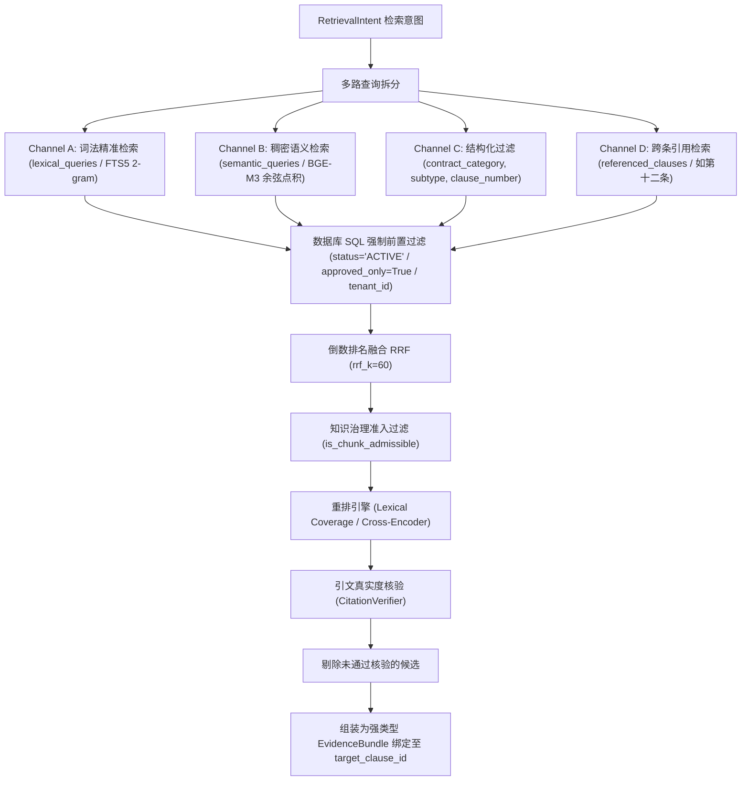

# Phase 12-D: 多路混合检索与 EvidenceBundle 证据包绑定架构规范

- **状态**: IMPLEMENTED & TESTED
- **核心组件**: [`contract_kb/modules/retrieval/service.py`](file:///d:/Users/Administrator/Desktop/AI合同/contract_kb/modules/retrieval/service.py)
- **测试用例**: [`tests/integration/test_dynamic_retrieval_pipeline.py`](file:///d:/Users/Administrator/Desktop/AI合同/tests/integration/test_dynamic_retrieval_pipeline.py)、[`tests/integration/test_parent_child_retrieval.py`](file:///d:/Users/Administrator/Desktop/AI合同/tests/integration/test_parent_child_retrieval.py)

---

## 1. 架构目标：从全局扁平列表到条款级证据包绑定
在旧版系统中，检索阶段输出的是全局扁平的 `ctx.rag_context`（仅 8 个孤立条目），无法明确哪项证据是为了验证哪条待审条款。
本项目通过构建强类型 **`EvidenceBundle`**，建立了**“待审条款 -> 检索意图 -> 权威条款 + 父章条 + 援引条款”** 的一一映射关系。

## 2. 四路混合召回架构 (Multi-Channel Retrieval)



## 3. `EvidenceBundle` 数据契约

```python
@dataclass
class EvidenceBundle:
    target_clause_id: str  # 绑定的待审条款唯一 ID
    intents: list[RetrievalIntent]  # 驱动产生的检索意图
    authoritative_clauses: list[
        dict[str, Any]
    ]  # 经审批通过的现行标准条款 (can_drive_mandatory_finding=True)
    parent_clause: dict[str, Any] | None  # 所属父级章条 (宏观上下文)
    related_conditions: list[str]  # 继承的前提条件
    related_exceptions: list[str]  # 继承的免责例外
    cross_referenced_clauses: list[dict[str, Any]]  # 跨条款引用的目标标准条目
    historical_cases: list[dict[str, Any]]  # 历史参考先例 (降级仅供参考)
    citation_summary: (
        CitationVerificationSummary  # 引文核验报告 (含 correctness 与 groundedness)
    )
```

## 4. 性能与安全保障
- **未核验候选前置剔除**：未通过底层数据库存在性或租户隔离校验的候选，在组装 bundle 前直接被 `unverified_set` 剔除，杜绝大模型“幽灵引文”；
- **Prompt 提示词自生成**：`bundle.prompt_context_text()` 自动格式化输出带有权威徽标、所属章条背景与前置条件的严谨提示词片段。
