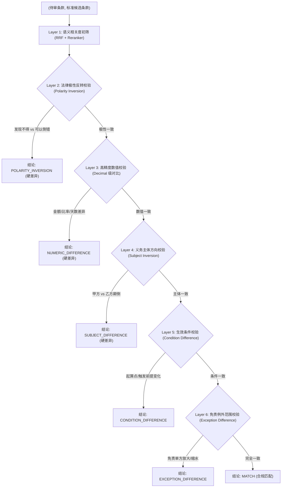

# Phase 12-E: 结构化合同差异对比引擎技术规范 (Clause Comparison Engine)

- **状态**: IMPLEMENTED & TESTED
- **核心组件**: [`contract_kb/modules/retrieval/comparison.py`](file:///d:/Users/Administrator/Desktop/AI合同/contract_kb/modules/retrieval/comparison.py)
- **测试用例**: [`tests/unit/test_numeric_semantic_consistency.py`](file:///d:/Users/Administrator/Desktop/AI合同/tests/unit/test_numeric_semantic_consistency.py)

---

## 1. 六层结构化校验流水线



## 2. 关键比对技术细节

### A. Decimal 高精度比对
- **百分比与千分比标准化**：`3‰` 与 `0.3%` 在底层换算为 `Decimal("0.003")`，避免浮点精度抖动，防止误报；`0.05%` 与 `0.5%` 精确计算出差值 `0.0045` 并给出量化告警。
- **工期与日历日口径校验**：显式检测“工作日”与“自然日”的口径错位（`DAY_UNIT_MISMATCH`）。

### B. 否定倒错检测
- 提取禁止词库（`不得`、`严禁`、`禁止`、`切勿`）与许可/义务词库（`可以`、`有权`、`应当`、`必须`）；
- 捕获“不得披露”对“可以披露”的极端合规倒错，将其置于最高风险优先级。

### C. 结构化比对契约 (`ClauseComparison`)
比对产物 `ClauseComparison` 为下游 `Stage 10 (LLM Review)` 与 `Stage 11 (Verify)` 提供结构化依据：
```python
class ClauseComparison(BaseModel):
    reviewed_clause_id: str
    reference_clause_ids: list[str]
    similarity_score: float | None
    conclusion: str  # MATCH / POLARITY_INVERSION / NUMERIC_DIFFERENCE ...
    polarity_inverted: bool
    numeric_differences: list[NumericDifference]
    subjects_changed: list[dict[str, Any]]
    condition_differences: list[dict[str, Any]]
    exception_differences: list[dict[str, Any]]
    requires_human_review: bool
    summary_findings: list[str]
```
