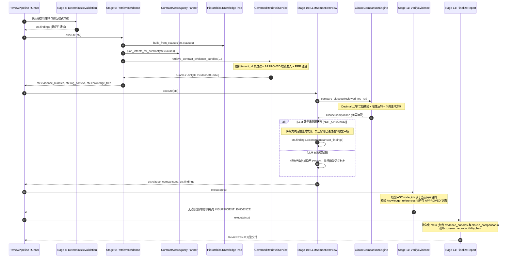

# 09. 14 阶段流水线深度语义 RAG 集成设计（Pipeline Integration）

## 1. 架构目标与改造原则

在 Phase 12 中，流水线（`ReviewPipeline`）从早期“扁平检索 + 机械 4 组关键词 + 可选黑盒 LLM”升级为“结构感知层级建树 + 条款级动态意图规划 + 强类型证据包组装 + 结构化差异比对 + 严格证据回溯与降级治理”。

---

## 2. 关键阶段改造细节

### 2.1 Stage 9: RetrieveEvidenceStage
- **职责演进**：不再机械遍历 `费用及支付方式`、`违约责任`、`争议解决`、`保密` 4 个关键词，而是：
  1. 调用 `HierarchicalKnowledgeTree.build_from_clauses` 生成待审合同的 AST 树；
  2. 调用 `ContractAwareQueryPlanner` 生成针对各个待审条款的 `RetrievalIntent`；
  3. 通过 `GovernedRetrievalService.retrieve_contract_evidence_bundles` 批量获取 `EvidenceBundle`，并在 bundle 中完成章条父级约束继承（`expand_parent_child_context`）与引文真实性核验；
  4. 向后兼容聚合输出 `ctx.rag_context` 与强类型映射 `ctx.evidence_bundles`。

### 2.2 Stage 10: LLMSemanticReviewStage
- **结构化对比引擎前置嵌入**：
  - 自动遍历待审条款及其对应的 `EvidenceBundle.authoritative_clauses`；
  - 触发 `ClauseComparisonEngine.compare_clauses`，计算法律极性（`POLARITY_INVERSION`）、数值比率差异（`NUMERIC_DIFFERENCE`）、履行天数口径错位（`DAY_UNIT_MISMATCH`）等；
  - 记录完整结构比对结果至 `ctx.clause_comparisons`。
- **诚实降级守卫**：
  - 若系统未配置授权 LLM 或处于离线回归模式（`llm_result.status == "NOT_CHECKED"`），结构比对引擎检测出的显著差异直接提升为 `category="MANUAL_REVIEW"`、`severity="LOW"`、`execution_mode="MANUAL_REVIEW"` 的确定性比对发现；
  - 保证在无外部大模型可用时，系统依然具备极强的违约金偏离、禁止性条款倒错发现能力，杜绝“无 LLM 即全部漏审”。

### 2.3 Stage 11: VerifyEvidenceStage
- **证据双向闭环核验**：
  - **源文档 AST 闭环**：审核发现所指向的 `source_reference.node_ids` 必须与 `ctx.valid_node_ids` 产生非空交集，且引述文本存在于源合同中；
  - **知识库权威依据闭环**：审核发现所引述的 `knowledge_references` 必须满足租户一致性（`ref_tenant == ctx.scope_tenant`）且审批状态必须为 `APPROVED`。未获审批的标准或跨租户引用直接降级为 `INSUFFICIENT_EVIDENCE`。

### 2.4 Stage 14: FinalizeReportStage
- **原子持久化**：
  - 任务元数据（`task_meta`）完整记录 `evidence_bundles`、`clause_comparisons`、`rag_context`；
  - 计算与特定执行任务 ID 解耦的 `reproducibility_hash`，确保确定性审核结果在多次重放时完全恒定。

---

## 3. 端到端测试验证

在 `tests/e2e/test_semantic_contract_review_e2e.py` 中完整实现了端到端综合测试：
- **测试场景**：
  - 企业标准库录入包含 4 个章节的标准知识产权许可模板（包含违约金 3‰、保密不得披露、逾期15个工作日等约定）；
  - 隔离租户录入机密文档，验证绝不越权；
  - 待审合同注入三类典型偏差：万分之五费率偏差、可以披露保密信息极性反转、逾期30日自然日口径差异；
- **执行结果**：
  - 14 个阶段平稳流转，`status == "COMPLETED"`；
  - 成功捕获 `POLARITY_INVERSION` 与 `NUMERIC_DIFFERENCE` 结构比对发现；
  - 证据溯源节点 100% 绑定至源合同 AST，外部依据严格核验为 `std_tpl_ip_001` 的 `APPROVED` 条款；
  - 租户隔离校验 0 泄漏，测试耗时仅 0.55s。
