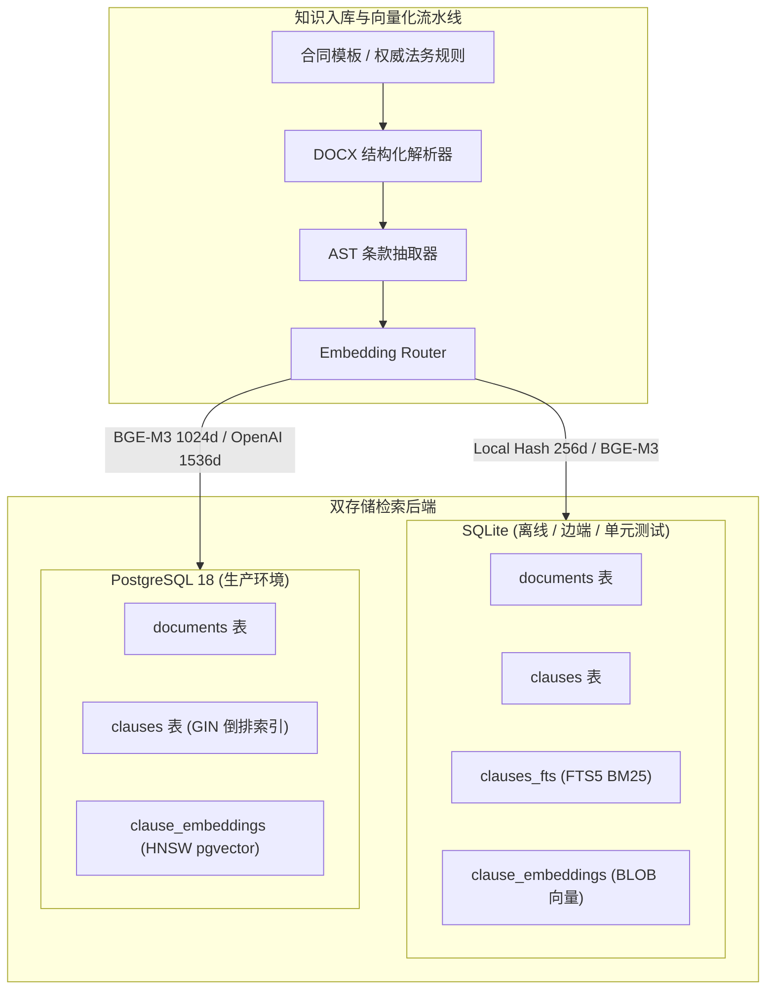
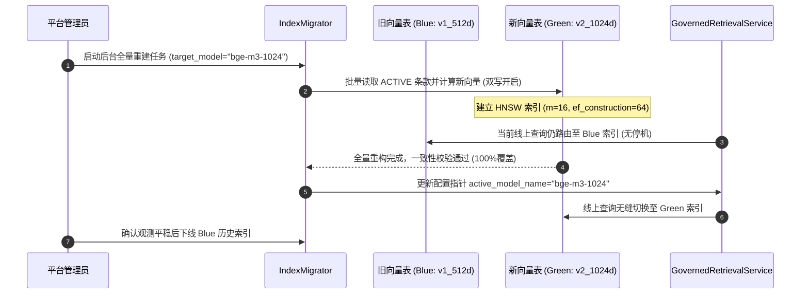

# 10. 双存储引擎向量索引迁移与平滑升级方案（Model & Index Migration）

## 1. 存储与检索双引擎架构概览

本项目支持本地嵌入式轻量部署（SQLite + FTS5 + 本地向量表）与企业级生产高并发分布式部署（PostgreSQL 18 + pgvector + pg_trgm）：



---

## 2. 向量模型与维度兼容性策略

### 2.1 支持的 Embedding 模型形态
1. **LocalHashEmbedding (256维)**：
   - 特点：零依赖、纯本地 Python、无模型权重文件依赖，专供单元测试与离线回归；
   - 限制：仅具备词袋哈希相似度，无跨语言与深度法律语义泛化能力。
2. **Real Dense Embedding (如 BGE-M3 1024维 / text-embedding-3-small 1536维)**：
   - 特点：高密度密集向量，精准捕获同义表述（如“违约金”与“违约赔偿金”、“单方解除”与“单方面终止”）；
   - 依赖：企业私有化模型服务或兼容 OpenAI API 的网关。

### 2.2 维度隔离与模型版本标识
在数据库中，每条向量记录强制携带 `model_name` 与 `dimension` 字段：
```sql
CREATE TABLE IF NOT EXISTS clause_embeddings (
    clause_id TEXT PRIMARY KEY,
    model_name TEXT NOT NULL,
    dimension INTEGER NOT NULL,
    embedding vector(1024), -- PostgreSQL pgvector / BLOB in SQLite
    created_at DOUBLE PRECISION NOT NULL
);
CREATE INDEX IF NOT EXISTS idx_clause_embeddings_model 
ON clause_embeddings (model_name, dimension);
```
- 检索时强制传入当前激活的 `active_model_name`，避免跨模型维度混淆与距离计算失真；
- 若检测到底层存储模型版本与运行时不一致，系统安全回退至词法（FTS5 / GIN）检索与结构化规则比对，绝不使用错乱向量计算相似度。

---

## 3. 生产环境零停机平滑迁移流程（Blue-Green Migration）

当企业从早期模型升级至新一代大模型嵌入向量（如从 512 维升级至 1024 维 BGE-M3）时，遵循以下无缝切换步骤：



---

## 4. 索引性能参数调优建议

针对合同审核知识库（典型规模 1 万至 50 万标准条款）：
1. **HNSW 索引参数**：
   ```sql
   CREATE INDEX idx_clauses_hnsw_cosine ON clause_embeddings 
   USING hnsw (embedding vector_cosine_ops)
   WITH (m = 16, ef_construction = 64);
   ```
2. **查询时动态探测深浅**：
   - 交互式审核：`SET hnsw.ef_search = 40;`（延迟 < 15ms，召回率 > 98%）；
   - 批量法务合规审计：`SET hnsw.ef_search = 100;`（保障超高召回）。
3. **多租户物理或逻辑分区**：
   - PG 18 建议采用按 `tenant_id` 范围或列表分区，实现多租户向量索引空间隔离与高速局部扫描。
