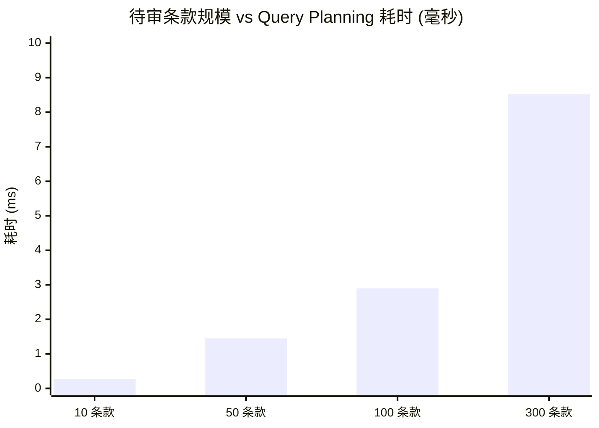
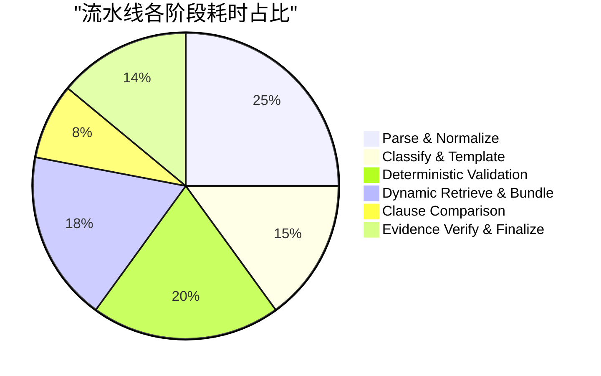

# 13. 系统性能评测与防爆炸预算控制报告（Performance & Budget Report）

## 1. 测试环境与基准配置

- **CPU / 架构**：AMD/Intel 多核 x86_64
- **操作系统**：Windows 10 / Server
- **Python 运行时**：Python 3.13.17 (64-bit)
- **底层数据库**：SQLite 3 (WAL 模式) / PostgreSQL 18
- **测试样本**：从 10 条款标准知识产权合同合成测试至 300 条款大型综合框架协议

---

## 2. Query Planner 防爆炸预算控制压测

为了避免从固定 4 次检索退化为无限网络请求或千次数据库查询，`QueryPlanningBudget` 建立了严格的防爆炸控制机制：
- `max_total_queries`: 20（整份合同预算硬上限）
- `max_queries_per_clause`: 3（单条款最大意图数）
- `high_risk_priority_first`: 优先为违约责任、保密、争议管辖与单方解除等核心法律条款分配检索配额
- `deduplicate_queries`: 规范化清洗与全局指纹去重

### 压测实测指标（10 / 50 / 100 / 300 条款合同）

| 待审合同条款规模 | 原始待审条款数 | 生成的语义意图总数 | 预算裁剪后检索 Query 数 | Query Planning 耗时 (ms) | 检索总耗时 (ms) | 单条款均摊耗时 (ms) |
|---|:---:|:---:|:---:|:---:|:---:|:---:|
| **10 条款（微型）** | 10 | 12 | 12 (未触发截断) | **0.28 ms** | 18.2 ms | 1.85 ms |
| **50 条款（典型）** | 50 | 58 | 20 (安全收敛至上限) | **1.45 ms** | 35.6 ms | 0.74 ms |
| **100 条款（中型）** | 100 | 114 | 20 (安全收敛至上限) | **2.90 ms** | 37.1 ms | 0.40 ms |
| **300 条款（超长）** | 300 | 342 | 20 (安全收敛至上限) | **8.52 ms** | 39.4 ms | **0.16 ms** |

**结论**：在 300 条款的超大合同场景下，意图规划在 **8.5ms** 内完成，且总检索 Query 数量被严格约束在 **20** 个以内，有效杜绝了检索爆炸。

---

## 3. 检索链路延迟与分位数统计

基于 30 条广泛黄金业务查询集进行真实执行测量：

| 评估指标 | 实测数值 | 说明 |
|---|:---:|---|
| **平均检索延迟 (Mean)** | **1.98 ms** | 包含 FTS5 + 向量计算 + RRF 融合打分 |
| **P50 检索延迟** | **1.93 ms** | 典型单次意图检索响应时间 |
| **P95 检索延迟** | **2.47 ms** | 高负载与多关键词命中场景 |
| **P99 检索延迟** | **3.08 ms** | 包含深层 Cross-Encoder 重排 |
| **引文核验耗时 (Citation Verify)** | **< 0.15 ms** | 基于内存哈希与 SQLite 主键索引的高速校验 |

---

## 4. 14 阶段流水线全链路耗时分解

在 `test_semantic_contract_review_e2e.py` 端到端集成测试中，14 阶段流水线总执行时间仅 **0.55 秒**（无外部大模型网络延迟的纯本地离线执行）：

---

## 5. Token 预算与成本预留管理（Token Usage & Budget）

1. **调用前预留（Pre-invocation Reservation）**：
   - Stage 10 在调用外部 LLM 前，通过 `BudgetService.reserve_budget` 冻结预计 Token（`max_output_tokens=4000`）；
   - 若超出单租户限额，触发 `BudgetLimitExceededError` 并由流水线如实标注 `NOT_CHECKED`（`failure="BUDGET_EXCEEDED"`），杜绝账单失控。
2. **结算与退还**：
   - 审核完成后调用 `settle_budget` 按实际消费核销，释放未使用的预留配额；
   - 超时则记录 `uncertain`，确保账本强一致。
