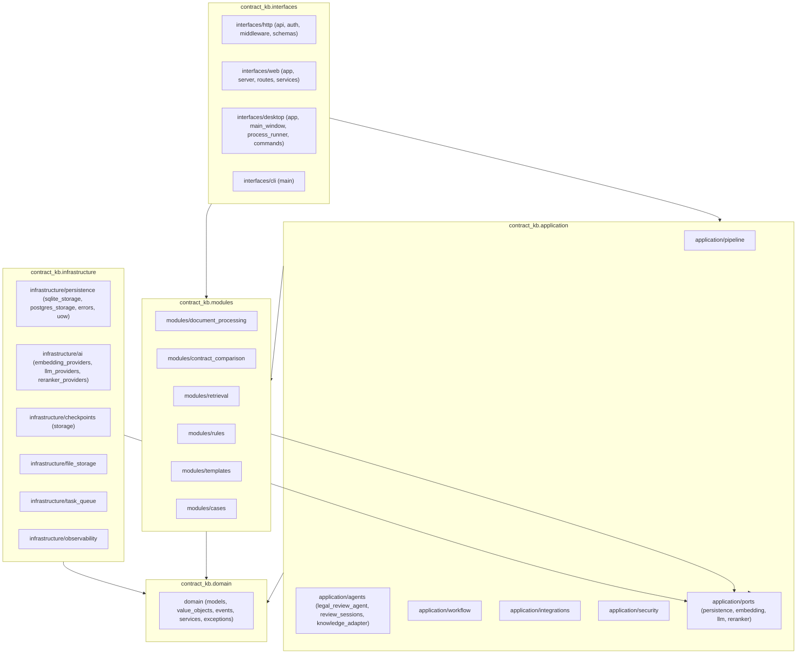

# 02 — Python 模块导入依赖图与循环依赖分析（Phase 15-A）

## 1. 重构前包级与模块级依赖现状

通过 `scripts/audit_architecture.py` 对全仓 `271` 个 Python 文件进行 AST 静态分析：

- **内部模块依赖边总数**：`498` 条
- **深层相对导入（`level >= 3`）**：`0` 处（现有子包主要采用 1~2 级相对导入或 `contract_kb.*` 绝对导入）
- **双向模块依赖（循环依赖 SCC）**：`1` 处
  - `contract_kb.api <-> contract_kb.auth`
  - **成因分析**：`contract_kb/api.py` 顶层导入 `from .auth import TrustedHeaderAuth, authorize, ...`；而 `contract_kb/auth.py` 在 `TrustedHeaderAuth.authenticate()` 方法内执行 `import contract_kb.api as api_mod; st = getattr(api_mod, "get_storage", lambda: None)()`。
  - **解耦方案**：在 `TrustedHeaderAuth.__init__` 中支持传入 `storage` 实例或可调用工厂 `Callable[[], Any]`，由 `api.py` 注入 `storage=lambda: get_storage()`，彻底消除 `auth -> api` 的反向模块导入。

## 2. 模块导入副作用审计

| 文件路径 | 导入期行为 | 风险评估与处置 |
|---|---|---|
| `contract_kb/api.py` | 创建 `FastAPI` 实例并挂载 `shared_router` 与异常处理器（无数据库连接、无网络请求、无线程启动） | 安全（标准 ASGI App 声明，`get_storage()` 惰性初始化） |
| `contract_kb/distill.py` | 顶层调用 `_TPL_LEAF_MAP = get_template_leaf_map()`（纯内存字典计算，无磁盘/网络 I/O） | 安全 |
| `build_doc.py` | 顶层直接 `open(r"d:\Users\Administrator\Desktop\AI合同_RAG切分与召回策略.md")` 读取宿主机文件并启动 `HTTPServer` | **高危副作用**：迁入 `tools/reports/build_doc.py` 并封装至 `main()` |
| `tools/check_db_tables.py` 等诊断脚本 | 顶层直接连接数据库执行查询 | 归入 `tools/diagnostics/`，不参与 `contract_kb` 包导入 |

## 3. 核心模块重构前依赖关系图（Mermaid）

```mermaid
flowchart TD
    subgraph Interfaces["Interfaces (散落于根目录与 tools/)"]
        API["contract_kb/api.py"]
        AUTH["contract_kb/auth.py"]
        CLI["contract_kb/cli.py"]
        WEB["tools/contract_diff_web.py"]
        GUI["start_gui.py"]
    end

    subgraph FlatRoot["contract_kb/ 根目录遗留核心模块"]
        RE["review_engine.py"]
        LA["legal_agent.py"]
        LAKB["legal_agent_kb.py"]
        AQM["agent_queue_manager.py"]
        AC["agent_checkpoint.py"]
        FD["full_diff.py"]
        CD["clause_diff.py"]
        TA["table_aligner.py"]
        FA["format_auditor.py"]
        ING["ingest.py"]
        DP["document_parser.py"]
        DXP["docx_parser.py"]
        CE["clause_extractor.py"]
        CLS["classifier.py"]
        RUL["rule_engine.py"]
        LLM["llm_review.py"]
        EMB["embeddings*.py"]
        ST["storage.py / storage_pg.py"]
    end

    subgraph ExistingDDD["已建 DDD 子包"]
        PIPE["application/pipeline/*"]
        WF["application/workflow/*"]
        RET["modules/retrieval/*"]
        DOM["domain/models/*"]
    end

    API <--> AUTH
    API --> RE
    API --> ST
    CLI --> ING
    CLI --> ST
    WEB --> FD
    WEB --> AQM
    WEB --> LAKB
    WEB --> ING
    WEB --> ST
    AQM --> LA
    AQM --> AC
    LA --> LAKB
    LA --> LLM
    LA --> WF
    FD --> CD
    FD --> TA
    FD --> ING
    ING --> DP
    ING --> DXP
    ING --> CE
    ING --> CLS
    PIPE --> RUL
    PIPE --> LLM
    PIPE --> FA
    PIPE --> RET
    ST --> EMB
    ST --> DOM
```

## 4. 重构后目标分层依赖图（Mermaid）

