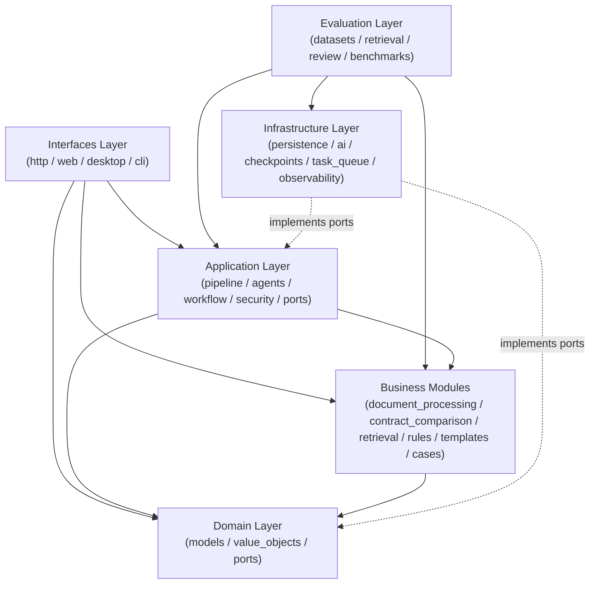

# 05 — 依赖方向策略与架构决策记录（Dependency Direction Policy & ADRs）

## 1. 分层依赖方向策略

系统严格遵循单向依赖与依赖倒置原则（Dependency Inversion Principle）：

### 1.1 硬性禁止的反向依赖（由 `tests/architecture/` 强制阻断）

| 源层级 (Source Layer) | 严禁依赖的目标 (Forbidden Targets) | 自动化守卫测试 |
|---|---|---|
| `contract_kb/domain/**` | `application`、`modules`、`infrastructure`、`interfaces`、`evaluation`、`tools`、`tests`、`fastapi`、`psycopg2` | `test_domain_layer_has_no_outward_dependencies` |
| `contract_kb/application/**` | `interfaces`（Web/HTTP/Desktop/CLI）、`evaluation`、`tools`、`tests` | `test_application_layer_does_not_depend_on_interfaces_or_tools` |
| `contract_kb/modules/**` | `interfaces`、`evaluation`、`tools`、`tests` | `test_business_modules_do_not_depend_on_interfaces_or_tools` |
| `contract_kb/**`（除 `evaluation/` 外） | `contract_kb.evaluation`、`tools`、`tests` | `test_production_modules_never_import_tests_tools_or_evaluation` |
| `contract_kb/**` 全部模块 | 任何模块级或包级循环导入（SCC > 1） | `test_zero_import_cycles_in_contract_kb` |
| `contract_kb/**` 全部模块 | 深度 ≥ 4 的相对导入（`from ....`） | `test_no_deep_relative_imports` |

---

## 2. 关键架构决策记录（ADRs）

### ADR-1501：保留 `contract_kb/` 平铺包根布局，不强制迁移 `src/` 布局

- **背景**：当前工程构建脚本、CI 工作流（`.github/workflows/ci.yml`）、Windows 启动批处理（`start_gui.bat`）与开发者本地命令大量使用 `python -m contract_kb.cli` 和 `uvicorn contract_kb.api:app`。
- **决策**：保留仓库根目录下的 `contract_kb/` 包布局，并在 `pyproject.toml` 中通过 `[tool.setuptools.packages.find]` 与 `[tool.setuptools.package-data]` 精确声明包与静态资源；同时通过构建 Wheel 并在非仓库目录下执行干净虚拟环境安装测试来防止隐式 CWD 依赖。
- **收益**：100% 兼容既有脚本与開發习惯，同时具备与 `src/` 布局等价的打包隔离验证能力。

### ADR-1502：采用“规范实现模块 + 根目录轻量兼容门面”平滑演进策略

- **背景**：外部脚本、测试套件与用户命令广泛引用 `contract_kb.storage`、`contract_kb.storage_pg`、`contract_kb.legal_agent`、`contract_kb.full_diff`、`contract_kb.review_engine`、`contract_kb.cli`、`contract_kb.api`。
- **决策**：
  1. 将完整业务实现迁入分层子包（如 `contract_kb/infrastructure/persistence/sqlite_storage.py`）；
  2. 在原路径保留仅含重导出语句的薄兼容门面（Compatibility Facade，25–45 行），保证 `from contract_kb.storage import Storage` 与 `from contract_kb.infrastructure.persistence.sqlite_storage import Storage` 指向内存中**同一个类对象（`is` 恒等）**。
- **收益**：彻底消除双份实现分叉风险，同时保证外部调用方零破坏。

### ADR-1503：解除 `api.py <-> auth.py` 循环依赖与 `domain -> application` 反向依赖

- **背景**：
  1. 基线审计发现 `contract_kb/api.py` 导入 `contract_kb/auth.py`，而 `TrustedHeaderAuth.authenticate` 在函数内静态 `import contract_kb.api` 以获取 `get_storage()`，形成双向依赖环；
  2. `contract_kb/domain/models/review.py` 在 `PipelineContext.get_deadline()` 中导入了 `contract_kb.application.pipeline.deadline`。
- **决策**：
  1. 将 `auth.py` 迁入 `contract_kb/interfaces/http/auth.py`，使 `TrustedHeaderAuth` 支持注入可调用的 `storage=lambda: get_storage()`，并在未显式注入时通过 `sys.modules.get("contract_kb.api")` 动态回退，消除静态循环导入；
  2. 将纯标准库实现的 `ExecutionDeadline` 与 `CancelToken` 下沉至领域值对象 `contract_kb/domain/value_objects/deadline.py`，并在 `application/pipeline/deadline.py` 中重导出。
- **收益**：`contract_kb` 包内循环依赖数从 `1` 降至 **`0`**，`domain` 层恢复 100% 零外向依赖。
