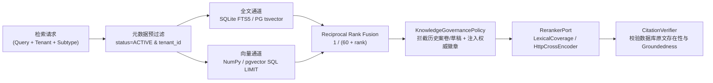
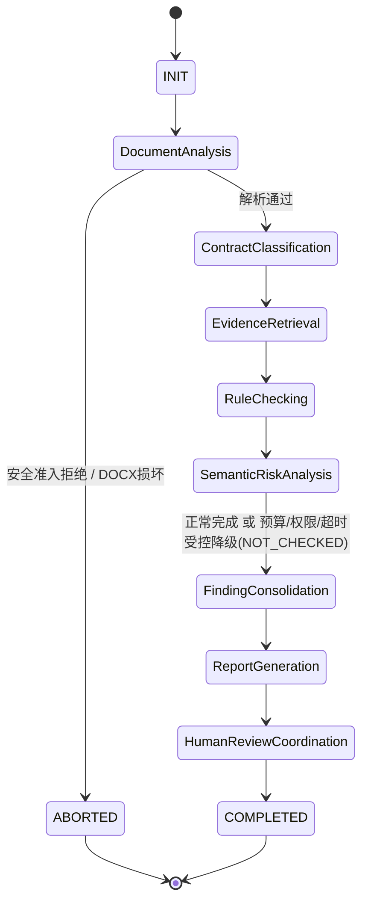

# 知识治理、混合检索与受控智能体架构（RAG & Controlled Agent Architecture）

## 1. 知识源权威分级与隔离（Knowledge Source Governance）

为彻底消除“历史问题合同污染标准审核”与“过期/草稿模板被召回”两类企业级合规风险，[`KnowledgeGovernancePolicy`](file:///d:/Users/Administrator/Desktop/AI合同/contract_kb/modules/retrieval/governance.py) 强制建立四级知识源信任矩阵：

| 知识源类型 (`KnowledgeSourceType`) | 权威等级 (`authority_rank`) | 可驱动强制违规结论 | 检索准入条件 | Prompt 隔离标识 |
| :--- | :---: | :---: | :--- | :--- |
| `APPROVED_RULE` | 1（最高） | **是** | `status='ACTIVE'` 且 `approved_status='APPROVED'` 且同租户 | `[企业已审批强制规则-权威依据]` |
| `TEMPLATE` | 2 | **是** | `status='ACTIVE'` 且非 `DRAFT/REJECTED` 且同租户 | `[企业现行标准模板条款-权威基准]` |
| `LEGAL_REFERENCE` | 3 | 否（辅助说明） | `status='ACTIVE'` 且 `approved_status='APPROVED'` | `[外部法规参考-辅助说明]` |
| `HISTORICAL_CASE` | 4 | **严禁（仅参考）** | 默认从标准审核通道物理隔离；仅显式开启历史参考时单独召回 | `[历史合同先例-仅供参考，严禁作为强制违规标准]` |

---

## 2. 混合检索、RRF 融合与双重引文核验

- **RRF 无量纲融合**：[`reciprocal_rank_fusion()`](file:///d:/Users/Administrator/Desktop/AI合同/contract_kb/modules/retrieval/reranker.py) 对全文与向量双路召回按 $score(d) = \sum_{c} \frac{1}{60 + rank_c(d)}$ 融合，避免余弦相似度与 BM25/FTS 分数直接线性相加的量纲失真。
- **可插拔重排序端口（[`RerankerPort`](file:///d:/Users/Administrator/Desktop/AI合同/contract_kb/modules/retrieval/reranker.py)）**：默认采用零外发离线 [`LexicalCoverageReranker`](file:///d:/Users/Administrator/Desktop/AI合同/contract_kb/modules/retrieval/reranker.py)（字符二元覆盖 + 金额比例数字锚点 + 权威等级加权）；生产内网可无缝注入 [`HttpCrossEncoderReranker`](file:///d:/Users/Administrator/Desktop/AI合同/contract_kb/modules/retrieval/reranker.py)（对非本机地址强制执行 `ALLOW_EXTERNAL_LLM=1` 出境门禁，超时自动降级至离线重排）。
- **引文真实性与依据度核验（[`CitationVerifier`](file:///d:/Users/Administrator/Desktop/AI合同/contract_kb/modules/retrieval/citation.py)）**：逐条反查数据库 `clauses` 表验证 `CitationCorrectness` 与 `AnswerGroundedness`。

---

## 3. 一次性加密 Nonce 防提示词注入信封

针对静态定界符（如 `<<<END_CONTRACT_DATA>>>`）可能被攻击者在恶意合同正文中提前伪造闭合的威胁，[`build_prompt()`](file:///d:/Users/Administrator/Desktop/AI合同/contract_kb/llm_review.py) 实施双层纵深隔离：
1. **静态与变体标签预清洗**：[`sanitize_untrusted_contract_text()`](file:///d:/Users/Administrator/Desktop/AI合同/contract_kb/llm_review.py) 将待审正文内所有 `<<<CONTRACT_DATA_UNTRUSTED>>>`、`<<<END_CONTRACT_DATA>>>` 及大小写/空白变形的 `</?UNTRUSTED_CONTRACT_BODY...>` 一律转义为安全占位文本。
2. **每次调用随机加密 Nonce 信封**：使用 `secrets.token_hex(12)` 生成 96-bit 不可预测随机令牌，将待审正文封装在 `<UNTRUSTED_CONTRACT_BODY nonce="{call_nonce}"> ... </UNTRUSTED_CONTRACT_BODY nonce="{call_nonce}">` 内，并在系统指令中声明仅将该特定 `nonce` 内部视为被动受审客体。

---

## 4. 受控智能体 8 状态机工作流（Controlled Agent Workflow）

本系统**严禁采用无边界自治循环（Unbounded ReAct / Free-form Autonomous Loop）**处理企业法律合同，统一采用确定性有向状态机 [`ControlledReviewAgentWorkflow`](file:///d:/Users/Administrator/Desktop/AI合同/contract_kb/application/workflow/state_machine.py)：

### 工具安全与预算护栏（[`ControlledToolExecutor`](file:///d:/Users/Administrator/Desktop/AI合同/contract_kb/application/workflow/tool_executor.py)）
- **强类型契约**：所有 8 个受控工具均具备独立的 Pydantic 输入与输出 Schema，参数畸变立即拦截并记录 `VALIDATION_ERROR`。
- **最小权限控制（`ToolPermission`）**：细分为 `READ_DOCUMENT`、`READ_KNOWLEDGE`、`EXECUTE_RULES`、`INVOKE_LLM`、`WRITE_REPORT`；剥夺 `INVOKE_LLM` 权限时，工作流零外部调用，自动记录 `PERMISSION_DENIED` 审计并降级输出 `NOT_CHECKED`，全部确定性规则结论 100% 正常生成。
- **硬性资源与成本账本（[`WorkflowBudget`](file:///d:/Users/Administrator/Desktop/AI合同/contract_kb/application/workflow/tool_executor.py)）**：强制使用 `Decimal` 核算成本上限（禁止 `float`），限制全局工具调用总次数、单工具最大调用次数、单工具超时（线程级超时中断）、最大 Token 消耗与墙钟总时长。

---

## 5. 评测证据分层诚实性准则（Evaluation Honesty）

[`contract_kb/evaluate.py`](file:///d:/Users/Administrator/Desktop/AI合同/contract_kb/evaluate.py) 强制通过 [`determine_evaluation_tier()`](file:///d:/Users/Administrator/Desktop/AI合同/contract_kb/evaluate.py) 自动识别并在 JSON 与 Markdown 报告顶部披露评测层级：
- `SYNTHETIC_UNIT_REGRESSION`：合成变异合同 + `local_hash_256` 离线哈希嵌入（仅用于 CI 确定性管线回归，**严禁对外宣称为真实法律语义模型准确率**）；
- `DESENSITIZED_TEMPLATE_BENCHMARK`：企业脱敏模板语料 + 真实语义 Embedding 模型；
- `REAL_MODEL_END_TO_END`：真实语义 Embedding + 授权生产 LLM 端到端评测。
