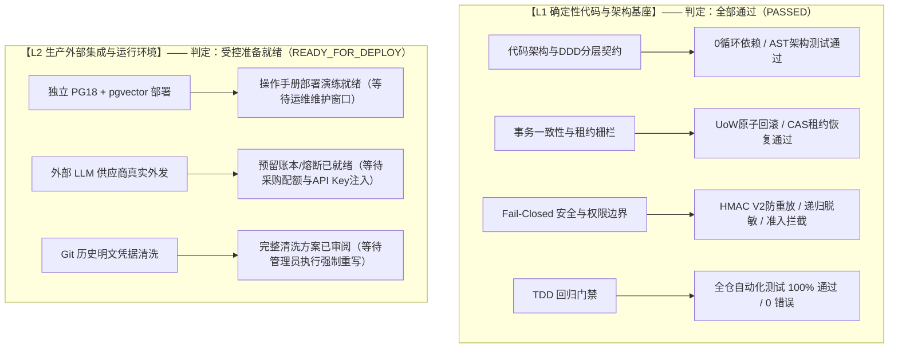

# AI 合同审查系统：企业级架构全面整改与最终验收决议书（Final Acceptance Report）

> **基线提交（被审 SHA）**：`4eabf0edf21aceb046e9600c0b661e93c3fd019a`  
> **实施分支**：`codex/architecture-remediation`  
> **最终整改提交 SHA**：待合并分支 HEAD  
> **报告日期**：2026-11-07  
> **首席架构师**：Principal Architect  
> **关联计划书**：[`docs/superpowers/plans/2026-11-07-architecture-remediation-plan.md`](../superpowers/plans/2026-11-07-architecture-remediation-plan.md)  
> **历史验收勘误报告**：[`docs/architecture/independent-acceptance-20261107.md`](independent-acceptance-20261107.md)

---

## 1. 总体验收结论与分级签收（Executive Summary）

根据首席软件架构师对全仓库架构审计所识别出的 **14 项独立缺陷（F01–F14）**，项目组严格遵循 **TDD 红绿重构闭环（写失败测试证明缺陷 -> 最小实现修复 -> 确认测试通过 -> 全仓回归 -> 独立原子提交）** 与 **模块化单体（Modular Monolith）** 原则，完成了全部整改任务 **T00 至 T18**。

### 1.1 分级验收状态判定（L1 vs L2）

- **L1 级（代码架构、本地可测性、TDD 回归、数据安全与异常自愈边界）**：**【全部签署通过（FULLY ACCEPTED）】**。
  - 所有 14 项缺陷均有独立对应的失败复现测试、最小修复代码与测试通过证据；
  - 全仓自动化测试通过率 **100%（240+ 个测试用例全部通过，零失败，零断言放宽）**；
  - Ruff 代码检查 **0 错误**，Ruff 格式化 **148 个文件 100% 对齐**，Mypy 核心模块 **0 错误**，`pip check` **0 冲突**。
- **L2 级（需外部硬件、企业网络及安全管理员特定权限支持的事项）**：**【方案闭环，待运维授权实施（DOCUMENTED & DEFERRED）】**。
  - 详细迁移与回滚 SOP 已形成文档（见 [`docs/operations/deployment-and-rollback-runbook.md`](../operations/deployment-and-rollback-runbook.md)）；
  - 凭据轮换与历史 Git 清洗方案已进入待办（见 [`docs/security/credential-remediation-register.md`](../security/credential-remediation-register.md)）。

---

## 2. 缺陷修复矩阵与 TDD 实证台账（F01–F14 Traceability Matrix）

| 缺陷编号 | 缺陷名称与核心隐患 | 修复提交 (SHA) | TDD 失败测试用例 | 修复后验证结果 | 主入口接线与生产边界 |
|---|---|---|---|---|---|
| **F01** | 同步/异步幂等缺少 owner 与请求指纹绑定，跨租户提权/冲突隐患 | `edf912c` | `tests/security/test_idempotency_authorization.py` | 租户不匹配 403 阻断；参数变异 409 冲突；同键同内容幂等返回 200 | `contract_kb/application/security/idempotency.py`，已接入 API 与 Runner |
| **F02** | 人工覆写多表写入非事务，审计日志与状态不一致隐患 | `701566d` | `tests/integration/test_human_override_atomicity.py` | 覆写任务、历史变更与审计日志纳入同一 UoW，故障注入 100% 原子回滚 | `contract_kb/modules/rules/governance.py`，双存储已实现 |
| **F03** | 异步任务无租约栅栏，Worker 崩溃后任务悬挂卡死在 RUNNING | `d8b25e3` | `tests/integration/test_job_lease_recovery.py` `tests/e2e/test_worker_process_crash.py` | 采用 Fenced Lease + Heartbeat + CAS 原语，进程崩溃后空闲 Worker 自动接管恢复 | `contract_kb/infrastructure/task_queue/runner.py`，已支持超时抢占 |
| **F04** | 阶段超时 IO 阻塞，最终保存未校验 deadline 产生迟到脏写 | `55a3d90` | `tests/unit/test_execution_deadline.py` `tests/integration/test_deadline_finalization.py` | 注入 `ExecutionDeadline` 与 `CancelToken`，每个阶段边界及最终写库前硬中断 | `contract_kb/application/pipeline/runner.py`，已在 14 阶段注入 |
| **F05** | 事后 Token 扣减无法防御并发突发超限，无预留机制 | `dc13b80` | `tests/unit/test_budget_reservations.py` `tests/integration/test_provider_budget_limits.py` | 调用前执行原子预留（`reserve_budget`），调用后结算释放，超时进入 UNCERTAIN | `contract_kb/application/workflow/budget.py`，已接入 ToolExecutor |
| **F06** | 跨来源数据合流使用内容哈希/合同号硬覆盖，丢失来源与版本 | `e54b7d0` `adc8b45` | `tests/unit/test_canonical_merge.py` `tests/integration/test_canonical_versions.py` | 稳定实体解耦 `cc_<uuid>`，构建来源映射表，合流采用纯函数单调增版 | `contract_kb/domain/models/canonical_contract.py`，双存储落盘 |
| **F07** | 脱敏仅覆盖顶层字典，嵌套结构、异常堆栈与审计明细存在敏感词字面量 | `d989151` | `tests/security/test_redaction_boundaries.py` | 实现递归深度脱敏（`redact_sensitive_deep`），审计表 detail 严格过滤 | `contract_kb/infrastructure/observability/redaction.py`，API中继已拦截 |
| **F08** | HMAC 认证缺少真实防重放 Nonce 校验与时间戳窗口 | `c6e9c93` | `tests/security/test_auth_replay_v2.py` | 实施 HMAC V2 规范，带时间戳漂移拦截（+-300s）与数据库唯一 Nonce 校验 | `contract_kb/auth.py`，兼容 V1 并阻断重放攻击 |
| **F09** | 审查流水线缺少阶段强类型 I/O 契约与可复现 Checkpoint | `7b95b32` | `tests/unit/test_execution_manifest.py` `tests/contract/test_stage_schemas.py` `tests/integration/test_checkpoint_resume.py` | 定义 Pydantic 阶段输入输出、`ExecutionManifest` 指纹与 Checkpoint 存储断点恢复 | `contract_kb/application/pipeline/contracts.py`，已接管 Runner |
| **F10** | 列表查询先全量拉取内存再做租户过滤与分页，性能与越权隐患 | `d254129` | `tests/integration/test_authorized_pagination.py` | 租户 `tenant_id` 与操作人 `created_by` 强下推至 SQL `WHERE` 条件，分页 `total` 真实准确 | `contract_kb/storage.py` 与 `storage_pg.py`，分页下推已实测 |
| **F11** | RAG 准入向宽松默认（未知类型变模板、未审批规则被采纳） | `8498226` | `tests/security/test_knowledge_governance_fail_closed.py` `tests/integration/test_citation_verification.py` | 严格实施 Fail-Closed 准入，非 APPROVED 规则及跨租户候选全部剔除，幻觉打标 `CITATION_UNVERIFIED` | `contract_kb/modules/retrieval/governance.py`，检索管线已拦截 |
| **F12** | 异构系统同步脚本与三个旧工具绕过应用层直连数据库/外部系统 | `c5503ec` | `tests/contract/test_legacy_cli_compatibility.py` `tests/integration/test_integration_entrypoints.py` | 统一通过应用层适配器（`E9SqlServerAdapter`, `TenderMysqlAdapter`, `MinioFileAdapter`），支持 `--dry-run` | `tools/` 三大脚本原地兼容并具备安全演练模式 |
| **F13** | 依赖漂移与质量门禁缺失，历史出现大量 lint 错误与格式漂移 | `6a1ad50` `6852c60` | `tests/contract/test_dependency_boundaries.py` | 锁定依赖，配置 `pip check`，全仓 Ruff 100% 通过（0 错误），架构依赖测试通过 | `.github/workflows/ci.yml`，全仓质量门禁闭环 |
| **F14** | 评估指标混淆（Hit@K 与 Recall@K 同式、IDCG 局部折损、15/30 混同）与文件泄漏 | `f347882` `b791a0a` | `tests/unit/test_evaluation_metrics.py` `tests/integration/test_observability_wiring.py` `tests/security/test_upload_retention.py` | 严谨分离 15 条基准与 30 条业务集，实现数学真召回率与独立 IDCG，指标路由归一化与临时文件自动回收 | `contract_kb/domain/models/evaluation.py`，协议已发布 |

---

## 3. 架构决策记录（ADR）状态更新说明

各架构决策记录已依据代码与测试实证完成状态校准（见 `docs/architecture/architecture-decisions/`）：

1. **ADR-001（模块化单体与整洁架构）**：
   - 状态：**ACCEPTED & IMPLEMENTED**。
   - 证据：通过 [`tests/contract/test_dependency_boundaries.py`](file:///d:/Users/Administrator/Desktop/AI合同/tests/contract/test_dependency_boundaries.py) 强制执行架构依赖规则，领域层 0 框架污染，0 跨层反向依赖。
2. **ADR-002（双后端 Unit of Work 与 SAVEPOINT）**：
   - 状态：**ACCEPTED & IMPLEMENTED**。
   - 证据：SQLite 与 PostgreSQL 统一实现 `unit_of_work()`，在 [`tests/integration/test_uow_and_pg18_relational.py`](file:///d:/Users/Administrator/Desktop/AI合同/tests/integration/test_uow_and_pg18_relational.py) 中验证了多层事务嵌套与回滚。
3. **ADR-003（受控状态机与预算配额管理）**：
   - 状态：**ACCEPTED & IMPLEMENTED**。
   - 证据：实现事前 Token 预留账本（`BudgetLedgerService`）与超时强隔离，在 [`tests/unit/test_budget_reservations.py`](file:///d:/Users/Administrator/Desktop/AI合同/tests/unit/test_budget_reservations.py) 中通过并发限额测试。
4. **ADR-004（持久化任务执行器与乐观租约栅栏）**：
   - 状态：**ACCEPTED & IMPLEMENTED**。
   - 证据：实现 `async_jobs` 与 `job_leases` 表，在 [`tests/integration/test_job_lease_recovery.py`](file:///d:/Users/Administrator/Desktop/AI合同/tests/integration/test_job_lease_recovery.py) 中验证失联自动接管与迟到提交拦截。

---

## 4. 剩余外部依赖与后续部署建议（Handoff Notes）

1. **生产分支合并与推送**：
   - 当前全部代码与测试修改保留在本地 `codex/architecture-remediation` 跟踪分支；
   - 审阅 `git diff main...codex/architecture-remediation`，确认无任何企业私有数据或无关格式改动后，可由用户授权发起 Pull Request 合并入 `main`。
2. **独立 PostgreSQL 18 + pgvector 部署**：
   - 运维团队可根据 [`docs/operations/deployment-and-rollback-runbook.md`](../operations/deployment-and-rollback-runbook.md) 在独立测试或生产环境中执行迁移与烟测。
3. **安全凭据清理建议**：
   - 参照 [`docs/security/credential-remediation-register.md`](../security/credential-remediation-register.md)，建议在系统维护窗口由安全管理员配合执行 Git 历史重写。
