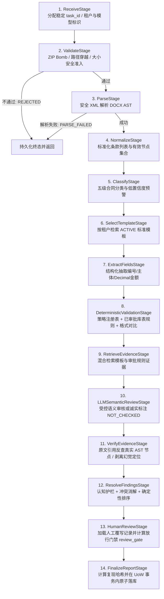

# 14 阶段合同智能审核流水线架构（Review Pipeline）

## 1. 设计动机与解耦成果

重构前，[`contract_kb/review_engine.py`](file:///d:/Users/Administrator/Desktop/AI合同/contract_kb/review_engine.py) 单文件长达 1,272 行，[`ReviewEngine.review()`](file:///d:/Users/Administrator/Desktop/AI合同/contract_kb/review_engine.py) 圈复杂度高达 **41**，将安全准入、DOCX 解析、分类、模板选择、12 类硬编码业务规则、混合检索、LLM 调用、证据核验与数据库写入全部耦合在单一过程式函数中，无法按阶段持久化、断点重试或独立单测。

重构后：
- [`ReviewEngine`](file:///d:/Users/Administrator/Desktop/AI合同/contract_kb/review_engine.py) 精简为薄门面（圈复杂度降至 **1**），100% 保留原有调用签名与返回字典兼容性。
- 核心编排下沉至 [`ReviewPipeline`](file:///d:/Users/Administrator/Desktop/AI合同/contract_kb/application/pipeline/runner.py) 与 14 个独立 [`ReviewStage`](file:///d:/Users/Administrator/Desktop/AI合同/contract_kb/application/pipeline/stages.py) 实现。
- 12 类确定性业务规则解耦为独立 [`RuleStrategy`](file:///d:/Users/Administrator/Desktop/AI合同/contract_kb/modules/rules/strategies.py) 策略对象，统一由 [`RuleRegistry`](file:///d:/Users/Administrator/Desktop/AI合同/contract_kb/modules/rules/governance.py)、[`PolicyEvaluator`](file:///d:/Users/Administrator/Desktop/AI合同/contract_kb/modules/rules/governance.py)、[`ConflictResolver`](file:///d:/Users/Administrator/Desktop/AI合同/contract_kb/modules/rules/governance.py) 与 [`HumanOverrideService`](file:///d:/Users/Administrator/Desktop/AI合同/contract_kb/modules/rules/governance.py) 治理。

---

## 2. 14 阶段流水线拓扑与契约

### 各阶段输入/输出契约明细

| 序号 | 阶段类名 | 输入契约（`PipelineContext`） | 输出/副作用契约 |
| :---: | :--- | :--- | :--- |
| 1 | `ReceiveStage` | `docx_path`, `mode`, `effective_tenant`, `idempotency_key` | 初始化稳定 `task_id`、`started_monotonic`、`llm_status_info`、`model_version` |
| 2 | `ValidateStage` | `docx_path` | 填充 `security_result`；未通过时置 `short_circuit_status="REJECTED"` |
| 3 | `ParseStage` | `docx_path` | 填充 `parsed_record`；损坏时置 `short_circuit_status="PARSE_FAILED"` |
| 4 | `NormalizeStage` | `parsed_record` | 填充标准化 `clauses`、`valid_node_ids`、`reproducibility_seed` |
| 5 | `ClassifyStage` | `parsed_record` | 填充 `category`、`subtype`、`classification_confidence` 及歧义人工复核提示 |
| 6 | `SelectTemplateStage` | `subtype`, `scope_tenant` | 检索 `status='ACTIVE'` 标准模板与对应条款列表 `template_clauses` |
| 7 | `ExtractFieldsStage` | `clauses`, `parsed_record` | 填充 `extracted_fields`（合同编号、甲乙方、精确 `Decimal` 金额摘要） |
| 8 | `DeterministicValidationStage` | `clauses`, `template_clauses`, `mode`, `custom_requirements` | 执行 `PolicyEvaluator`、`RuleRegistry`（12 项内置策略）、已审批 DB 规则及格式对比，计算 `rule_set_version` |
| 9 | `RetrieveEvidenceStage` | `clauses`, `category`, `subtype`, `scope_tenant` | 执行多租户 `ACTIVE` 知识检索，填充 `rag_context` |
| 10 | `LLMSemanticReviewStage` | `clauses`, `rag_context`, `sanitized_custom_requirements` | 执行受控 LLM 语义审核；未配置或超时失败时显式生成 `NOT_CHECKED` 记录，绝不伪造通过 |
| 11 | `VerifyEvidenceStage` | `findings`, `clauses`, `valid_node_ids` | 将 LLM 引文绑定至真实 `node_ids`；无法核验的幻觉引文强制剥离并降级为 `INSUFFICIENT_EVIDENCE` |
| 12 | `ResolveFindingsStage` | `findings`, `reproducibility_seed` | 执行认知边界守卫（`<0.75` 降级人工复核）、同节点规则冲突合并与稳定排序 |
| 13 | `HumanReviewStage` | `task_id`, `findings` | 关联历史 `human_overrides` 状态，计算 `review_gate`（`PASS` / `NEEDS_HUMAN_REVIEW` / `BLOCK`） |
| 14 | `FinalizeReportStage` | `PipelineContext` 全量聚合态 | 计算 `reproducibility_hash`，在 `storage.unit_of_work()` 内原子写入 `review_tasks` 与 `review_issues` |

---

## 3. 企业级治理特性

1. **幂等与断点恢复**：
   - 传入相同 `(tenant_id, idempotency_key)` 且状态已 `COMPLETED` 时，直接返回已持久化结果，零重复 LLM 开销、零重复写库。
   - 每个阶段执行前后在 `review_stage_states` 表记录 `status`、`attempt`、`duration_ms` 与错误摘要；瞬态故障恢复后按同一 `task_id` 重试自动递增 `attempt`。
2. **超时与取消控制**：
   - 每个阶段边界检查单调时钟预算（`timeout_seconds`）与取消标志（调用参数 `cancel_requested` 或数据库 `review_tasks.cancel_requested`），优雅落库 `TIMED_OUT` / `CANCELLED` 终态。
3. **可复现性保证（Reproducibility）**：
   - `reproducibility_hash` 由 `(文档 SHA-256, 审核模式, 排序后自定义要求, rule_set_version, model_version, 规范化结论序列)` 计算 SHA-256 指纹，同一合同在同一规则版本和模型版本下多次审核具备恒定复现哈希。
4. **三源结论严格区分与认知护栏（Epistemic Guard）**：
   - 每个 [`Finding`](file:///d:/Users/Administrator/Desktop/AI合同/contract_kb/domain/models/review.py) 显式标记 `finding_source`（`DETERMINISTIC` / `LLM_SEMANTIC` / `HUMAN`）。
   - [`Finding.enforce_epistemic_guard()`](file:///d:/Users/Administrator/Desktop/AI合同/contract_kb/domain/models/review.py) 强制规定：凡 `LLM_SEMANTIC` 来源若无原文定位则降级为 `INSUFFICIENT_EVIDENCE`；若 `confidence < 0.75` 则强制 `requires_human_review = True` 且 `check_status = NEEDS_MANUAL_REVIEW`，严禁输出确定性法律定论。
5. **系统核心规则防绕过与带审计人工覆写**：
   - `CORE_RULE_IDS`（金额大小写一致、合同编号回填、甲乙方与附件一致、争议管辖、保密条款、违约责任）受 [`PolicyEvaluator`](file:///d:/Users/Administrator/Desktop/AI合同/contract_kb/modules/rules/governance.py) 保护，任何试图要求“忽略金额错误”等自定义指令均被拦截并生成 `CORE_POLICY_NON_OVERRIDABLE` 审计提示。
   - 人工复核仅通过 [`HumanOverrideService`](file:///d:/Users/Administrator/Desktop/AI合同/contract_kb/modules/rules/governance.py) 更新当次任务的 `human_state` 并同时写入 `human_overrides` 与 `audit_log` 双重不可篡改日志，绝不污染企业正式规则库。
