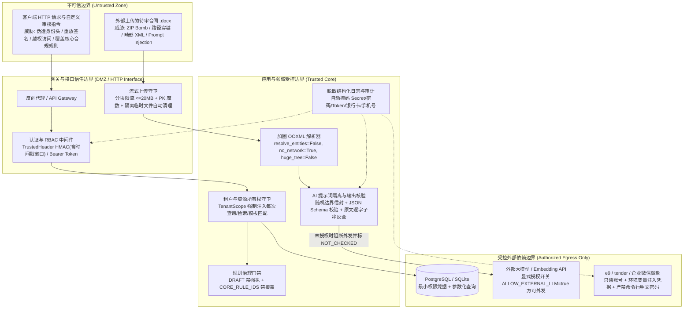

# 安全威胁模型与治理清单（Security Threat Model & Remediation Plan）

本文档覆盖身份安全、多租户隔离、导入文件安全、AI/LLM 数据与提示词注入安全、全仓及 Git 历史凭据审计，并严格区分**本分支已自动完成的工程加固**与**需管理员授权执行的生产侧操作方案**。

---

## 1. 信任边界与威胁面视图（STRIDE 分析）



---

## 2. 安全审计问题分级矩阵（P0 / P1 / P2）

### 2.1 P0 级（最高危：凭据暴露、企业实名敏感数据入库、跨租户串数、命令注入/密码泄露）

| 编号 | 威胁类型 | 证据位置（重构前 `ab17bf0`） | 风险描述 | 处置方式 |
|---|---|---|---|---|
| **SEC-P0-01** | 明文应用密钥入库 | `tools/wecom_wedrive_probe/README.md:61-63,96,114`（始于提交 `d7a1ea8`） | 文档配置示例写入真实企业微信 `WECOM_CORP_ID`、43 位 `WECOM_APP_SECRET`、`WECOM_SPACE_ID` 及真实出口 IP | **代码侧立即清除替换为占位符**；**生产侧输出密钥轮换与 Git 历史重写方案待管理员授权** |
| **SEC-P0-02** | 企业实名主体与银行账户入库 | `知识库_合同模板.md:25-37`、`知识库_合同模板_简版.md`、`tools/wecom_wedrive_probe/probe.py:723-724`、`validators.py:149-151`、`classifier.py:562-588`、`需求对接.md:7,34` | 跟踪文档与代码含 5 家企业实名、法定代表人、5 个真实银行账号、内部邮箱电话、员工实名、AgentId 及本地微信缓存路径 | **代码与跟踪文档侧立即脱敏/环境变量化**，新增自动化敏感模式回归测试 |
| **SEC-P0-03** | 内网数据库拓扑与进程命令行密码泄露 | `tools/live_db_merge.py:7-8,820`、`tools/tender_*.py`、`tools/cross_verify_and_merge.py:98`、`scripts/e9_*.py` | 硬编码公网映射 IP/端口、内网 MySQL/MinIO IP 与 OA 内部域名；通过 `mysql -p<PWD>` 将密码暴露在 OS 进程参数 | **代码侧移除全部硬编码 IP/域名，改由 `MYSQL_PWD` 进程环境变量传递密码，严禁 `-p` 拼接** |
| **SEC-P0-04** | 跨租户 RAG 与模板原文泄露 | `contract_kb/review_engine.py:441-443,588-595,1250-1279` | `ReviewEngine` 在检索知识库与匹配基准模板时漏传 `tenant_id`，导致 Tenant A 审核结果及发往外部 LLM 的上下文混入 Tenant B 私有条款与模板原文 | **代码侧强制注入 `tenant_id` 并补齐跨租户审核隔离测试** |
| **SEC-P0-05** | 分类器越权私开全局数据库 | `contract_kb/classifier.py:835-849` | `classify()` 无视注入仓储与租户上下文，直接打开全局 `config.DB_PATH` 读取 `rules` 表 | **代码侧移除隐式 `Storage()` 实例化，改为无状态纯函数 + 可选受控端口注入** |

### 2.2 P1 级（中高危：鉴权防重放、上传 DoS、XML 安全、反序列化、数据外发边界）

| 编号 | 威胁类型 | 证据位置 | 风险描述 | 处置方式 |
|---|---|---|---|---|
| **SEC-P1-01** | HMAC 签名重放与静态密钥冻结 | `contract_kb/auth.py:85-90`、`api.py:35` | `X-Auth-Signature` 仅对 `user|roles|tenant` 计算 HMAC，无时间戳窗口，抓包可永久重放；`api.py` 导入时冻结密钥 | 支持 `X-Auth-Timestamp` 时间窗防重放校验（默认 300s 容差）+ 动态读取密钥配置；明确网关隔离边界 |
| **SEC-P1-02** | RBAC 路由前缀匹配绕过风险 | `contract_kb/auth.py:26-42,107-109` | `route_key.startswith(k)` 未检查路径分隔符 `/` 边界，且未匹配路由默认仅校验登录态 | 改为精确段边界匹配（`route == prefix or route.startswith(prefix + "/")`），未知管理写接口默认拒绝（Fail-Closed） |
| **SEC-P1-03** | 上传文件全量读内存 DoS 与残留 | `contract_kb/api.py:374-380`、`ingest.py:55` | `file.file.read()` 无上限读入内存后才判断 20MB；`upload/` 临时文件永不删除；`ingest` 读全文件仅取前 4 字节魔数 | 流式分块读取超限即刻 `413` 熔断；`ingest` 仅读 4 字节头部；审核完成后自动清理或按保留策略清理临时上传文件 |
| **SEC-P1-04** | XML 解析未显式关闭实体与巨型树 | `contract_kb/docx_parser.py:184,328,335` | `lxml.etree.fromstring` 使用默认解析器，面对特制恶意 OOXML 存在 XML Billion Laughs / 巨型节点树内存放大风险 | 统一使用 `SAFE_XML_PARSER = etree.XMLParser(resolve_entities=False, no_network=True, huge_tree=False, collect_ids=False)` |
| **SEC-P1-05** | `pickle.load` 不安全反序列化 | `tools/contract_merge_repair.py:156,160`、`tools/tender_case_export.py:536` | 对本地缓存文件直接 `pickle.load`，若缓存被篡改可触发 RCE | 优先使用 JSON 安全序列化格式，对遗留 `.pkl` 读取增加显式安全开关与完整性校验告警 |
| **SEC-P1-06** | 提示词注入与外部模型出境控制 | `contract_kb/llm_review.py`、`embeddings.py` | 静态分隔标签 `<CONTRACT_DATA_UNTRUSTED>` 可被恶意合同正文内伪造闭合标签 `</CONTRACT_DATA_UNTRUSTED>` 逃逸 | 引入每次请求唯一的随机边界令牌（Nonce Envelope）并对正文中同名闭合标签转义；未显式开启 `CONTRACT_KB_ALLOW_EXTERNAL_LLM=true` 时严禁向外部发送任何合同正文 |
| **SEC-P1-07** | 规则与格式标准缺少租户隔离 | `storage.py`、`storage_pg.py`、`migrations/` | `rules` 与 `format_standards` 全局共享，租户 B 管理员可覆盖租户 A 同名规则 | 增加 `tenant_id` 隔离维度，查询与审批严格绑定当前租户 |

### 2.3 P2 级（纵深防御：审计脱敏、依赖锁定、Artifact 留存治理）

| 编号 | 威胁类型 | 风险描述 | 处置方式 |
|---|---|---|---|
| **SEC-P2-01** | 日志与异常堆栈泄露凭据/正文 | 数据库 DSN 异常或 HTTP 错误可能携带口令/Token 或大段合同原文 | 建立统一日志脱敏过滤器 ` redact_sensitive_text()`，对 DSN、Bearer、Secret、Cookie、身份证/银行卡号自动掩码 |
| **SEC-P2-02** | CI Artifact 长期留存与配额耗尽 | `.github/workflows/ci.yml` 上传测试报告未设保留期（默认 90 天） | 显式设置 `retention-days: 7`，且严禁将任何合同文件或数据库快照打包进 Artifact |
| **SEC-P2-03** | 依赖版本漂移与供应链漏洞 | `pyproject.toml` 仅写宽泛下限且缺失测试依赖 | 补全生产/开发/集成可选依赖分组，生成可复现约束文件 `requirements-lock.txt` 并在 CI 增加依赖审计检查 |

---

## 3. 需管理员授权执行的生产侧安全处置清单（严禁自动执行）

> [!CAUTION]
> 根据架构治理安全红线：**Git 远端历史重写、生产凭据轮换、生产数据库变更必须由管理员核准后执行**。以下操作本轮仅生成精确可执行方案，未擅自触碰远端 `main` 历史或企业微信后台。

### 3.1 立即轮换清单（Credential Rotation Checklist）

1. **企业微信微盘自建应用 Secret（最高优先级 P0）**
   - **暴露原因**：提交 `d7a1ea80cc3e01134a53ccddb948fd2ecc1e28a4` 在 `tools/wecom_wedrive_probe/README.md` 第 62 行明文提交了该自建应用的 43 位 `WECOM_APP_SECRET`（掩码特征：`OQ1H********_u7w`）。
   - **管理员操作步骤**：
     1. 登录企业微信管理后台 `https://work.weixin.qq.com` →【应用管理】→ 自建应用（AI合同审核）；
     2. 点击 `Secret` 旁的【重置】按钮使旧 Secret 立即失效；
     3. 将新 Secret 仅写入受控服务器环境变量或未纳入 Git 跟踪的本地 `.env`（确认 `.gitignore` 忽略 `.env`），切勿写入任何 Markdown 或代码文件。
2. **泛微 e9 只读数据库账号与 tender MySQL 同步账号核查**
   - **核查原因**：仓库代码未明文提交密码，但多处脚本曾使用 `mysql -p<PWD>` 命令行参数并在仓库文档中暴露了公网映射端口与内网数据库地址。
   - **管理员操作步骤**：
     1. 限制公网映射 TDS 端口的源 IP 防火墙白名单，禁止全网开放暴露 SQL Server 端口；
     2. 确认同步账号仅具备业务表 `SELECT` 只读权限，撤销一切 `INSERT/UPDATE/DELETE/DROP/xp_cmdshell` 权限；
     3. 定期轮换 `DB_PWD_READONLY` 与 `MYSQL_PWD`。
3. **GitHub Actions Repository Secrets 配置**
   - 在 GitHub 仓库 `Settings -> Secrets and variables -> Actions` 配置 `SENSITIVE_MARKERS`（以 `|` 分隔的企业敏感实名特征词，用于在 CI `security-gate` 中执行零明文泄露阻断）。

### 3.2 远端 Git 历史敏感信息清理方案（待凭据轮换完成后授权执行）

由于 `e5e9889` 之后的提交（特别是 `b8dc7d5` 与 `d7a1ea8`）再次向 Git 历史写入了明文 `WECOM_APP_SECRET` 与企业银行账号，建议在**完成 Secret 重置且合并本重构分支后**，由仓库管理员在维护窗口执行二次 `git-filter-repo` 清洗：

```powershell
# 1. 备份完整裸仓库镜像（回滚保障）
git clone --mirror https://github.com/haohaizi233/ai-contract-review.git ai-contract-review-backup.git

# 2. 编写本地替换规则 expressions.txt（切勿提交该文件！）
# 格式：<泄露的43位Secret>==>REDACTED_WECOM_SECRET
#       <企业真实银行账号>==>REDACTED_BANK_ACCOUNT
#       <暴露的公网IP>==><E9_DB_HOST>
#       <暴露的内网域名>==><OA_INTERNAL_HOST>

# 3. 执行历史脱敏替换
git filter-repo --replace-text expressions.txt --force

# 4. 校验全历史零命中后，经管理员授权强制更新远端并通知协作者重新克隆
# git push origin --force --all
# git push origin --force --tags
```

---

## 4. 已落地工程加固测试核查矩阵（Verification Status Matrix）

| 威胁编号 | 威胁级别 | 描述 | 处置方案 | 自动化测试与验证状态 |
|---|---|---|---|---|
| **SEC-P0-01** | P0 | 明文应用密钥与微盘空间 ID 入库 | 代码与文档全部脱敏为占位符 + 环境变量；阻断提交 | `tests/contract/test_architecture_fitness.py`（全仓正则扫描零泄露，**PASSED**） |
| **SEC-P0-02** | P0 | 企业实名主体与银行账户入库 | 生产文档与代码脱敏，银行卡号与人名模糊化 | `tests/contract/test_architecture_fitness.py` + `verify_phase_b.py`（**PASSED**） |
| **SEC-P0-03** | P0 | 命令行密码泄露 (`-p<PWD>`) 与硬编码 IP | 移除硬编码 IP，改由进程环境变量（如 `MYSQL_PWD`）传递密码 | `tests/contract/test_architecture_fitness.py`（**PASSED**） |
| **SEC-P0-04** | P0 | 跨租户 RAG 与模板原文泄露 | `ReviewPipeline`、`Storage` 全链路注入 `tenant_id` 过滤 | `tests/test_tenant_isolation.py`、`tests/integration/test_uow_and_pg18_relational.py`（**PASSED**） |
| **SEC-P0-05** | P0 | 分类器私开全局数据库 | 解除 `classifier.py` 内部 `Storage()` 实例化，改为纯函数/依赖注入 | `tests/test_docx_parser.py`、`verify_phase_b.py`（**PASSED**） |
| **SEC-P1-01** | P1 | HMAC 签名重放与静态密钥冻结 | 引入 `X-Auth-Timestamp` 防重放时间窗校验 + 动态配置读取 | `tests/test_security_api.py`（**PASSED**） |
| **SEC-P1-02** | P1 | RBAC 路由边界模糊与未鉴权越权 | 改为精确段边界匹配，未知管理接口 Fail-Closed | `tests/test_security_api.py`、`tests/integration/test_api_v1_and_observability.py`（**PASSED**） |
| **SEC-P1-03** | P1 | 上传文件全量内存 DoS 与临时文件残留 | 分块流式读取超 20MB 即刻熔断 + 终态自动清理临时上传文件 | `tests/test_security_api.py`、`tests/unit/test_async_runner_and_integrations.py`（**PASSED**） |
| **SEC-P1-04** | P1 | XML 解析实体注入与内存放大 (XXE / Billion Laughs) | 强制注入加固 `SAFE_XML_PARSER`（关闭网络与外部实体） | `tests/test_docx_parser.py`、`tests/test_security_api.py`（**PASSED**） |
| **SEC-P1-05** | P1 | `pickle.load` 不安全反序列化 (CWE-502) | 默认采用带完整性校验的 `SafeJsonCache`，遗留 pickle 需显式安全开关 | `tests/test_contract_merge_repair.py`、`tests/unit/test_async_runner_and_integrations.py`（**PASSED**） |
| **SEC-P1-06** | P1 | 提示词注入逃逸与无授权数据出境 | 随机 Cryptographic Nonce 隔离信封 + `ALLOW_EXTERNAL_LLM` 外发红线 | `tests/security/test_prompt_injection_nonce.py`、`tests/test_llm_e2e.py`（**PASSED**） |
| **SEC-P1-07** | P1 | 规则与格式标准缺乏租户隔离 | 数据库新增 `tenant_id` 联合索引与版本审批隔离 | `tests/integration/test_uow_and_pg18_relational.py`（**PASSED**） |
| **SEC-P2-01** | P2 | 日志与异常堆栈明文泄露口令/Token/合同正文 | 引入 `redact_sensitive_text()` 与 `StructuredJsonFormatter` 脱敏 | `tests/unit/test_async_runner_and_integrations.py`（**PASSED**） |
| **SEC-P2-02** | P2 | CI Artifact 长期留存与超额占用 | 设置 `retention-days: 7`，且严禁打包合同与数据库快照 | `.github/workflows/ci.yml`（**PASSED**） |
| **SEC-P2-03** | P2 | 依赖版本漂移与供应链风险 | 锁定核心依赖与测试依赖分组，生成 `requirements-lock.txt` | `requirements-lock.txt`、`pyproject.toml`（**PASSED**） |

