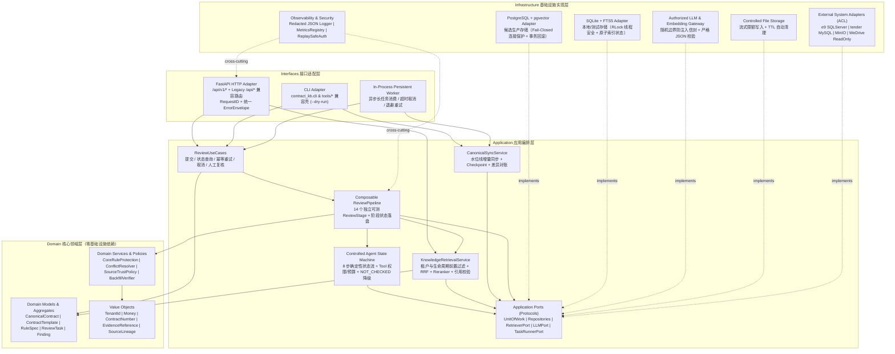

# 目标架构设计（Target Enterprise Architecture）

基于 Phase A 实证审计结果，本系统采用 **Modular Monolith（模块化单体）+ Clean Architecture + Ports & Adapters（六边形架构）** 作为目标架构基线。在不破坏既有 `contract_kb` CLI/HTTP API 与测试入口的前提下，完成包内分层解耦、统一仓储与事务边界、可恢复审核流水线、多源隔离 RAG 与受控状态机 Agent。

---

## 1. 目标逻辑分层与目录结构

为遵循渐进式重构原则（保留 Git Blame 历史、保持 `import contract_kb.*` 100% 向后兼容），核心领域与应用架构直接演进于 `contract_kb/` 包内，避免推倒重命名造成的全仓导入断裂：

```text
contract_kb/                        # 系统主包（兼容既有入口 + Clean Architecture 四层内核）
  domain/                           # 【领域层】零外部框架/零 SQL/零 HTTP 依赖
    models/                         # 领域实体与聚合根（ReviewTask, Finding, CanonicalContract, RuleSpec...）
    value_objects/                  # 不可变值对象（TenantId, Money, ChineseAmount, EvidenceReference, ContractNumber）
    events/                         # 领域事件（ReviewCompleted, RuleApproved, DocumentIndexed）
    services/                       # 纯领域服务（金额一致性计算、主体核验、编号回填检查、冲突消解）
    policies/                       # 业务策略（SourceTrustPolicy, RuleGovernancePolicy, CoreRuleProtectionPolicy）

  application/                      # 【应用层】用例编排、流水线契约与抽象端口（Ports）
    ports/                          # Repository / UnitOfWork / KnowledgeRetriever / LLMProvider / TaskQueue 协议
    pipeline/                       # 14 阶段可组合 ReviewPipeline 与 Stage 输入输出契约
    workflow/                       # 受控状态机审核 Agent、显式 Tool Schema、预算守卫与降级控制
    use_cases/                      # 审核提交/重试/取消、知识检索、模板导入、历史合同增量同步

  modules/                          # 【业务子模块】按限界上下文高内聚组织
    documents/                      # 安全 OOXML 解析、条款抽取、版式审计
    templates/                      # 78 套五级分类标准数据（内聚包内，彻底断绝反向依赖 tools/）
    rules/                          # 策略模式规则注册表、版本评估、冲突消解与人工覆写审计
    retrieval/                      # 多源隔离混合检索（Tenant/Active 过滤 -> FTS+Vec -> RRF -> Rerank -> 证据核验）
    cases/                          # 历史审批案卷纯函数归并、去重键计算与对账差异报告
    integrations/                   # 泛微 e9 / tender MySQL / MinIO / 企业微信微盘防腐适配器（ACL）

  infrastructure/                   # 【基础设施层】Ports 的具体技术适配器
    persistence/                    # 统一 StorageFactory、UnitOfWork、SQLite / PostgreSQL+pgvector 仓储适配器
    security/                       # 防重放 HMAC 认证、段安全 RBAC、流式上传守卫、敏感脱敏器
    task_queue/                     # 基于持久化状态的轻量异步任务执行器（幂等/退避重试/取消/清理）
    observability/                  # 结构化脱敏 JSON 日志、Request/Trace ID、P50/P95/P99 指标采集器

  interfaces/                       # 【接口层】协议转换与参数校验
    http/                           # FastAPI /api/v1 规范化路由 + 统一错误信封 + /healthz & /readyz
    cli/                            # CLI 命令入口与 --dry-run 支持

  # 稳定兼容门面（保留原文件路径与公共类签名，委托内部新架构实现）
  api.py / review_engine.py / rule_engine.py / classifier.py / storage.py / storage_pg.py ...

migrations/                         # PostgreSQL 增量幂等迁移脚本（001, 002, 003）
tests/                              # 测试金字塔（unit / integration / contract / security / e2e / performance + 原有回归套件）
docs/architecture/                  # 架构设计与 ADR 决策库
```

---

## 2. 目标分层架构与端口适配器全景图



---

## 3. 核心对象归属界定（领域模型 vs 持久化 DTO vs 外部适配器）

| 分类 | 代表对象 | 职责与约束 |
|---|---|---|
| **领域模型与值对象（Domain）** | `TenantId`, `Money`, `ContractNumber`, `EvidenceReference`, `Finding`, `FindingSource` (`DETERMINISTIC`/`LLM_SEMANTIC`/`HUMAN`), `RuleSpec`, `CanonicalContract`, `SourceTrustLevel` | 表达纯粹业务规则与不变量（如“未审批规则不可执行”、“低置信度或无原文引用不可产出确定性违规结论”、“核心规则不可被自定义指令屏蔽”）；不携带 `sqlite3.Row`、`psycopg2` 游标或 `fastapi.UploadFile`。 |
| **应用契约（Application Contracts）** | `ReviewContext`, `ReviewStage`, `StageExecutionRecord`, `ReviewResult`, `RetrievalQuery`, `RetrievalHit`, `ToolCallRequest`, `UnitOfWork` | 定义跨阶段、跨模块的稳定输入输出 Schema 与事务边界，所有外部技术实现均通过 `Protocol` 注入。 |
| **持久化模型 / DTO（Persistence）** | `DocumentRow`, `ClauseRow`, `TaskRow`, `StageStateRow`, `CanonicalContractRow`, `SyncWatermarkRow` | 封装表字段序列化（JSON 列编解码、`vector` / `BLOB` 转换、`?` vs `%s` 参数占位符），仅存在于 `infrastructure/persistence/` 与兼容仓储内。 |
| **外部系统适配器（ACL Adapters）** | `E9SqlServerAdapter`, `TenderMysqlAdapter`, `WeDriveReadOnlyAdapter`, `OpenAICompatLLMProvider` | 处理连接池、超时、退避重试、分页游标、环境变量凭据读取，并将外部异构结构映射为内部 `CanonicalContract` 或 `SemanticReviewOutcome`。 |

---

## 4. 渐进迁移与防回归路径

1. **Strangler Fig（绞杀者模式）包内演进**：
   - 先建立 `domain/`、`application/`、`modules/`、`infrastructure/` 新内核组件并通过单元测试验证；
   - 再将原 `review_engine.py`、`rule_engine.py`、`classifier.py`、`api.py` 改造为调用新内核的薄门面（Thin Facade），保持原有类名、方法名与返回字典关键字段 100% 兼容。
2. **双轨路由兼容**：
   - 新增 `/api/v1/contract-kb/*` 与 `/api/v1/contract-review/*` 规范化版本路由（含分页、幂等键、异步模式与统一错误体）；
   - 原 `/api/contract-kb/*` 与 `/api/contract-review/*` 继续可用并共享同一套认证、租户隔离与领域服务，确保既有客户端零改造平滑过渡。
3. **测试先行锁死行为**：
   - 每阶段修改前后运行全量 `pytest` + AST 循环依赖门禁，确保零新增循环依赖、零跨租户泄露、零断言删减。
