# History Tables | Flowable Enterprise Documentation

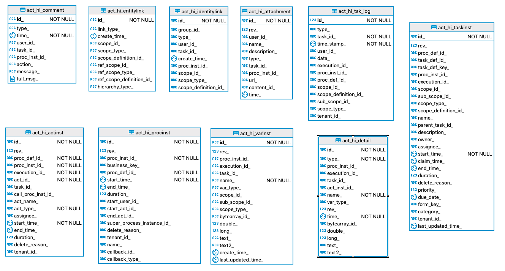

## ACT\_HI\_ACTINST[​](#act_hi_actinst "Direct link to ACT\_HI\_ACTINST")

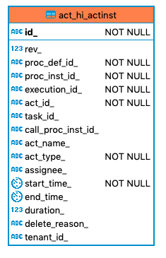

## ACT\_HI\_ATTACHMENT[​](#act_hi_attachment "Direct link to ACT\_HI\_ATTACHMENT")

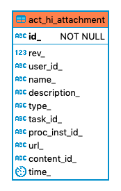

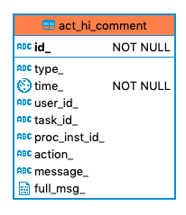

## ACT\_HI\_DETAIL[​](#act_hi_detail "Direct link to ACT\_HI\_DETAIL")

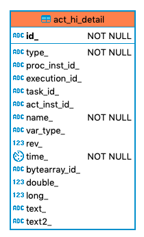

## ACT\_HI\_ENTITYLINK[​](#act_hi_entitylink "Direct link to ACT\_HI\_ENTITYLINK")

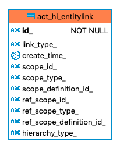

## ACT\_HI\_IDENTITYLINK[​](#act_hi_identitylink "Direct link to ACT\_HI\_IDENTITYLINK")

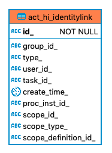

## ACT\_HI\_PROCINST[​](#act_hi_procinst "Direct link to ACT\_HI\_PROCINST")

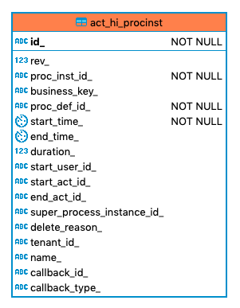

## ACT\_HI\_TASKINST[​](#act_hi_taskinst "Direct link to ACT\_HI\_TASKINST")

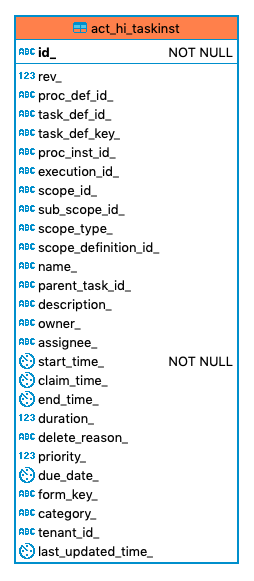

## ACT\_HI\_TSK\_LOG[​](#act_hi_tsk_log "Direct link to ACT\_HI\_TSK\_LOG")

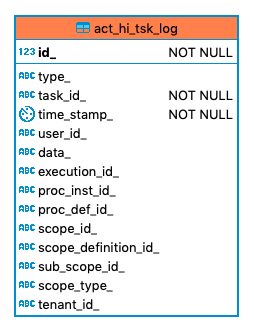

## ACT\_HI\_VARINST[​](#act_hi_varinst "Direct link to ACT\_HI\_VARINST")

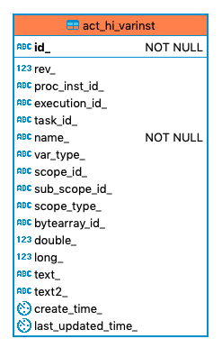

- [ACT\_HI\_ACTINST](#act_hi_actinst)
- [ACT\_HI\_ATTACHMENT](#act_hi_attachment)
- [ACT\_HI\_COMMENT](#act_hi_comment)
- [ACT\_HI\_DETAIL](#act_hi_detail)
- [ACT\_HI\_ENTITYLINK](#act_hi_entitylink)
- [ACT\_HI\_IDENTITYLINK](#act_hi_identitylink)
- [ACT\_HI\_PROCINST](#act_hi_procinst)
- [ACT\_HI\_TASKINST](#act_hi_taskinst)
- [ACT\_HI\_TSK\_LOG](#act_hi_tsk_log)
- [ACT\_HI\_VARINST](#act_hi_varinst)