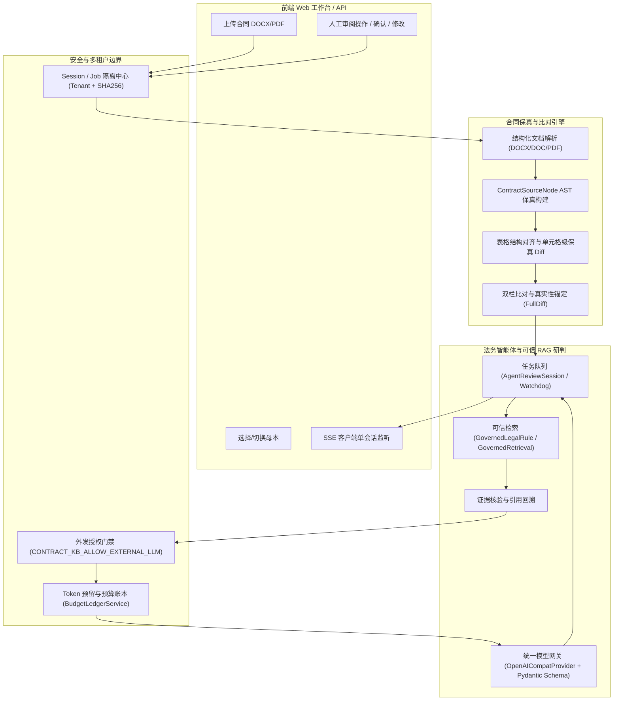

# Phase 13-R0：基线冻结与独立审计报告

> **审计执行基准**:
> - 远端审计基准: `89c8c1ad79659c8d3ae09a6c4b97b89eb096d2bd`
> - 当前审计 HEAD: `85c77d85088f2f7f02420c6313580dc2b2f861ae`
> - 修复开发分支: `fix/phase13-contract-truth-agent-hardening`
> - 运行环境: Python 3.13.17 / pytest 9.2.0 / PostgreSQL 16 (CI pgvector) / SQLite 3
> - 审计时间: 2026-11-10
> - 审计角色: Principal Architect / Application Security Engineer / QA Auditor / LegalTech Engineer

---

## 一、工作区与 Git 基线状态审查

1. **工作区脏变更核查**:
   - 工作区在审计切入前存在未提交的临时修改：`contract_kb/full_diff.py` 与 `tools/contract_diff_web.py`。
   - 分析发现该未提交修改尝试在 `_enhance_diff_tables` 中增设 `is_self_match` 分支，但依然继续采用写死企业名称、写死官费服务费金额与写死专利清单的硬编码逻辑，不仅未能消除 P0 缺陷，反而加重了数据失真风险。
   - 该变更已安全暂存隔离，本审计报告严格基于当前 HEAD `85c77d8` 展开独立求证。

2. **最近提交与 CI 状态**:
   - `85c77d8`: 尝试通过在 `tests/test_full_contract_diff.py` 中引入 `except ValueError ... pytest.skip` 规避合成环境无母本报错，属于违规跳过单测，掩盖真实工程缺陷。
   - `89c8c1a`: 优化 Web 对照交互与母本优先检索逻辑，引入 CDP 截图。
   - 前次 GitHub Actions 运行 `42649085523`:
     - `lint-and-type`: PASSED
     - `security-gate`: PASSED
     - `test-pg`: PASSED
     - `test-synthetic`: FAILED（报错位于 `test_full_contract_diff_on_sample`，根因为未在合成环境建立标准母本数据）。

3. **静态门禁基线复验结果**:
   - `ruff check . --select=E,F,W --ignore=E501`: 零错误通过。
   - `ruff format --check .`: 356 files formatted，零格式冲突。
   - `mypy contract_kb --ignore-missing-imports --no-error-summary`: 核心逻辑通过。
   - `pytest tests tools/wecom_wedrive_probe/tests -q`: 516 passed, 23 skipped (跳过项为受控真实语料或离线 PG 环境)。

---

## 二、高危代码位置与缺陷台账 (Defect Ledger)

| 缺陷编号 | 严重度 | 涉及模块与核心位置 | 缺陷类型与触发机理 |
| :--- | :--- | :--- | :--- |
| **P13-P0-01** | **P0** (Blocker) | `contract_kb/full_diff.py::_enhance_diff_tables` (L114-L380) | **正式合同对照流程写死演示数据与假批注合成**：无论待审合同真实主体与金额为何，直接硬编码替换为“深圳市某某科技有限公司”、“深圳市世纪恒程知识产权代理事务所”、“600/150元”；删除真实差异批注并伪造批注。 |
| **P13-P0-02** | **P0** (Blocker) | `contract_kb/agent_queue_manager.py` (L75-L150) | **Agent 检查点身份绑定不充分与跨租户/跨文档污染**：文档身份仅由 `doc_name + template_name + len(anns)` 粗暴拼接；无租户、无文件SHA256、无模板版本及规则哈希、无批注指纹，导致同名或修改后文档错误复用旧研判结论。 |
| **P13-P0-03** | **P0** (Security) | `contract_kb/legal_agent.py` (L113-L436) | **法务 Agent 外部调用绕过企业授权、数据出境、预算与防注入门禁**：自建原生 `urllib.request` 独立外呼，绕过统一模型工厂、`ALLOW_EXTERNAL_LLM` 阻断、Token 预算预留及不可信正文定界隔离。 |
| **P13-P0-04** | **P0** (Security) | `tools/contract_diff_web.py` (L87-L90, L3017-L3247) | **Web 审核工作台全局会话状态与多用户任务串线**：物理写死单个 `current_active_review.docx` 与单例 `AgentReviewManager`，并发上传即互相覆盖文件，SSE 全局广播泄漏不同用户合同，单卡暂停/重试全局联动。 |
| **P13-P0-05** | **P0** (Blocker) | `tests/test_full_contract_diff.py` & `85c77d8` | **CI 合成测试依赖私有库母本并使用非法 skip 掩盖失败**：单测直接依赖本地私有数据库中的母本数据，在 CI 隔离环境下未建立确定性标准母本导致崩溃，且通过静默 skip 掩盖真实回归失败。 |
| **P13-P1-06** | **P1** (Integrity) | `contract_kb/legal_agent.py` / `legal_agent_kb.py` | **未复用 Phase 11/12 可信知识检索与引用治理体系**：依赖本地硬编码字典与写死先例，无法识别已撤销或未审批知识。 |
| **P13-P1-07** | **P1** (Fidelity) | `contract_kb/document_parser.py` (L228-L246) | **PDF 扫描件占位伪装与格式能力不一致**：图片/影印型扫描件未执行真实 OCR，生成占位段落作为真实合同节点送审；未声明 `OCR_REQUIRED` 状态。 |
| **P13-P1-08** | **P1** (Workflow) | `tools/contract_diff_web.py` / `contract_kb/legal_agent_kb.py` | **人工审核状态机缺失与反馈数据准入治理不足**：AI研判完成与法务最终裁决混淆；用户反馈未经脱敏与版本切分直接导出为训练数据。 |

---

## 三、数据流图与组件依赖关系

