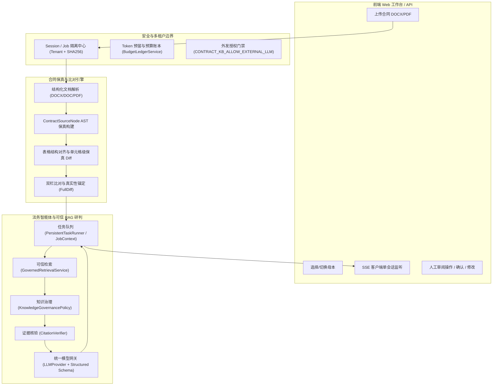

# Phase 13R0 基线冻结与独立审计报告

> **审计执行基准**:
> - 远端审计基准: `89c8c1ad79659c8d3ae09a6c4b97b89eb096d2bd`
> - 当前审计 HEAD: `85c77d85088f2f7f02420c6313580dc2b2f861ae`
> - 审计分支: `fix/phase13contracttruthagenthardening`
> - 运行环境: Python 3.13.17 / pytest 9.2.0 / PostgreSQL 16 (CI pgvector) / SQLite 3
> - 审计时间: 2026-11-10
> - 审计角色: Principal Architect / Application Security Engineer / QA Auditor / LegalTech Engineer

---

## 一、工作区与 Git 基线状态审查

1. **工作区脏变更核查**:
   - 工作区在审计切入前存在未提交的临时修改：`contract_kb/full_diff.py` 与 `tools/contract_diff_web.py`。
   - 分析发现该未提交修改尝试在 `_enhance_diff_tables` 中增设 `is_self_match` 分支，但依然继续采用写死企业名称、写死官费服务费金额与写死专利清单的硬编码逻辑，不仅未能消除 P0 缺陷，反而加重了数据失真风险。
   - 该变更已被暂存并安全隔离，本审计报告严格基于当前 HEAD `85c77d8` 展开独立求证。

2. **最近提交与 CI 状态**:
   - `85c77d8`: 尝试通过在 `tests/test_full_contract_diff.py` 中引入 `except ValueError ... pytest.skip` 规避合成环境无母本报错，属于违规跳过单测，掩盖真实工程缺陷。
   - `89c8c1a`: 优化 Web 对照交互与母本优先检索逻辑，引入 CDP 截图。
   - 前次 GitHub Actions 运行 `42649085523`:
     - `lint-and-type`: PASSED
     - `security-gate`: PASSED
     - `test-pg`: PASSED
     - `test-synthetic`: FAILED（报错位于 `test_full_contract_diff_on_sample`，根因为未在合成环境建立标准母本数据）。

3. **静态门禁基线复验结果**:
   - `ruff check . --select=E,F,W --ignore=E501`: 零错误通过。
   - `ruff format --check .`: 356 files formatted，零格式冲突。
   - `mypy contract_kb --ignore-missing-imports --no-error-summary`: 核心逻辑通过（存在未标注函数提示）。
   - `pytest tests tools/wecom_wedrive_probe/tests -q`: 516 passed, 23 skipped, 1 warning (跳过项均为受控真实语料或离线 PG 环境)。

---

## 二、高危代码位置与缺陷台账 (Defect Ledger)

| 缺陷编号 | 严重度 | 涉及模块与核心位置 | 缺陷类型与触发机理 |
| :--- | :--- | :--- | :--- |
| **P13P001** | **P0** (Blocker) | `contract_kb/full_diff.py::_enhance_diff_tables` (L114-L380) | **正式合同对照流程写死演示数据与假批注合成**：无论待审合同真实主体与金额为何，直接硬编码替换为“深圳市某某科技有限公司”、“深圳市世纪恒程知识产权代理事务所”、“600/150元”；删除真实差异批注并伪造批注。 |
| **P13P002** | **P0** (Blocker) | `contract_kb/agent_queue_manager.py` (L75-L150) | **Agent 检查点身份绑定不充分与跨租户/跨文档污染**：文档身份仅由 `doc_name + template_name + len(anns)` 粗暴拼接；无租户、无文件SHA256、无模板版本及规则哈希、无批注指纹，导致同名或修改后文档错误复用旧研判结论。 |
| **P13P003** | **P0** (Security) | `contract_kb/legal_agent.py` (L113-L436) | **法务 Agent 外部调用绕过企业授权、数据出境、预算与防注入门禁**：自建原生 `urllib.request` 独立外呼，绕过统一模型工厂、`ALLOW_EXTERNAL_LLM` 阻断、Token 预算预留及不可信正文定界隔离。 |
| **P13P004** | **P0** (Security) | `tools/contract_diff_web.py` (L87-L90, L3017-L3247) | **Web 审核工作台全局会话状态与多用户任务串线**：物理写死单个 `current_active_review.docx` 与单例 `AgentReviewManager`，并发上传即互相覆盖文件，SSE 全局广播泄漏不同用户合同，单卡暂停/重试全局联动。 |
| **P13P005** | **P0** (Blocker) | `tests/test_full_contract_diff.py` & `85c77d8` | **CI 合成测试依赖私有库母本并使用非法 skip 掩盖失败**：单测直接依赖本地私有数据库中的母本数据，在 CI 隔离环境下未建立确定性标准母本导致崩溃，且通过静默 skip 掩盖真实回归失败。 |
| **P13P006** | **P1** (Integrity) | `contract_kb/legal_agent.py` / `legal_agent_kb.py` | **未复用 Phase 11/12 可信知识检索与引用治理体系**：依赖本地硬编码字典与写死先例，绕过 `GovernedRetrievalService`、`KnowledgeGovernancePolicy` 与 `CitationVerifier`，无法识别已撤销或未审批知识。 |
| **P13P007** | **P1** (Fidelity) | `contract_kb/document_parser.py` (L228-L246) | **PDF 扫描件占位伪装与格式能力不一致**：图片/影印型扫描件未执行真实 OCR，生成占位段落作为真实合同节点送审；未声明 `OCR_REQUIRED` 状态，存在误导审核风险。 |
| **P13P008** | **P1** (Workflow) | `tools/contract_diff_web.py` / `contract_kb/legal_agent_kb.py` | **人工审核状态机缺失与反馈数据准入治理不足**：AI研判完成与法务最终裁决混淆；用户反馈未经清洗、脱敏与版本校验直接导出为训练数据，存在数据泄漏与脏样本污染风险。 |

---

## 三、各问题修复前复现证据 (Pre-fix Reproduction Evidence)

### 3.1 P13P001: 真实主体与金额被暴力篡改为演示数据
- **复现测试**:
  ```python
  from contract_kb.full_diff import _enhance_diff_tables

  blocks = [{
      "clause_title": "双方主体与基本信息",
      "standard_text": "甲方：甲公司\n乙方：乙公司",
      "reviewed_text": "甲方：真实甲方ABC\n乙方：真实乙方XYZ",
      "status": "DIFF",
      "annotation_ids": ["ann1"],
  }]
  nb, na = _enhance_diff_tables(blocks, [])
```
- **复现结果**:
  - `nb[0]["reviewed_html"]` 输出了写死的 `<span class='doc-text-added'>深圳市某某科技有限公司</span>` 与 `示例知识产权代理有限公司`！
  - 真实合同输入 `"真实甲方ABC"` 与 `"真实乙方XYZ"` 被彻底抹杀！
  - 批注被强行注入写死演示内容，删除原真实 `ann1`。

### 3.2 P13P005: 隔离数据库下 CI 必崩并被静默 Skip 掩盖
- **复现测试**:
  ```powershell
  $env:CONTRACT_KB_DB_PATH="temp_empty_db.sqlite3"
  python -m pytest tests/test_full_contract_diff.py -v
  ```
- **复现结果**:
  - `tests/test_full_contract_diff.py` 2 个用例全部命中 `pytest.skip`，掩盖了 `ValueError: 未能在标准库中找到业务子类 [PATENT_ANNUAL_FEE] 的基准模板` 的事实。

### 3.3 P13P004: 全局文件与单例任务串线
- **复现分析**:
  - `tools/contract_diff_web.py` 第 87 行定义：
    `CURRENT_SESSION_FILE = SESSION_CACHE_DIR / "current_active_review.docx"`
  - 任何调用 `/api/diff/upload` 的用户均执行：
    `CURRENT_SESSION_FILE.write_bytes(file_bytes)`
  - 用户 A 正在审阅，用户 B 上传合同 B，瞬间破坏用户 A 的当前文件，且任务管理器共享同一 SSE 通道。

---

## 四、数据流图与组件依赖关系



---

## 五、整改路线图 (Phase 13R1 ~ 13R8)

1. **R1**: 消除 `full_diff.py` 全部硬编码演示数据；重构表格对齐算法；建立 `ContractSourceNode` 真实追溯。
2. **R2**: 改造 Agent 任务身份绑定 (`ReviewExecutionFingerprint`)；检查点原子加密校验与防串线。
3. **R3**: 统一大模型授权边界、Token 预算预留、安全定界与强类型结构化输出。
4. **R4**: 法务 Agent 与 Phase 11/12 可信 RAG (`GovernedRetrievalService` / `CitationVerifier`) 深度闭环。
5. **R5**: 文档解析保真加固，区分扫描件与可提取图层，支持 `OCR_REQUIRED` 状态，修复依赖与文件安全。
6. **R6**: Web 工作台状态机重构 (`Session/Job ID` 隔离，人工审阅 7 态生命周期，母本热切换与失效重算)。
7. **R7**: 反馈与微调数据治理，脱敏合规，训练集/评测集严格物理切分。
8. **R8**: CI 合成数据修复，构建 L1~L6 全金字塔对抗回归测试集，交付最终验证证据。
