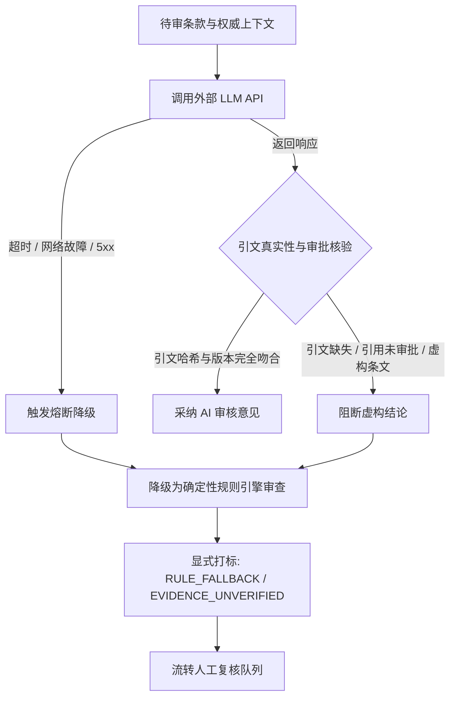

# Phase 14-R: 真实大模型评测边界与基准规范 (09-real-model-evaluation-boundary)

## 一、评测层级与执行边界定义

为杜绝“以 Mock 假冒真实评测”或“因外部 API 波动破坏 CI 确定性”，系统建立严格的三层评测边界：

| 评测层级 | 运行环境 | 执行频次 | 依赖条件 | 验证核心 | 判定准则 |
|---|---|---|---|---|---|
| **L1: 确定性门禁 (Hermetic CI)** | GitHub Actions / 本地沙箱 | 每次 PR / Push | 零外部网络依赖、离线 Mock、确定性规则引擎 | 代码语法、类型安全、架构契约、安全漏洞、状态机流转 | 100% 通过，耗时 < 3 分钟 |
| **L2: 规则与治理真值测试 (Deterministic Rules)** | 本地 / 预发环境 | 每日构建 / 发布前 | 本地 SQLite / Docker PG、离线知识库母本 | 受控 RAG 召回、引文哈希比对、版本回滚阻断、审批状态同步 | 零误召回、零违规放行 |
| **L3: 真实大模型基准评测 (Live LLM Benchmark)** | 独立评测集群 / GPU 节点 | 周度 / 大版本发布 | 真实 API Key (DeepSeek-V3/R1, Qwen-Max, Claude 3.5 Sonnet) | 复杂条款隐蔽法律风险、长文本跨条款冲突、自然语言修改建议质量 | 满足黄金标准集 F1-Score 与零虚构引文指标 |

---

## 二、黄金测试集 (Golden Corpus) 规范

评测集存放于受控目录或专用基准测试库，不得将客户敏感合同明文签入公共代码库。

1. **标准母本集 (Standard Golden Templates)**：
   - 劳动合同（标准版、竞业限制版）
   - 采购与服务协议（含知识产权归属、严苛违约金、验收阶梯条款）
   - 保密协议（NDA 严格版、单向版、双向版）
   - 房屋租赁协议（含免责条款、押金扣除、违约责任）
2. **对抗样本集 (Adversarial Clauses)**：
   - **文字截断攻击**：前 40 字符相同但后半段颠倒责任主体的恶意篡改条款。
   - **伪造法律依据**：引用废止法条（如已失效的《中华人民共和国合同法》）或未审批的企业内部红线。
   - **混淆知识库源**：同一集团下不同子公司（Tenant A 与 Tenant B）的同名合同条款。
   - **格式注入攻击**：在条款内嵌入 `<script>`、HTML 标签、Markdown 伪造链接。

---

## 三、真实模型熔断与降级机制 (Fail-Closed Circuit Breaker)

在与真实外部 LLM 交互时，系统严格执行如下安全降级策略：

1. **零虚构引文准则 (Zero-Hallucination Citation)**：
   - LLM 返回的任何风险结论，若包含法律依据引用，必须经由 `CitationVerifier` 回查数据库；
   - 只要引文 `source_hash` 与数据库权威母本不符，或审批状态非 `APPROVED`，立即丢弃该条引文，并将结论标记为“未经验证的建议”并触发人工审核提示。
2. **超时与重试限制**：
   - 单次 API 调用超时严格限制为 30s，重试最多 2 次（指数退避）。
   - 连续失败超过 3 次触发租户级熔断，自动切换到全量确定性规则兜底，杜绝审查阻塞。

---

## 四、核心评测指标与阈值基线

真实模型发布前必须通过基准跑分评估，未达阈值禁止发布：

| 评估维度 | 指标定义 | 最低合规阈值 | 目标阈值 | 评测方式 |
|---|---|---|---|---|
| **法律风险检出率 (Recall)** | 黄金集中已知法律风险被准确发现的比例 | $\ge 92\%$ | $\ge 96\%$ | 自动化对比黄金标注点 |
| **误报率 (False Positive Rate)** | 合规正常条款被误判为高危风险的比例 | $\le 8\%$ | $\le 4\%$ | 法务专家双盲复核 |
| **虚构引文率 (Hallucination Rate)** | 模型引述了不存在或未审批条款的比例 | **严格 0%** | **严格 0%** | `CitationVerifier` 校验 |
| **跨租户隔离违规率** | 模型输出包含其他租户私有信息的概率 | **严格 0%** | **严格 0%** | 敏感词与实体探测 |
| **单条款平均响应延迟** | 端到端单条款风险分析与建议耗时 | $\le 3.5\text{ s}$ | $\le 1.8\text{ s}$ | P95 耗时监控 |
| **成本消耗上限** | 单份千行标准合同平均消耗 Token 费用 | $\le \yen 1.2$ | $\le \yen 0.5$ | 计费计量上报 |
