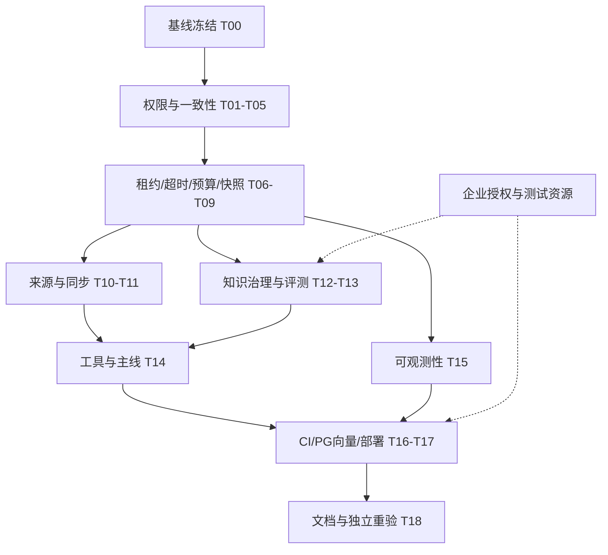

# AI 合同审查系统：架构整改与分级验收实施计划书

> **执行者说明：**后续实施时使用 `superpowers:executing-plans` 逐任务执行；如明确选择分派实施，再使用 `superpowers:subagent-driven-development`。所有任务以复选框跟踪，未执行项不能标完成。本文件只交付计划，不表示已经实施整改。

**Goal：**关闭独立验收中的权限、事务、可靠性和来源追溯缺陷，保留现有合同审核能力，建立对应确切提交、可复核的分级验收证据。

**Architecture：**延续模块化单体、现有 `contract_kb` 命名空间和双存储适配器；优先补足稳定应用端口、数据库事务、任务租约和版本快照。保留确定性审核流水线作为主入口，统一主线与候选 Agent 的安全边界，不重复运行两套审核。

**Tech Stack：**Python >=3.11、FastAPI、Pydantic、SQLite、PostgreSQL + pgvector、pytest、Ruff、mypy、GitHub Actions。具体依赖版本通过锁文件和独立环境验证确定；本计划不要求整体升级依赖。

**Spec：**[独立验收报告](../../architecture/independent-acceptance-20261107.md)、[目标架构](../../architecture/target-architecture.md)、四份现有 ADR，以及用户提供的企业级架构审计与渐进式重构任务书。冲突时以用户任务边界、真实代码和独立验收证据为准，修订原报告中的过度承诺。

**日期：**2026-11-07（Asia/Singapore）。**状态：**拟执行计划。**被审基线：**`4eabf0edf21aceb046e9600c0b661e93c3fd019a`。本文排期、阈值和新增接口均为建议实施决策，不代表用户已批准生产操作。

## 1. 全局约束

- 不推倒重写，不进行无必要的全仓重命名；保留旧 CLI、`ReviewEngine` 和 API 兼容入口。
- 优先模块化单体；本轮不引入 Kafka、Kubernetes、Redis/Celery 或自治多 Agent 对话。
- 不删除、跳过或放宽原有有效断言来获得绿灯。
- 不使用真实密钥、合同正文、客户实体或内网地址制作公开夹具、提示词、日志和 CI Artifact。
- 默认合成语料、临时 SQLite、独立 PG 测试库；凭据从受控环境注入，不写入命令行或报告。
- 未授权不得真实外发合同，不执行生产同步、凭据轮换、Git 历史重写、破坏性迁移、main 推送或合并。
- 生产数据库故障必须 fail-closed，不静默切换空 SQLite。
- 所有阶段先保护现有行为，再实施最小变更；每阶段可独立验证和回退。
- Git 回退不等于数据回滚；一切 schema、幂等记录、快照和历史版本变动必须单列兼容说明。
- 验收证据必须标明 SHA、环境、命令、退出码、通过/失败/跳过和数据层级；不以文案替代实测。

## 2. 五项重点失败模式

| 条件 | 用户应得到的行为 | 负责任务 |
|---|---|---|
| 同租户其他用户重用幂等键，或同一用户换正文/审核参数 | 无他人结果泄露；内容冲突409；同内容安全复用 | T01 |
| 审核结果已更新，审计写入/数据库提交恰好失败 | 状态、覆写历史、审计全部回滚，不能报失败却悄悄忽略风险 | T02、T03 |
| worker被杀、租约过期，旧worker随后恢复并尝试提交 | 新worker可恢复；旧worker不可覆盖；无重复结论和重复不可控副作用 | T06、T09 |
| 工具不返回、最终阶段超时、并发模型请求超预算 | 请求可在期限内结束；过期不标成功；超额调用不能被授权发送 | T07、T08 |
| 同号多来源合同发生部分增量、乱序更新或跨租户同步 | 来源不丢失、版本不回退、水位线隔离、重复批次无业务变化 | T10、T11 |

## 3. 推荐路线与交付范围

### 3.1 方案比较

| 路线 | 处理方式 | 优点 | 局限 | 建议 |
|---|---|---|---|---|
| A：只修几个明显bug | 只处理owner、事务、RUNNING恢复 | 很快形成局部修复 | Agent/RAG、工具主线、CI与文档仍不一致，无法完成原任务 | 仅用于临时止血 |
| B：按风险分阶段整改，分级验收 | 先安全和可靠性，再数据/AI/集成，最后统一复核 | 每阶段可交付，避免让真实模型授权阻塞基础修复 | 需要严格维护依赖、范围和证据 | **推荐** |
| C：再做一次全仓架构重构 | 重排目录、替换任务框架、全面翻新仓储 | 可以统一更多结构 | 扩大回归面，掩盖当前缺陷，违背渐进治理目标 | 本轮不采用 |

本计划按 B 编排。新增抽象必须由具体缺陷驱动，不能以增加目录或类数量作为完成指标。

### 3.2 两条验收线

**L1：确定性审核可受控试运行。**覆盖安全API、确定性规则、人工复核、双库关系行为、基本RAG证据治理、队列恢复、文件生命周期、监控和真实CI；默认不启用外部LLM。它不是整套企业AI系统最终签收。

**L2：企业AI审核与集成最终验收。**在L1上补齐真实PG向量、真实脱敏语料/授权模型、旧工具主线迁移、可靠增量同步、成本与效果评测、部署与回滚演练。真实资源或授权缺失时明确记为“待外部前提”，不拿合成结果替代。

候选Agent在本轮默认作为可选实验入口：先修复组件缺陷，再复用统一安全执行器；没有业务必要时不强接API。原ADR-003调整为“主线确定性流水线 + 可选受控工作流”，明确哪些保护真正作用于主线。

### 3.3 明确的下一步

首先执行 **T00基线冻结 → T01幂等与权限修复 → T02人工覆写原子化**。这三项不依赖真实模型或企业生产数据，收益确定、阻断性最强。不要先做全仓格式化、目录调整、模型升级或Agent功能扩张。

## 4. 里程碑、依赖与预计投入

以下是工程估算，不是交期承诺。以一名熟悉Python/FastAPI的工程师为主要实施者、另有评审人员按阶段介入估算；1人日按8小时有效工程投入。并发仅适用于文件和接口不冲突的工作，不能把人日直接除以人数。

| 阶段 | 任务 | 预计人日 | 前置依赖 | 里程碑 |
|---|---|---:|---|---|
| R0 基线与执行环境 | T00 | 0.5—1 | 无 | M0：基线和隔离环境可复现 |
| R1 安全与一致性 | T01—T05 | 5—8 | M0 | M1：权限/审计/防重放/分页门禁通过 |
| R2 任务可靠性 | T06—T09 | 7—11 | T01、T02、T03 | M2：租约、deadline、预算、恢复成立 |
| R3 数据与知识治理 | T10—T13 | 6—10 | T01、T02、T09 | M3：来源、版本、水位线、证据和评测口径可信 |
| R4 主线、工具与可观测性 | T14—T15 | 4—7 | T06—T13 | M4：实际入口接线、基本运维指标可用 |
| R5 CI与最终验收 | T16—T18 | 5—8 | 全部相关任务 | M5：确切SHA的必需CI、部署/回滚与签收材料 |
| 合计 | 19项任务 | **27.5—45人日** | 外部等待时间另计 | 单人约6—9工作周，另预留15%—20%风险缓冲 |

L1可在R1/R2及T12、T15、T16的相应基础门禁满足后先行评审，不等于省略R3/R4/R5，也不允许在未完成全量任务时写“整体验收通过”。HMAC网关改造、PG测试环境、历史凭据处置和真实模型授权可能影响日历周期，应独立跟踪。



### 4.1 角色与责任

| 角色 | 主要责任 |
|---|---|
| 技术负责人 | 确认边界、接口和迁移策略，处理阻塞，审核里程碑证据 |
| 后端实施者 | T01—T12、T14—T15及相应自动化测试 |
| 测试/独立评审 | 设计负向与并发测试、复现缺陷、按确切SHA重新验收；不能只复述实施者结论 |
| 运维/DBA | 隔离PG+pgvector、备份恢复、部署演练、网关签名切换、受控Secrets |
| 法务/业务代表 | 真实脱敏样本标注、规则解释、误报漏报与人工复核标准 |
| 安全管理员 | 凭据轮换、历史清洗、实体标记与对外模型授权范围 |

同一人可以兼任多个角色；安全授权与业务效果验收不应由实现代码的人自行推定。

## 5. 文件与接口责任分配

新增路径为拟定路径，实施前核验是否已存在同职责组件，优先扩展，不重复建立第二套框架。

| 文件/目录 | 责任 |
|---|---|
| `application/ports/persistence.py` | 拆出按调用场景划分的稳定Repository/UoW协议，逐步替代关键Any |
| `application/security/idempotency.py`（新增） | 请求指纹、owner绑定、幂等状态与409语义 |
| `domain/models/execution.py`（新增） | 租约令牌、deadline、预算预留、执行manifest等纯模型 |
| `application/ports/execution.py`（新增） | Clock、租约、预算、阶段快照端口 |
| `interfaces/http/auth_digest.py`（新增） | 有界请求摘要与认证V2适配，不在领域层操作Request |
| `auth.py` | V2签名/重放校验及受控兼容 |
| `infrastructure/observability/redaction.py` | 递归结构脱敏、字符串兼容、安全字段白名单 |
| `infrastructure/task_queue/runner.py` | 租约/心跳/取消/恢复，协调执行器，不承担业务规则 |
| `application/pipeline/runner.py`、`stages.py` | deadline传播、快照恢复、强类型阶段I/O和受控提交 |
| `application/workflow/tool_executor.py` | 复用执行约束，硬预算授权、超时返回与工具审计 |
| `modules/cases/reconciliation.py` | 纯函数合流、来源键、内容哈希和差异 |
| `modules/integrations/adapters.py` | 外部读取适配、分页、更新游标和受控写入编排 |
| `modules/retrieval/governance.py`、`citation.py` | fail-closed准入、可信度、来源定位和引用核验 |
| `storage.py`、`storage_pg.py` | SQL、事务、唯一约束、租约CAS、业务历史、兼容迁移 |
| `migrations/004_*`及后续编号（新增） | 按任务追加迁移，不修改已经执行过的001—003 |
| `tests/security/`、`integration/`、`contract/`、`e2e/` | 产品断言测试；验收txt脚本仅作历史反例，不能代替测试 |

## 6. 逐任务实施清单

各任务遵循：新增失败断言 → 运行确认失败 → 最小实现 → 通过目标测试与相关回归 → 独立评审 → 独立提交。测试文件和测试名是计划新建项，当前尚不存在；表中命令需在相应测试已创建后执行。

### T00：冻结基线与建立隔离执行环境

**缺陷关联：**F13、验收证据不一致。**依赖：**无。**建议提交：**`docs: freeze remediation baseline and acceptance scope`。

**文件：**新建 `docs/architecture/remediation-status.md`、`docs/architecture/evidence/<sha>/manifest.json`；保留现有独立验收报告和证据目录，不覆盖。

**接口产物：**证据manifest包含 `git_sha, branch, dirty, python_version, dependency_lock_digest, database_version, dataset_tier, commands, exit_codes`；证据必须可追溯到实际源码，不用动态字符串HEAD代替确切SHA。

- [ ] 重新运行 `git status --short`、`git rev-parse HEAD`、`git ls-remote origin HEAD refs/heads/main`，记录与本计划基线差异。
- [ ] 检查AGENTS和已有执行约束；保护当前未提交的验收报告。实施时创建 `codex/architecture-remediation` 隔离分支/工作树，沿用被审提交，不回退到旧main。
- [ ] 重新建立249通过/22跳过的测试基线，允许环境不同导致结果变化，但必须解释；不得强行维持数量。
- [ ] 配置纯合成SQLite和独立PG测试库，测试账号只对测试库有权限；不使用通用生产DSN。
- [ ] 建立状态台账，每个任务记录状态、关联提交、命令、结果、阻塞者、下一动作。
- [ ] 验证manifest没有秘密或合同正文后提交文档；不推main。

**通过条件：**实施者可从manifest重建基线；被审源代码与验收报告对应；测试数据不碰生产；当前失败/跳过真实列出。

### T01：修复同步/异步幂等的owner与请求内容绑定

**关联：**F01。**依赖：**T00。**文件：**新增 `application/security/idempotency.py`、`tests/security/test_idempotency_authorization.py`、`tests/integration/test_idempotency_concurrency.py`、`migrations/004_request_idempotency.sql`；修改api、pipeline runner、task runner、双存储及其端口。

**拟定契约：**`RequestIdentity(tenant_id: str, actor_id: str, operation: str, key: str, fingerprint: str)`；`reserve_request(identity: RequestIdentity) -> IdempotencyReservation`，结果明确 `CREATED / IN_PROGRESS / REPLAY / CONFLICT`。fingerprint由文件SHA-256、操作名、审核模式、规范化审核要求、适用配置版本构成，不含文件路径和敏感原文。

**决策：**幂等作用域=`tenant + actor + operation + key`；重复返回前仍做资源授权。跨owner同键不会读取他人资源；管理员查看他人任务走显式授权查询，不借用幂等短路。相同作用域但指纹不同409；同指纹执行中返回202与同一资源ID；完成后返回既有资源。不同用户可以各自用同一个键创建自己的任务。

- [x] 写失败测试：Alice/Bob同租户同键互不可见；同用户换正文、mode或审核要求返回409；同步与异步接口均覆盖。
- [x] 写并发测试：两个独立连接同时reserve，只有一个获得执行资格；请求崩溃后的reservation具备可恢复/终止状态；不同租户互不干扰。
- [x] 执行 `python -m pytest tests/security/test_idempotency_authorization.py tests/integration/test_idempotency_concurrency.py -q`，确认在旧实现失败。
- [x] 使用专用幂等记录表和数据库唯一约束；新入口不再直接通过旧 `(tenant,key)` 查完整任务。将reserve、创建job/task及资源绑定放在明确事务内；不得持有DB事务跨LLM调用。
- [x] 针对旧键记录生成只读统计和迁移报告：可识别owner的按原owner保留；owner缺失或冲突进入人工处理，不自动授予新请求。旧代码与新幂等模型不允许无治理混写。
- [x] 运行上述测试及 `tests/test_tenant_isolation.py`、API集成/E2E回归，通过后提交 `fix: bind idempotency to owner and request fingerprint`。

**验收断言：**任何重复提交路径都不能返回未授权资源；并发执行一次；内容冲突409；202与重放返回的资源ID稳定；数据库并发约束在SQLite与PG都成立。

### T02：人工覆写的事务、并发和审计原子化

**关联：**F02。**依赖：**T00。**文件：**修改 `modules/rules/governance.py`、双存储、UoW端口；新增 `tests/integration/test_human_override_atomicity.py`。

**契约：**保留 `HumanOverrideService.apply_override(...)`；仓储反馈、完整覆写历史、审计在同一UoW内。新增 `expected_state`或版本令牌用于乐观并发，状态已变化时返回409；生产调用必须携带经过授权的tenant/actor。

- [x] 写故障测试：分别在状态更新后、history写入、audit写入、commit时注入失败，三类数据必须全部回到原状态。
- [x] 写成功断言：一次覆写产生一个历史记录，previous/new/actor/reason正确；跨tenant拒绝；两人并发覆写不会静默丢失前次修改。
- [x] 运行 `python -m pytest tests/integration/test_human_override_atomicity.py -q`，确认旧版非原子行为被捕获。
- [x] 在服务UoW内组合全部写入；禁止内部方法提前提交外层事务；审计不可用则业务操作失败，不能伪装完整成功。
- [x] SQLite与真实PG分别验证嵌套savepoint、rollback、读写混合和提交失败路径。
- [x] 通过回归后提交 `fix: make human override and audit atomic`。

**通过条件：**失败无部分业务状态、成功完整留痕、并发冲突可见；不能只验证history表写成功这一条路径。

### T03：统一递归脱敏与审计入口保护

**关联：**F07。**依赖：**T02接口稳定。**文件：**修改redaction、双存储log_audit、错误处理和覆写note；新增 `tests/security/test_redaction_boundaries.py`。

**契约：**`redact_value(value: object) -> object`递归处理dict/list/tuple；`safe_audit_detail(event_type: str, fields: Mapping[str, object]) -> str`仅接受事件白名单字段。兼容原字符串入口，但先解析可识别JSON，再进行限长与保守文本脱敏。

- [x] 写失败测试覆盖JSON字符串、Python风格字典文本、list嵌套对象、大小写/连字符变体的token/password/DSN/cookie，以及异常堆栈里的凭据。
- [x] 增加自定义对象、超深嵌套、循环引用、超长note测试；处理失败须产出安全占位信息，不能回退原文。
- [x] 运行 `python -m pytest tests/security/test_redaction_boundaries.py -q`，确认当前JSON与列表缺口失败。
- [x] 把审计脱敏放到唯一持久化入口；完整业务理由可以在受控业务记录保存，审计只保留必要摘要/引用和actor，不复制合同正文。
- [x] 对SQLite/PG审计表和捕获日志做负向断言：合成敏感标记不能出现；普通错误仍可通过request/task ID定位。
- [x] 通过目标测试与安全回归后提交 `fix: redact structured logs and persisted audit details`。

**通过条件：**敏感内容不进入日志/trace/audit；限长递归可控；不因脱敏破坏正常查询和排障。

### T04：认证签名V2与真实防重放

**关联：**F08。**依赖：**T03；网关协同。**文件：**修改auth/config；新增HTTP digest适配、`migrations/005_auth_replay_nonces.sql`、`tests/security/test_auth_replay_v2.py`、`docs/security/auth-signature-v2.md`。

**契约：**`verify_request_signature(canonical: bytes, signature: str, key_id: str) -> VerifiedIdentity`；`consume_nonce(issuer: str, nonce_digest: str, expires_at: datetime) -> bool`必须由共享持久化实现原子唯一消费，不使用单进程set作为生产保障。

**建议协议：**V2对版本、key_id、issuer、user/roles/tenant、method、原始path/query摘要、body SHA-256、整数timestamp、随机nonce做确定性序列化后HMAC-SHA256。正文摘要必须由服务有界读取验证，不能只信任客户端提供的摘要头。nonce至少128bit随机；时钟允许偏差默认300秒，nonce保留覆盖有效窗口（默认至少600秒）；拒绝NaN/Infinity和异常长度。生产V2强制时间戳。

- [x] 写失败测试：相同签名重放、换method/path/query/body、nonce并发消费、过期/未来时间、非法float、角色篡改均失败。
- [x] 增加multipart摘要一致性、超限请求413、body摘要验证后仍可正常解析文件的测试；大文件不能先无界读入内存。
- [x] 执行 `python -m pytest tests/security/test_auth_replay_v2.py -q`，确认当前实现无法满足。
- [x] 网关与服务共用协议测试向量；正文只在验证完成后进入业务写入；重放库故障fail-closed。
- [x] 兼容策略：测试环境先双版本验证并记录比例；生产切换日期由运维确认。V1仅在显式兼容开关及受信网关边界保留，不能作为V2失败时自动回退。
- [x] 多实例测试同nonce只成功一次，通过后提交 `fix: add request-bound authentication and replay protection`。

**通过条件：**合法请求正常，签名被截获后不能换请求使用，nonce窗口内重复操作被拒绝；明确密钥轮换只是协议兼容设计，实际轮换另行授权。

### T05：授权条件下推数据库后再分页

**关联：**F10。**依赖：**T01。**文件：**修改api与双存储 `list_tasks/list_async_jobs`；新增 `tests/integration/test_authorized_pagination.py`。

**契约：**列表端口增加可选 `created_by: str | None`，返回 `items,total,limit,offset`；只有授权admin查询可传None，普通用户由应用层强制注入actor，不接收客户端自报owner覆盖。

- [x] 用交错Alice/Bob数据写失败测试：limit1的第一页必须有Alice自己的首条记录，total为Alice全部授权记录数；第二页、空页、tenant和admin分别验证。
- [x] 运行 `python -m pytest tests/integration/test_authorized_pagination.py -q`。
- [x] SQL WHERE先包含tenant/owner，再COUNT与ORDER BY/LIMIT/OFFSET；稳定排序包含唯一ID避免同时间翻页漂移。
- [x] 保留原分页字段与旧路由兼容；如旧接口形状不同，写明确适配器，不能顺手变更响应格式。
- [x] 双库通过后提交 `fix: paginate tasks within authorized ownership scope`。

### T06：持久化作业租约、心跳与失联恢复

**关联：**F03、ADR-004。**依赖：**T01、T02。**文件：**修改task runner与双存储；新增execution模型/端口、`migrations/006_job_leases.sql`、`tests/integration/test_job_lease_recovery.py`、`tests/e2e/test_worker_process_crash.py`。

**契约：**`claim_job(worker_id: str, lease_seconds: int) -> JobLease | None`；`heartbeat_job(job_id: str, lease_token: str) -> bool`；`finish_job(job_id: str, lease_token: str, outcome: JobOutcome) -> bool`。JobLease包含worker、随机令牌或单调generation、lease_until、attempt；所有更新使用token/generation做CAS。

**建议初值：**lease=60秒、heartbeat=15秒，可配置；使用数据库UTC时间判定租约。PG保留SKIP LOCKED，SQLite多连接使用数据库事务/CAS，不只依赖Python RLock。调用外部服务期间不得长时间持锁。超时重认领增加attempt，到max_attempts进入DEAD_LETTER。

- [ ] 写两个独立进程的crash测试：claim后杀worker，新worker在租约过期后认领并完成；断言不是永远RUNNING。
- [ ] 写旧worker迟到提交失败、双worker竞争、heartbeat失败、cancel/timeout与完成竞争、达到最大尝试进入死信测试。
- [ ] 运行 `python -m pytest tests/integration/test_job_lease_recovery.py tests/e2e/test_worker_process_crash.py -q`。
- [ ] 实现字段、索引、CAS、心跳和启动扫描；旧RUNNING无lease记录不得盲重跑，先盘点并标为RECOVERY_REQUIRED，由受控恢复策略处理。
- [ ] 明确at-least-once仅指调度；每个外部副作用需独立幂等键或不可自动重试标识，不能承诺普遍exactly-once。
- [ ] 通过独立SQLite/PG多连接竞争后提交 `fix: recover expired jobs with fenced leases`。

**通过条件：**失联任务可恢复，旧执行者不可覆盖新结果，活跃任务不会被错误抢占，所有终态与进度更新都检查租约。

### T07：统一deadline、可取消IO与最终提交保护

**关联：**F04。**依赖：**T06。**文件：**修改pipeline runner/stages、tool_executor、llm_review及provider适配；新增 `tests/unit/test_execution_deadline.py`、`tests/integration/test_deadline_finalization.py`。

**契约：**`ExecutionDeadline.remaining_seconds() -> float`、`raise_if_expired()`；持久化`expires_at`用于重启恢复，进程内用monotonic计时；每个stage/工具通过执行上下文接收deadline和cancel_token。

- [ ] 采用可控Clock测试阶段开始/结束、最终阶段提交前、模型调用、取消后继续写入；超过deadline不能保存COMPLETED。
- [ ] 单独测阻塞工具：超时后调用方在明确容差内返回，晚到结果不可发布；测试没有无限挂住的后台线程或进程泄漏。
- [ ] 执行 `python -m pytest tests/unit/test_execution_deadline.py tests/integration/test_deadline_finalization.py -q`。
- [ ] 删除每次调用创建executor后退出等待的模式；网络调用必须设置connect/read/总deadline；纯计算/不可协作插件使用可终止的受控进程边界，不能声称Future.cancel能停止线程。
- [ ] 对已有写事务定义提交点：事务前检查deadline，事务内只执行有界DB操作；提交后deadline到达时不得把已成功提交的业务状态伪装成回滚，可返回明确已完成状态并保留实际耗时。
- [ ] SQLite/PG配置适用的锁等待/语句超时；长DB迁移不在审核请求内执行；资源清理测试通过后提交 `fix: enforce deadlines and cancellation at execution boundaries`。

**通过条件：**最终阶段超期反例消失；用户取消或超时不会发布晚到结论；已发生副作用如无法撤销须准确记录，不制造“已取消但已外发”的假象。

### T08：调用前预算预留与并发硬约束

**关联：**F05、ADR-003。**依赖：**T07。**文件：**修改tool_executor/provider接口；新增 `application/workflow/budget.py`、`tests/unit/test_budget_reservations.py`、`tests/integration/test_provider_budget_limits.py`。

**契约：**`reserve_budget(input_tokens: int, max_output_tokens: int, price_version: str) -> BudgetReservation`；`settle_budget(reservation_id: str, actual_usage: TokenUsage) -> None`；`release_budget(reservation_id: str) -> None`。成本使用Decimal，账本区分reserved/consumed/uncertain。

- [ ] 失败测试覆盖max=1/返回9999、两个并发请求、价格版本改变、tokenizer未知、provider不支持输出上限、超时后usage未知。
- [ ] 运行 `python -m pytest tests/unit/test_budget_reservations.py tests/integration/test_provider_budget_limits.py -q`。
- [ ] 发送前核验输入token和预留输出，显式向provider传递剩余额度；无可信token估算或provider硬限额能力时，拒绝“硬预算模式”的外部调用，不能只调用后记账。
- [ ] 超时usage未知保留预留并标UNCERTAIN，不能立即释放给后续调用重复消费；接入供应商对账再结算。
- [ ] provider违反已声明上限时标PROVIDER_LIMIT_VIOLATION并阻止后续调用；已经发生的费用如实记录，不能宣称能追溯撤销供应商扣费。
- [ ] 主pipeline与可选Agent复用账本，通过后提交 `fix: reserve provider budgets before invocation`。

### T09：阶段强类型契约、快照和可复现manifest

**关联：**F09、ADR-001/002。**依赖：**T01、T06—T08。**文件：**修改domain review模型、pipeline runner/stages；新增 `application/pipeline/contracts.py`、`application/pipeline/checkpoints.py`、`migrations/007_execution_checkpoints.sql`、`tests/contract/test_stage_schemas.py`、`tests/integration/test_checkpoint_resume.py`、`tests/unit/test_execution_manifest.py`。

**契约：**`ExecutionManifest`包含文件哈希、tenant、规则集快照/版本、模板版本、embedding/index版本、provider/model/deployment、生成参数、prompt/schema版本、执行代码版本；`save_checkpoint(task_id, stage_name, input_hash, output, manifest_hash, lease_token)`原子记录本阶段输出和完成状态。输入输出使用具名模型进行运行时校验，替代仅字段名tuple。

- [ ] 写失败测试：第9阶段失败后恢复，前8阶段计数维持1；完成记录缺快照不可当成可恢复；保存RUNNING后杀进程可定位中断stage。
- [ ] 写model-a/model-b、prompt/模板/规则/索引变动产生不同manifest指纹测试；指纹与task ID独立，结果哈希另列。
- [ ] 运行 `python -m pytest tests/contract/test_stage_schemas.py tests/integration/test_checkpoint_resume.py tests/unit/test_execution_manifest.py -q`。
- [ ] 在执行前保存RUNNING，成功后原子保存输出与COMPLETED；恢复校验manifest及快照哈希，重建上下文并跳过已提交阶段。
- [ ] 固定规则/模板/索引快照不可获得时，恢复请求返回明确不可恢复/需重新审查，而不是悄悄使用新版本继续。重跑创建新attempt/关联任务，不覆盖历史证据。
- [ ] 旧任务无快照保留“历史任务/不可断点恢复”语义，允许显式新任务重审；不伪造快照。
- [ ] 快照中合同派生数据按业务数据同等级授权、保留和加密策略管理，不上传CI Artifact；逐阶段测试及旧审核回归通过后提交 `feat: resume review from validated versioned checkpoints`。

**可复现边界：**确定性规则可做同manifest同结果断言；外部LLM即使temperature=0也不承诺逐字相同。保存原始受控响应/usage和模型manifest用于追溯，区分“可审计重放”与“再次调用必得相同输出”。

### T10：稳定合同实体、来源合流和业务版本

**关联：**F06。**依赖：**T02、T09。**文件：**修改canonical模型、reconciliation、双存储；新增 `migrations/008_contract_source_history.sql`、`tests/unit/test_canonical_merge.py`、`tests/integration/test_canonical_versions.py`。

**契约：**`merge_canonical(existing: CanonicalContract | None, incoming: SourceContractRecord) -> MergeOutcome`为纯函数；持久化`save_canonical_version(outcome, expected_version)`通过乐观锁提交。实体ID与合同编号/内容哈希分离，来源唯一键为`tenant + source_system + external_id`。

- [ ] 写两批同步映射丢失反例、同内容不增版、实质变化增版、乱序旧更新不覆盖、同号不同业务实体不误并、附件hash去重测试。
- [ ] 执行 `python -m pytest tests/unit/test_canonical_merge.py tests/integration/test_canonical_versions.py -q`。
- [ ] 分离当前实体、版本历史、来源映射；先加载existing合流再提交。冲突字段保留双来源与人工待决，不无声采用“第一个非空”。
- [ ] 保留source_hash、source_updated_at、版本、附件证据；version由持久化事务控制，不能让DTO默认1压过自增。
- [ ] 对历史以内容哈希生成的ID提供old→new映射报告和兼容读取；不自动合并有歧义的真实企业记录。
- [ ] 三批以上合成增量、双库和并发版本冲突通过后提交 `fix: preserve canonical identity provenance and version history`。

### T11：租户水位线、更新捕获和原子同步批次

**关联：**F06/F12扩展。**依赖：**T06、T10。**文件：**修改adapters；新增 `application/integrations/sync_service.py`、`migrations/009_sync_checkpoints.sql`、`tests/integration/test_incremental_sync_recovery.py`。

**契约：**`SyncCursor(tenant_id, source_system, source_scope, updated_at, external_id)`；`commit_sync_batch(batch_id, records, expected_cursor, new_cursor) -> SyncBatchResult`在同一业务库UoW内提交数据、差异和水位线。SQLite/PG生产同步均用DB水位线；JSON store只允许明确的离线单次工具场景。

- [ ] 写已有行update_time变化、时间相同ID不同、乱序时间、软删除、重复批次、tenant A推进不影响B、写数据后水位线前崩溃等失败测试。
- [ ] 执行 `python -m pytest tests/integration/test_incremental_sync_recovery.py -q`。
- [ ] 外部系统具备可靠更新时间时使用`(updated_at,id)`游标与稳定排序；无可靠更新字段时采用定期hash对账/受控全量比对，并在adapter能力表明确不能即时捕获更新，不假装仅id游标已解决。
- [ ] 源端读取采用参数化SQL、只读账号、有限分页和超时；MinIO/附件网络副作用与业务提交分开，通过暂存、hash和幂等资源键协调，不假定文件与DB天然原子。
- [ ] 错误批次不推进水位线；批次ID幂等；回放不重复实体；dry_run不写目标库、不推进水位线、不覆盖资源。
- [ ] 双库故障注入通过后提交 `fix: commit tenant sync checkpoints with canonical updates`。

### T12：RAG准入fail-closed、来源权限及证据定位

**关联：**F11、ADR-003边界。**依赖：**T01、T09。**文件：**修改retrieval governance/service/citation、storage检索过滤、embedding配置；必要时新增 `migrations/010_knowledge_governance_metadata.sql`；新增 `tests/security/test_knowledge_governance_fail_closed.py`、`tests/integration/test_retrieval_authorization.py`。

**契约：**`KnowledgeDescriptor(source_type, lifecycle_status, approval_status, tenant_id, document_version, rule_version, source_locator)`；准入产物`AdmissibilityDecision(allowed, reason, trust_level, may_drive_mandatory_finding)`；unknown/missing不隐式升格为TEMPLATE/APPROVED。

- [ ] 写未知类型、规则缺审批、已撤销规则、过期模板、无tenant、跨tenant向量候选、同租户权限受限文档、伪造chunk locator和引用原文测试。
- [ ] 执行 `python -m pytest tests/security/test_knowledge_governance_fail_closed.py tests/integration/test_retrieval_authorization.py -q`。
- [ ] 分别定义模板/正式规则/历史合同/法律参考生命周期；规则只允许明确APPROVED；模板是否强制审批由规则表明确，不把历史默认值当批准。
- [ ] SQL/向量召回前施加tenant及资源权限过滤；引用验证也使用同一授权作用域，不能通过全局get_clause补回未授权内容。
- [ ] embedding变更拒绝隐式混用，要求新索引版本、重建/比对和可回滚切换；默认外发授权为false并统一解析方式。CloudEmbedding继续标占位，不把SDK未实现描述为生产能力。
- [ ] 定位信息保留document/clause/node/version，无法证实引用时标NOT_CHECKED或需人工，不输出确定性结论；通过后提交 `fix: enforce explicit knowledge trust and authorized retrieval`。

### T13：独立qrels、真实效果分层和成本口径

**关联：**F14、原报告指标错误。**依赖：**T09、T12；真实评测另需企业授权。**文件：**修改evaluate/retrieval_golden/benchmark_retrieval；新增 `tests/unit/test_evaluation_metrics.py`、`tests/fixtures/evaluation_synthetic/qrels.json`、`docs/architecture/evaluation-protocol.md`。

**契约：**`EvaluationDatasetManifest(dataset_id, dataset_version, provenance_tier, split, qrels_digest, authorization_reference)`；`recall_at_k(retrieved_ids, relevant_ids, k)`按全部相关集合计算；NDCG的IDCG基于完整独立qrels，不能只排序已召回结果。

- [ ] 写手工可计算的小集合测试：漏掉相关项时Recall小于1，IDCG不因漏召回而降低；空集明确N/A而非自动1；Hit与Recall区别可见。
- [ ] 将15条benchmark和30条evaluate分开命名、版本化；旧指标若保留用于回归明确标legacy_success_rate，不继续叫标准Recall。
- [ ] 执行 `python -m pytest tests/unit/test_evaluation_metrics.py -q`，确认旧口径失败。
- [ ] 合成集保留回归；真实脱敏集按合同/模板族划分开发与锁定测试集，不把同模板近重复分到两边。建议首批不少于100份脱敏合同、200条检索查询；样本不足时只报样本内结果和不确定性，不作为统计生产保证。
- [ ] 法务独立标注高风险、证据、应人工复核项；至少20%双人复核，争议仲裁；公布标签数量、样本来源范围及置信区间，不上传合同原文到CI。
- [ ] 初始业务评审候选门槛：关键风险召回率>=95%、误报率<=10%、引用真实可定位率100%；仅作建议，需业务方在看测试集结果前定版。达不到时维持辅助审查+人工复核，不调整标签迁就模型。
- [ ] 真实模型必须证明实际调用成功且usage可核对；Token=0的离线结果不可当供应商成本。计费包含输入/输出、失败重试、embedding/rerank和人工部分另列。
- [ ] 输出SYNTHETIC/真实脱敏/真实模型E2E三类独立报告后提交 `fix: evaluate retrieval and review against independent labeled datasets`。

### T14：可选Agent边界与三个重点工具逐步接线

**关联：**F12、ADR-001/003。**依赖：**T08、T11、T12。**文件：**修改review_engine/pipeline与workflow共享服务、`tools/tender_case_export.py`、`live_db_merge.py`、`cross_verify_and_merge.py`；新增 `tests/contract/test_legacy_cli_compatibility.py`、`tests/integration/test_integration_entrypoints.py`。

**契约：**既有CLI保留参数/返回码/输出结构；CLI只调用应用服务。`ContractIntegrationOrchestrator`与pipeline复用的执行器必须通过已定义的ExecutionDeadline/Budget/Repository端口，不再新建一套同职责逻辑。

- [ ] 先为三个旧CLI创建golden输入/输出和dry-run副作用断言，覆盖中文路径、空编号、复合编号、分页、附件损坏、部分失败。
- [ ] 执行 `python -m pytest tests/contract/test_legacy_cli_compatibility.py tests/integration/test_integration_entrypoints.py -q`，验证测试确实经过CLI→应用服务→adapter调用链。
- [ ] 按 `cross_verify_and_merge → live_db_merge → tender_case_export` 顺序迁移，一个工具一提交。SQL/HTTP/MinIO访问放adapter，合流/编号/转换复用纯函数；每次保留旧入口兼容回归。
- [ ] 对外部调用定义超时、有限重试、退避、分页、速率上限、幂等能力和部分成功状态；非幂等写操作不默认自动重试。
- [ ] 默认不让API重复运行pipeline和Agent；如启用可选workflow，feature flag、独立授权、统一账本和同一领域结果契约必须完整，输出明确来源。
- [ ] 为ADR-003更新实际调用图，未接线部分标实验/延期；所有CLI在Mock源下端到端通过后提交 `refactor: route legacy integration commands through application adapters`（可拆三提交）。

### T15：真实业务指标、临时文件生命周期与故障追踪

**关联：**F14及文件/运维缺口。**依赖：**T03、T06—T09。**文件：**修改metrics/provider/runner/middleware；新增 `infrastructure/file_storage/retention.py`、`tests/integration/test_observability_wiring.py`、`tests/security/test_upload_retention.py`。

**契约：**LLM/检索/DB计时在实际调用边界记录；HTTP按路由模板聚合，禁止用完整task ID/文件名作label；文件清理`collect_expired_uploads(now, dry_run=True)`只扫描受控上传目录并验证绝对路径边界。

- [ ] 写一次LLM成功/超时/解析失败实际增加对应计数测试；pipeline里的检索也计数；DB指标不只来自readyz。
- [ ] 用fake clock验证P50/P95/P99或合适Histogram桶；记录积压、最老任务年龄、失联恢复、人工复核比例、索引一致性错误、同步延迟和预算消耗。
- [ ] 写取消、超时、死信、重复提交、worker被杀后上传文件回收测试；活跃租约/可恢复任务仍引用的文件不删；checkpoint必要输入不因清理被破坏。
- [ ] 执行 `python -m pytest tests/integration/test_observability_wiring.py tests/security/test_upload_retention.py -q`。
- [ ] 加密和保留策略：生产卷/对象存储加密由运维受控配置并验证，日志仅ID；本地开发不冒充已经实现生产密钥托管。Retention默认值与企业审批后的期限分别记录。
- [ ] 告警先覆盖队列失联/积压、外部模型失败、DB不可用、引用异常；低样本率不能输出虚假的100%成功，样本数为0显示N/A。
- [ ] 通过后提交 `feat: wire execution metrics and safe upload retention`。

### T16：可复现依赖、全仓质量门禁及安全扫描闭环

**关联：**F13、全仓120/41问题。**依赖：**M1/M2；可提前准备配置，不与业务修复混提交。**文件：**修改pyproject、锁文件、ci.yml；新增安全扫描配置、`tests/contract/test_dependency_boundaries.py`、`docs/security/credential-remediation-register.md`。

**建议运行基线：**正式受支持解释器先明确为Python3.12/3.13，保留声明的>=3.11时必须加3.11兼容检查或发布前修正支持说明；Linux部署环境为主，Windows本地路径/CLI做兼容测试。锁文件按必要的平台/解释器差异生成，不能直接把单机pip freeze当成跨平台保证。

- [ ] 在全新隔离环境验证依赖安装；CI使用版本锁定约束：安装所有锁定依赖后editable项目安装使用`--no-deps`，最后pip check。验证锁文件确实被消费，漂移会阻断。
- [ ] 将Ruff范围逐步扩大到受控tracked `contract_kb/tests/tools/scripts`。120项lint和41个格式问题单独提交，只做可证明无行为变化的清理；禁止夹带业务改造。
- [ ] 架构测试覆盖import和from-import、层间允许矩阵、运行期动态接线；端口行为用Repository契约测试，不以参数名字相同代替语义等价。
- [ ] 配置当前树及完整可达历史的凭据扫描，企业实体标记在受控CI缺失时给明确不可验收状态；报告只给路径/类别，不回显密钥。公共PR无Secret权限时使用合成门禁，不能把它计作受控实体扫描完成。
- [ ] 增加依赖漏洞扫描和严重度/例外期限登记；漏洞例外必须有责任人和到期时间，不使用continue-on-error掩盖安全主门禁。
- [ ] 必需CI保留正确失败码；Artifact失败不掩盖测试结果，也不因上传失败重跑企业副作用任务；仅上传脱敏指标/JUnit、短保留期，不上传DOCX/全文/快照。
- [ ] 执行全仓lint/format、mypy、pytest、pip check和扫描，在全新环境通过后提交 `ci: enforce reproducible dependencies and complete quality gates`。

### T17：真实PG+pgvector、并发负载、部署与恢复演练

**关联：**最终未验证项、ADR-002/004。**依赖：**M1—M4、T16；需独立测试基础设施。**文件：**新增 `tests/integration/test_pgvector_pipeline_e2e.py`、`tests/performance/test_concurrent_review_load.py`、`docs/operations/deployment-and-rollback-runbook.md`；修改CI test-pg选择范围。

**策略：**先使用现有CI的PG16+pgvector作为可复现必需目标，不在用户Windows主机上冒然编译扩展；若正式部署目标是PG18，必须另外增加PG18+vector等价行为测试，不能用PG16替代。镜像/扩展版本要锁定并记录digest。

- [ ] 专用测试库实际执行001及全部新增迁移、vector extension、维度/索引版本、检索排序、tenant/owner过滤、pipeline与UoW；环境已声明DSN但连接/扩展不可用时fail，不能skip成绿灯。
- [ ] PG job纳入 `tests/integration/test_uow_and_pg18_relational.py`、新owner/lease/checkpoint/canonical行为测试，而非只跑旧两个文件。
- [ ] 双连接/双进程验证SKIP LOCKED、lease fencing、并发幂等、事务rollback；API真正注入PG完成上传→审核→人工覆写→查询→取消/重试E2E。
- [ ] 定义固定benchmark环境：CPU/RAM、PG/扩展、模型、文档大小分布、语料量、并发度、冷/热缓存、样本数和原始耗时。基线与整改版在同环境独立数据库运行。
- [ ] 建议先测试并发1/4/8、每档至少100个合成审核任务；记录P50/P95/P99、失败/超时、资源峰值和队列年龄。建议门槛为无数据错乱/假成功，确定性本地审核P95不比同环境基线恶化20%以上；业务SLO需结合实际资源另定，真实模型耗时单列。
- [ ] 故障演练涵盖重启API、kill worker、DB断连、模型超时、磁盘暂不可用、备份恢复；恢复后做任务/issue/audit/source/version数量及hash对账。
- [ ] 部署采用新版本schema预检、维护窗口、备份与恢复验证、readiness、有限流量观察；数据回滚采用已演练流程，不直接DROP列或git revert后强启旧worker。
- [ ] 输出确切SHA的CI链接与演练报告后提交 `test: verify pgvector execution and recovery in isolated deployment`。

### T18：文档修订、独立重验与最终交接

**关联：**F01—F14全部、四份ADR、原始任务书。**依赖：**全部相关任务完成或明确延期。**文件：**修订 `docs/architecture/architecture-acceptance.md`、四份ADR、dependency-rules、migration-plan、rag-agent、README/API文档；新增 `docs/architecture/remediation-final-acceptance.md`。

- [ ] 每个F问题逐条列出修复SHA、失败测试、修复后结果、主入口接线证据和剩余限制；不能只写“已解决”。
- [ ] 原验收报告改为历史阶段报告，并附勘误链接；保留原独立验收报告，不覆盖不利证据。
- [ ] 修正15/30查询混用、函数行数、缺失JSON和不存在路径、PG关系与vector混同、扫描零泄漏/nonce绝对防御/100%稳定等声明。
- [ ] 更新ADR状态：决策采纳、实现覆盖、验证环境、未完成项、替代方案和重验触发条件分开记录；撤回无法支持的绝对陈述。
- [ ] 重新执行全部必需测试与当前SHA远端CI，检查跳过原因；新测试总数应自然增加，不硬凑249。
- [ ] 独立复现历史txt反例：不再泄漏、不再部分提交、不再悬挂/假成功；将关键断言并入产品测试。超时和成本数值以环境实测为准。
- [ ] 法务/运维/安全分别签署其负责的业务样本、部署演练、凭据与授权状态；未签部分列延期，禁止归入“完成”。
- [ ] 审阅最终git diff，确认没有企业数据/意外格式化/测试放宽；分支PR准备完成后由用户决定推送、合并和生产发布。
- [ ] 提交 `docs: reconcile ADR implementation and independent acceptance evidence`，输出L1/L2各自结论和阻塞清单。

## 7. 迁移与兼容策略

### 7.1 计划中的数据库增量

| 迁移 | 内容 | 风险/实施前核查 |
|---|---|---|
| 004_request_idempotency | owner/操作/指纹独立请求表，唯一约束及资源引用 | 历史owner缺失、重复键和混版本写入；先只读画像，不直接猜测归属 |
| 005_auth_replay_nonces | issuer+nonce摘要唯一、过期索引 | 跨实例一致性、清理TTL、时钟与库不可用时fail-closed |
| 006_job_leases | worker/token/generation/lease_until/heartbeat | 旧RUNNING处理、时间类型、CAS与旧worker晚到提交 |
| 007_execution_checkpoints | manifest、阶段I/O摘要/快照、attempt历史 | 敏感派生数据保留/加密、旧任务不可恢复标识 |
| 008_contract_source_history | 稳定实体、来源映射、版本历史、旧ID映射 | 同号误并、旧版本覆盖、唯一键冲突和查询性能 |
| 009_sync_checkpoints | tenant/source/scope游标与batch记录 | JSON游标导入、数据与水位线原子提交、源更新时间可靠性 |
| 010_knowledge_governance_metadata | 知识类型/审批/版本/来源定位缺失项 | 历史规则不能无审核补APPROVED；索引重建与fail-closed影响 |

命名为计划值，实施前重新检查最大迁移编号避免冲突。SQLite也必须提供受测的版本升级逻辑，不把PG SQL直接套用SQLite。现有001—003不改写。每个迁移均需空库、已有合成数据、重复执行、中途失败、重新启动和校验测试。

### 7.2 数据迁移四步

1. **只读画像**：表数量、键冲突、缺owner/tenant、孤儿引用、旧RUNNING、历史版本和知识审批状态；输出脱敏统计。
2. **隔离演练**：脱敏副本或合成等价数据，完成迁移、业务回归、耗时/锁影响、恢复验证。
3. **生产方案**：备份位置与恢复实测、维护窗口、写入冻结、预检断言、每步命令、回滚触发条件和责任人；先形成可审阅材料再请求授权。
4. **获批执行与对账**：行数/引用/租户/来源/内容hash/版本对账，异常停止，不自动删除“多余”业务数据。

### 7.3 回滚纪律

- 纯代码修复：回退对应提交，但不能回退到已知泄漏/越权实现继续开放服务。
- schema：优先新增向前兼容；不自动删新列/历史表。旧代码无法理解新幂等或租约语义时，禁止旧新worker混跑。
- 幂等回退：旧实现无法识别新request表时先停写/暂停提交，保留只读查询；不默默产生重复审核。
- 租约回退：停止新认领，等待/标记在途任务，由兼容worker处理；保留fencing防迟到覆盖。
- 数据合流回退：恢复迁移前备份或受控版本，不通过删除来源映射恢复表面一致。
- 凭据轮换/历史清洗：独立安全变更，不能作为普通代码回滚的一部分自动撤销或重做。

## 8. 测试命令与证据规则

以下命令是实施阶段要运行的命令模板，本文编写时未执行整改后的测试，也不声称会通过。

### 8.1 每个任务的最小门禁

```powershell
# 从隔离工作树根目录运行，先执行任务自己的测试
.\.venv\Scripts\python.exe -m pytest tests/security/test_idempotency_authorization.py -q
.\.venv\Scripts\python.exe -m ruff check contract_kb tests tools scripts
.\.venv\Scripts\python.exe -m ruff format --check contract_kb tests tools scripts
.\.venv\Scripts\python.exe -m mypy contract_kb --ignore-missing-imports
.\.venv\Scripts\python.exe -m pip check
git diff --check
```

扩大范围lint在T16前可能因既有120项问题失败；任务记录必须分开“新增问题”和“既有债务”，但最终门禁不靠忽略整个tools/scripts目录达标。

### 8.2 全量回归

```powershell
.\.venv\Scripts\python.exe -m pytest tests tools/wecom_wedrive_probe/tests -ra --junitxml=acceptance-report.xml
.\.venv\Scripts\python.exe -m pytest tests/security tests/contract tests/e2e -ra
```

PG测试DSN由CI Secret/隔离测试配置注入，不能在文档或命令历史中写真实用户名密码：

```powershell
# 仅当已在受控测试环境注入独立 CONTRACT_KB_TEST_PG_DSN 后执行
.\.venv\Scripts\python.exe -m pytest tests/test_pg_storage.py tests/test_pg_migration.py tests/integration/test_uow_and_pg18_relational.py tests/integration/test_pgvector_pipeline_e2e.py -ra
```

当任务声明验证PG能力时，连接失败、缺vector扩展、迁移失败应直接失败；真实语料/真实模型未授权的受控skip则按“未验收”单列，两者不能混为一种跳过。

### 8.3 单个证据记录模板

```yaml
task: T01
status: NOT_STARTED
source_sha: "<确切提交>"
environment: "<OS/Python/DB/lock摘要>"
dataset_tier: SYNTHETIC
command: "<实际运行命令，凭据用受控注入>"
exit_code: null
passed: null
failed: null
skipped: null
failure_injection: "<故障位置与预期一致性>"
ci_run_url: null
limitations: []
reviewer: null
```

证据存储使用脱敏字段与指标，禁止把stage完整上下文、上传合同、provider请求正文或真实Secret附到CI。报告和JUnit也要扫描路径、异常内容和用户输入。

## 9. CI必需作业设计

| Job | 实际验证内容 | 通过要求 |
|---|---|---|
| lint-and-type | 扩大后的受控源文件lint/format；核心类型；边界契约 | 不新增exclude掩盖现有文件，0错误 |
| test-synthetic | 单元/规则/安全/API/CLI合成回归 | 全部应执行测试通过，授权型skip准确列出 |
| test-reliability | kill-worker、租约CAS、checkpoint、deadline、预算故障 | 证明恢复/拒绝晚到提交，不只检查状态字符串 |
| test-pgvector | 真实PG+vector+迁移+新UoW/租约/授权/API E2E | 配置有效测试DSN后0因环境不可用skip |
| security-current-and-history | 当前及完整可达历史凭据扫描；受控实体扫描 | 敏感命中只输出位置；历史已知风险按获批处置状态列示，未处置不伪装全绿 |
| dependency-audit | 锁文件消费、pip check、依赖漏洞 | 无未登记阻断级漏洞，例外有期限/责任人 |
| benchmark-synthetic | 同环境回归、确定性一致性 | 不虚构跨环境改善；有原始样本数与分位数 |
| controlled-real-evaluation | 脱敏集、真实模型、授权引用、业务标签 | 单独受控environment，缺授权不外发、不算最终通过 |

若历史扫描发现仍有效凭据，先完成安全处置方案并等待管理员操作；是否在归档历史中保留已撤销凭据的扫描例外必须有书面记录，不能靠全目录allowlist消除告警。

## 10. 里程碑验收单

### M1：安全与一致性

- [ ] 同步/异步同键不能读取他人结果，参数冲突409。
- [ ] 人工覆写状态、history、audit一起提交或一起回滚。
- [ ] JSON、嵌套、异常及audit中的敏感标记均被拦截。
- [ ] HMAC V2已在网关/服务联测；生产兼容风险有明确截止与边界。
- [ ] 列表授权后分页，total正确。

### M2：可靠执行

- [ ] 真进程退出可恢复；CAS拦截旧worker。
- [ ] 阶段/工具/最终提交deadline正确；取消状态不被晚到结果覆盖。
- [ ] 调用前预算预留和provider限额受测，未知usage不错误释放。
- [ ] 阶段快照恢复不重跑已提交前置阶段，manifest不匹配拒绝继续。
- [ ] 临时文件/快照在恢复期可用，终态按策略清理。

### M3—M4：数据与主线

- [ ] 多来源增量不丢映射，版本正确递增，更新/删除捕获范围准确。
- [ ] tenant水位线隔离，数据与游标原子提交，dry-run零副作用。
- [ ] 未审批规则/未知来源/未授权候选不能成为正式依据。
- [ ] 15/30条查询分开，标准Recall/NDCG与生成依据度定义正确。
- [ ] 三个重点工具真实走应用服务和adapter；可选Agent状态不夸报。
- [ ] LLM/DB/检索指标来自实际调用，零样本与未知成本不伪装成功。

### M5：最终签收

- [ ] F01—F14每项有可追溯处置，无未处置P1。
- [ ] 原有有效测试保留，新增关键故障和并发测试通过。
- [ ] 独立环境PG+vector/API E2E及部署回滚演练通过。
- [ ] 远端必需CI对应确切整改SHA，不是旧main，也不是只看本地输出。
- [ ] 真实样本/模型和管理员动作分别完成或明确列为延期范围，签收级别与范围一致。
- [ ] ADR、README、实际入口、迁移与测试证据一致，最终diff无敏感数据与无关变更。

## 11. 需要外部协同的事项

| 事项 | 计划内可先做的准备 | 实际执行所需条件 | 缺失时影响 |
|---|---|---|---|
| 独立PG+pgvector环境 | CI配置草案、合成测试、镜像与版本选择 | 运维提供专用环境/权限 | PG向量与L2不能签收 |
| 网关HMAC V2 | 协议、测试向量、服务兼容代码 | 网关维护者配合切换 | 生产认证闭环未完成 |
| 真实脱敏合同样本 | 标注规则、脱敏检查、合成评测 | 企业授权数据与法务标注 | 只能签合成回归，不签真实效果 |
| 真实LLM/embedding | 限额、超时、账本、mock合同测试 | 指定供应商/区域/数据范围/预算与密钥 | 不做真实外发、不签真实模型能力 |
| e9/tender/MinIO/WeDrive | 参数化adapter、mock分页/限流/dry-run | 最小只读权限及允许的访问窗口 | 只能签adapter契约，不签真实系统集成 |
| 凭据轮换 | 暴露清单、依赖方、轮换与验证方案 | 安全管理员明确授权与操作 | 安全历史处置未关闭 |
| Git历史清洗 | 影响评估、备份、协作方重置方案 | 仓库管理员授权及维护窗口 | 不能声称历史凭据已消失 |
| 生产迁移/上线 | 隔离演练、备份恢复、具体runbook | 用户/运维最终审批 | 不执行生产写入或切换 |

以上依赖不阻塞T01/T02等独立本地修复。需要用户确认时应拿出具体可审阅方案，不以泛泛的“是否继续”代替准备工作。

## 12. 主要风险与应对

| 风险 | 触发信号 | 应对 |
|---|---|---|
| 计划再次变成大改造 | 同一PR同时修改auth、队列、规则、CLI输出 | 按任务拆PR，接口变动先定契约，不同职责分提交 |
| 旧新schema混写 | 旧worker仍在认领新job/旧代码不识别request表 | 维护窗口停写；明确版本兼容矩阵与读写切换 |
| 超时表面修复 | 返回TIMEOUT但线程继续外发/晚到提交 | 测副作用、资源回收与fencing，不只测异常类型 |
| lease太短导致重复执行 | heartbeat频繁超时、长stage被抢 | DB时间+合理heartbeat，压测后调参；副作用独立幂等 |
| 规则或模板在恢复中变化 | manifest不一致、重跑结果漂移 | 固定版本快照，无法恢复则显式新审，不覆盖旧报告 |
| 同号合同错误合并 | 多来源同编号但主体/业务不同 | 来源唯一键+冲突待决；不以合同号单字段做自动实体合并 |
| 真实评测样本泄漏/污染 | 原文出现在Artifact，开发/测试近重复 | 数据本地受控、按模板族切分、独立标注、只发布聚合指标 |
| 安全扫描假绿灯 | Secret缺失成功退出、历史被排除 | 明确未验证状态，按L1/L2签收；管理员动作单列 |
| 工时低估 | 发现历史数据冲突或网关不兼容 | 每个里程碑重估，不为赶进度放宽断言或改报告口径 |

## 13. 执行交接与状态维护

本次交付仅为计划书；所有实施任务初始状态都是NOT_STARTED。建议后续选择按本计划由同一主实施者逐任务推进，并在M1/M2/M5做独立复核，以减少接口漂移。确需并行时，优先让文档/评测协议/隔离CI环境准备独立推进；共享storage/api/runner的修改必须顺序整合。

每次工作结束更新 `remediation-status.md`，至少写明：当前SHA、已完成任务、刚运行的检查、未通过项、外部依赖、下一条可执行动作。中断恢复时先核对代码/证据，不凭聊天记忆继续。

**首个实施批次：T00 → T01 → T02。首个可评审结果：owner与请求指纹幂等修复、人工覆写失败原子回滚、对应失败/通过测试及独立提交。** 达到这一批次后再推进认证与执行可靠性，不把一次性全仓变动包装成阶段交付。
