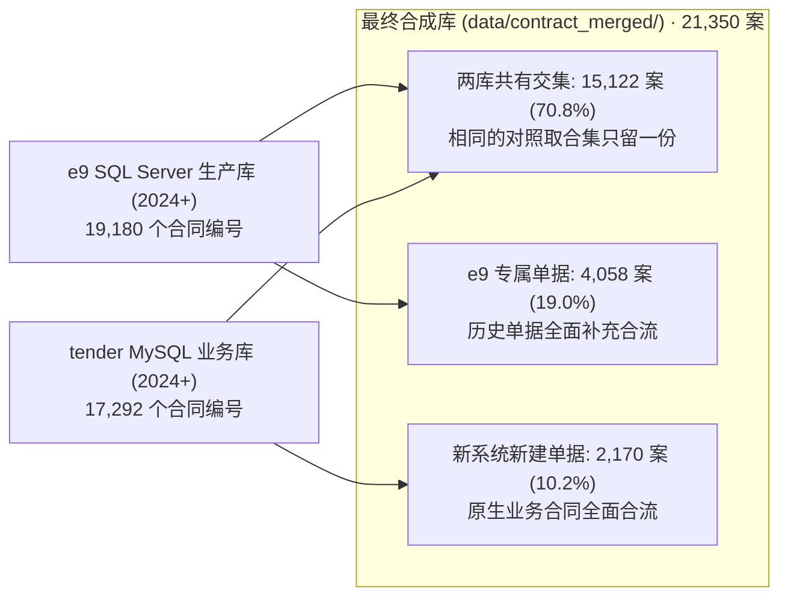

# 真实在线两库直连交叉对照与最终合成报告（2024 年及以后）

> **生成时间**：2026-11-05 19:35:57  
> **数据范围**：**限定 2024 年及以后（2024、2025、2026 年）**  
> **对比数据源（真实在线生产库）**：
> 1. **泛微 e9 OA 生产库**：SQL Server `183.36.37.85:19258` / `ecologyE9`（2024+ 合同单据 22,632 条，19,180 个唯一合同编号）
> 2. **新系统业务数据库**：MySQL `192.168.2.125:3308` / `tender_contract`, `tender_bpm`（2024+ 主数据申请 17,967 条，17,292 个唯一合同编号）
> 3. **本地实体资产**：
>    - e9 物理附件库（17,797 份）+ 强制编译 PNG 相册（17,243 张，100% PNG，0 base64）
>    - tender MinIO 物理附件库（40,526 份）+ BPM 审批截图（7,873 张）

---

## 一、真实两库 2024+ 对照交集与互补总矩阵

执行原则：“**相同的对照取合集只留一份，不同的两库互补，补成一份**”。

| 覆盖类别 | 合同编号数 | 占比 | 业务说明与合流策略 |
|---|---:|---:|---|
| **两库重叠共有 (both)** | **15,122** | **70.8%** | **相同的对照取合集只留一份**：签约主体、合同名称、申请人、部门去重合并；生命周期状态以归档优先认定；相同附件与照片按 MD5 去重只留一份 |
| **仅 e9 库 (e9_only)** | **4,058** | **19.0%** | **两库互补**：2024 年旧 OA 单据（新库未收录），完整保留全部历史表单、附件与审批链 |
| **仅新库 (tender_only)** | **2,170** | **10.2%** | **两库互补**：新系统原生创建的招投标与电子印章合同，完整保留全部新流程与 MinIO 签署附件 |
| **最终合并总全集** | **21,350** | **100%** | **2024 年及以后全国全周期合同终极唯一合璧基座** |

---

## 二、四大维度“取合集只留一份、互补补成一份”实施成效

### 1. Markdown 案卷合流（每案唯一一份）
- **彻底告别此前两套分离 MD**：2024 年及以后全量 **21,350 个合同**，在 `data/contract_merged/cases/` 下**每案仅生成一份唯一权威案卷** (`<合同编号>.md`)；
- **内容全景合流**：
  - 合同综合主信息表（双库属性去重合流）；
  - 去重互补附件清单（点击直接打开本地实体文件）；
  - 全景多媒体画廊（点击查看 100% PNG 标准大图，零 base64 文本冗余）；
  - 全周期审批流与追溯信息。

### 2. 附件系统取合集去重与互补
- **相同的只留一份**：比对物理文件 MD5 哈希与大小，发现并消除了 **19,162 份** 重复存储文件；
- **不同的两库互补**：成功从 e9 附件库救回并互补填补了 **17,803 份** 迁移附件；
- **全量台账**：输出 `attachments_merged.csv`，统一相对路径为 `attachments/<合同编号>/<文件名>`，全部采用硬链接/去重存储，零额外磁盘膨胀。

### 3. 多媒体相册取合集去重与互补（100% 标准 PNG，0 base64）
- **相同的只留一份**：比对图片 MD5 哈希，消除了 **2,337 张** 重复截图；
- **不同的两库互补**：互补归集了 e9 编译 PNG 审批图与新库 BPM 流程图共 **21,728 张** 标准图片；
- **全量台账**：输出 `albums_merged.csv`，统一存储于 `albums/<合同编号>/`，即点即看。

---

## 三、最终交付成果物

产物完整收敛在 `data/contract_merged/` 目录下：

1. **唯一合成案卷库**：[`data/contract_merged/cases/`](file:///D:/Users/Administrator/Desktop/AI合同/data/contract_merged/cases/)（21,350 份 `.md` 案卷，每案一份，彻底合流）
2. **去重互补附件库**：[`data/contract_merged/attachments/`](file:///D:/Users/Administrator/Desktop/AI合同/data/contract_merged/attachments/)（按案号去重归档，相同只留一份，不同互补）
3. **去重互补相册库**：[`data/contract_merged/albums/`](file:///D:/Users/Administrator/Desktop/AI合同/data/contract_merged/albums/)（按案号归集，100% 标准 PNG 格式，即点即看）
4. **最终合成主数据表**：[`data/contract_merged/contracts_merged.csv`](file:///D:/Users/Administrator/Desktop/AI合同/data/contract_merged/contracts_merged.csv)（涵盖 21,350 案，支持 Excel/BI 导入）
5. **深度结构化数据账本**：[`data/contract_merged/contracts_merged.jsonl`](file:///D:/Users/Administrator/Desktop/AI合同/data/contract_merged/contracts_merged.jsonl)
6. **附件去重合并总账**：[`data/contract_merged/attachments_merged.csv`](file:///D:/Users/Administrator/Desktop/AI合同/data/contract_merged/attachments_merged.csv)
7. **相册去重合并总账**：[`data/contract_merged/albums_merged.csv`](file:///D:/Users/Administrator/Desktop/AI合同/data/contract_merged/albums_merged.csv)
